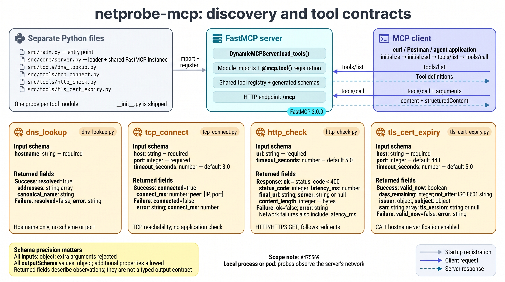

# netprobe-mcp: network checks for SRE agents

This MCP server runs HTTP, DNS, TCP and TLS checks from its own network location. Deployed inside the EKS cluster, it lets an agent test Service connectivity alongside Kubernetes resource state. The incident reporter uses these probes to gather evidence for its report.

The project was scaffolded with kmcp v0.3.0 and uses FastMCP 3.0.0. The four probe functions are the custom implementation; the scaffold supplies discovery, configuration, the entry point and container build. See the [article](../../docs/article.md#custom-mcp-tools-checking-the-network-from-inside-the-cluster) for its role in the workflow and the [setup guide](../../docs/setup-guide.md#8-build-and-deploy-the-custom-mcp-server) for ECR/Kubernetes deployment.

## Contents

- [Tools](#tools)
- [Run locally](#run-locally)
- [MCP fundamentals, using dns_lookup](#mcp-fundamentals-using-dns_lookup)
- [Call the MCP server manually with curl and jq](#call-the-mcp-server-manually-with-curl-and-jq)
- [Use the Postman collection](#use-the-postman-collection)
- [Read the server logs](#read-the-server-logs)
- [Concepts to study, ranked by importance](#concepts-to-study-ranked-by-importance)
- [Build and run a container](#build-and-run-a-container)
- [Project structure](#project-structure)
- [Add a tool](#add-a-tool)
- [Deployment and verification](#deployment-and-verification)

## Tools

| Tool | Arguments | Result |
|---|---|---|
| `http_check` | `url`, `timeout_seconds=5.0` | Success flag, HTTP status, latency, redirect target, server header, body length; error on failure |
| `dns_lookup` | `hostname` | Resolution flag, addresses and canonical name; error on failure |
| `tcp_connect` | `host`, `port`, `timeout_seconds=3.0` | Connection flag, connection time and peer; error on failure |
| `tls_cert_expiry` | `host`, `port=443`, `timeout_seconds=5.0` | Validity flag, days remaining, expiration time, issuer, subject, DNS names and TLS version; error on failure |

FastMCP derives the tool schemas from type hints and docstrings. The functions return structured evidence rather than performing repairs. Their read-only annotations describe their intended use; they do not enforce network access restrictions.

`http_check` accepts HTTP/HTTPS URLs and follows redirects. `tls_cert_expiry` uses certifi's CA bundle for certificate and hostname verification. An invalid or expired certificate can fail the handshake and return an error instead of expiration metadata. This is a connectivity/evidence tool, not a certificate-inspection tool that bypasses verification.



*Each probe has its own Python module. The loader imports those modules, their decorators register tools on the shared FastMCP instance, and clients discover the definitions with `tools/list`. Input schemas declare arguments; the current output schemas declare only an object, while the cards describe the fields returned by the functions.*

## Run locally

Run these commands from `byo/netprobe-mcp/`. Python 3.12 and uv are required; the manual HTTP examples below also use curl and jq.

```bash
uv sync
uv run pytest -q
```

The original run passed ten tests with two warnings in 0.94 s. Separate MCP client calls listed and exercised all four tools; the recorded output is in [results/raw/netprobe-local-mcp-test.txt](../../results/raw/netprobe-local-mcp-test.txt).

For streamable HTTP, leave this process running:

```bash
uv run python src/main.py --transport http --host 127.0.0.1 --port 3000
```

The MCP endpoint is `http://127.0.0.1:3000/mcp`. It is streamable HTTP, not a WebSocket endpoint. For a client that launches the server and communicates over stdin/stdout:

```bash
uv run python src/main.py --transport stdio
```

Stdio is the default transport. Other supported entry points are:

```bash
uv run dev       # HTTP, default host localhost and port 3000
uv run dev-http  # same as dev
uv run start    # stdio
```

The CLI accepts `--host` and `--port`; `HOST` and `PORT` set their defaults. `MCP_TRANSPORT_MODE` overrides the selected transport when set:

```bash
MCP_TRANSPORT_MODE=http uv run python src/main.py --host 127.0.0.1 --port 3000
```

If startup reports `address already in use`, another process already owns that port. Use the existing server, stop it in its original terminal, or choose another port with `--port` and update `MCP_URL` in the manual examples. The uv/Authlib deprecation warnings shown in the learning session did not cause the port-binding failure.

## MCP fundamentals, using dns_lookup

Learn the path from a Python function to an MCP tool call first. `DynamicMCPServer` adds convenient loading around that path, so its machinery is easier to understand after the protocol it serves.

These explanations follow the manual learning session on 2026-10-17 and keep the same DNS example throughout. The commands describe the handshake-based, stateful HTTP flow exercised with this project's installed stack. SDK versions, application versions and dated MCP protocol revisions are different things; newer documentation may describe a different lifecycle.

### Host, client, server and model

The application hosting the conversation contains MCP clients. Those clients discover and call functions exposed by MCP servers. The model can request a tool call; the application executes that request.

| Component | In the incident-reporter example |
|---|---|
| **Host** | The incident-reporter application that manages the model interaction and tool execution |
| **Client** | The `ClientSession` inside that application, which communicates with netprobe |
| **Server** | The netprobe process, exposing tools through FastMCP |
| **Model** | The LLM called through OpenRouter |

An MCP server can communicate over HTTP or stdio. Running the server over HTTP is similar to hosting a web API. FastMCP supplies the MCP message handling, schemas and dispatch to the functions.

The model requests an operation; the host's MCP client sends the request to the server. A curl request performs that client-side communication manually. A language model is optional when invoking MCP tools directly. See the [MCP architecture](https://modelcontextprotocol.io/specification/2025-11-25/architecture).

The [incident reporter](../incident-reporter-agent/src/agent.py) makes the bridge visible: it reads MCP schemas, converts them into model tool definitions, receives requested calls, invokes MCP and returns the results to the model. Its allowlist controls which tools that application offers to the model.

### Discover, then call

`tools/list` returns tool names, descriptions and input schemas. `tools/call` identifies a tool and supplies arguments. With HTTP, both requests go to the same endpoint, `/mcp`. The JSON body identifies the operation.

To discover tools:

```json
{
  "jsonrpc": "2.0",
  "id": 1,
  "method": "tools/list"
}
```

To execute a discovered tool:

```json
{
  "jsonrpc": "2.0",
  "id": 42,
  "method": "tools/call",
  "params": {
    "name": "dns_lookup",
    "arguments": {"hostname": "example.com"}
  }
}
```

Here, `method` selects the MCP operation, `name` selects the Python tool, and `arguments` supplies its inputs. The response carries the same request `id` so the client can match it to its request. Initialization and any required session headers accompany this interaction in the current HTTP setup.

### What FastMCP handles before and after a function

The function understands a Python argument and returns a Python dictionary:

```python
def dns_lookup(hostname: str) -> dict:
    ...
    return {
        "resolved": True,
        "addresses": addresses,
        "canonical_name": canonical,
    }
```

It does not contain code to read HTTP headers, parse JSON-RPC or construct an SSE response. FastMCP and its underlying MCP SDK handle the surrounding work:

| Stage | What happens for the request above |
|---|---|
| Receive | Read the HTTP request and resolve the MCP session |
| Parse | Interpret the JSON as an MCP `tools/call` message |
| Dispatch | Find the registered tool named `dns_lookup` |
| Validate | Check that its arguments satisfy the declared input types |
| Execute | Call `dns_lookup(hostname="example.com")` |
| Package | Convert the returned dictionary into an MCP tool result |
| Respond | Send the result with JSON-RPC `id: 42`, using the selected HTTP response format |

**Dispatch means selecting and calling the correct registered function.** For `tools/list`, FastMCP instead reads its registry and returns descriptions and schemas; it does not execute the DNS lookup.

The `@mcp.tool()` decorator registers a function. The [loader](src/core/server.py) imports each module, which executes its decorators. `DynamicMCPServer.__init__()` creates the shared FastMCP instance before those tool modules import it. This directory-scanning design is project scaffolding; a small MCP server can register a function directly in one file.

### The probe functions return evidence

The actual work is an ordinary function. In [dns_lookup.py](src/tools/dns_lookup.py), these lines ask the operating system to resolve a hostname, then collect the returned addresses:

```python
infos = socket.getaddrinfo(hostname, None)
addresses = sorted({i[4][0] for i in infos})
```

An illustrative result is:

```json
{
  "resolved": true,
  "addresses": ["10.0.0.42"],
  "canonical_name": "checkout.demo-broken.svc.cluster.local"
}
```

That is **evidence that this hostname resolved to that address from the server's environment**. It does not establish that the application is healthy. DNS can resolve a Kubernetes Service even when it has no backend endpoints. An agent can combine this result with a TCP connection test or HTTP check to form a diagnosis.

"Evidence" is an ordinary description here, not a special MCP feature: it means the function reports what it observed. A successful TCP connection establishes network reachability to a port; it does not establish application correctness. An HTTP 200 after redirects might be a login page. The individual observations need interpretation.

Execution location matters. A local probe observes the laptop's DNS and network; a probe deployed in EKS observes that pod's DNS, routing and permissions. Port-forwarding a deployed server lets a local client call it while the probes still execute inside the pod.

### The input schema is a public contract

The function declares:

```python
def dns_lookup(hostname: str) -> dict:
```

FastMCP derives the following input schema in the installed stack:

```json
{
  "type": "object",
  "properties": {
    "hostname": {"type": "string"}
  },
  "required": ["hostname"],
  "additionalProperties": false
}
```

This tells callers that arguments must be an object, `hostname` is required and must be a string, and additional arguments are not accepted. This matches the contract:

```json
{"hostname": "example.com"}
```

This does not:

```json
{"host": "example.com"}
```

The second object uses a different parameter name and omits the required `hostname`. Passing `url` to `dns_lookup` has the same problem; the learning-session server log showed both "Missing required argument" for `hostname` and "Unexpected keyword argument" for `url`.

**Public means exposed to clients through `tools/list`.** It does not mean publicly accessible on the internet. Contract means clients can build calls against this declared interface. Renaming `hostname` affects those clients.

The contract also has limits: `"type": "string"` does not establish that the value is a valid hostname. Likewise, `port: int` declares an integer; enforcing `1–65535` requires an additional constraint. Defaults, descriptions and validation rules are part of designing the interface.

Pass a hostname without a scheme or port to `dns_lookup`; pass a complete URL to `http_check`. A Markdown link such as `[https://example.com](https://example.com)` is not a plain URL argument.

### Design useful, predictable results

The input contract tells callers what to send. Output design tells them how to interpret the answer. Compare these possible returns:

```python
return "It worked!"
```

```python
return {
    "resolved": True,
    "addresses": ["10.0.0.42"],
    "canonical_name": hostname,
}
```

The second gives a caller named facts it can inspect, display or combine with another check. A failed lookup also has an explicit result:

```json
{
  "resolved": false,
  "error": "Name resolution failed"
}
```

Predictable means the fields have consistent meanings. `resolved` should always be a boolean; `addresses`, when returned, should consistently contain a list of addresses. Include explicit units in fields such as `latency_ms`, `connect_ms` and `days_remaining`.

FastMCP packages the Python return value into an MCP response:

| Term | Purpose |
|---|---|
| `content` | MCP content blocks, such as text containing the result |
| `structuredContent` | The result represented directly as structured JSON |
| `outputSchema` | A declared schema describing the structured result |

This is a shortened response showing the two representations of the same DNS result:

```json
{
  "jsonrpc": "2.0",
  "id": 42,
  "result": {
    "content": [
      {"type": "text", "text": "{\"resolved\":true,\"addresses\":[\"10.0.0.42\"],\"canonical_name\":\"checkout.demo-broken.svc.cluster.local\"}"}
    ],
    "structuredContent": {
      "resolved": true,
      "addresses": ["10.0.0.42"],
      "canonical_name": "checkout.demo-broken.svc.cluster.local"
    },
    "isError": false
  }
}
```

The JSON text in `content` is escaped because it is inside a JSON string. `structuredContent` contains an object that a client can access directly. These are server-produced observations, not schema-constrained text generated by an LLM.

**The client can discover the output schema through `tools/list`.** However, the current `-> dict` annotation produces a broad schema:

```json
{
  "type": "object",
  "additionalProperties": true
}
```

This declares only that the result is an object. It does not declare `resolved` as a boolean or `addresses` as a list of strings. A more specific return model, such as a Pydantic model, can advertise and validate those fields. Without that, clients can inspect the data and read the description, but do not have a precise machine-readable contract for the individual fields. See the [tool result and output schema specification](https://modelcontextprotocol.io/specification/2025-11-25/server/tools#output-schema).

`canonical_name` represents a DNS name and normally does not contain `https://`. The implementation uses `socket.getfqdn()`, so the returned name may differ from the requested hostname; it is not a record of a browser's final URL.

### The three IDs identify different things

**The JSON-RPC `id` and the `Mcp-Session-Id` header identify different things.** SSE adds another optional identifier.

| Identifier | Example | Who chooses it? | Purpose |
|---|---|---|---|
| JSON-RPC request `id` | `42` or `"dns-check-1"` | Client | Match a response to one request |
| `Mcp-Session-Id` header | An opaque server-generated string | Server | Associate HTTP requests with an existing MCP session |
| Optional SSE `id:` field | `event-17` | Server | Identify a stream event for possible resumption |

Choose a number or string for the request ID. It does not need to be random. Keep IDs distinct among requests still awaiting responses. Request 43 may finish before request 42; the IDs let the client identify the responses. This correlation also works over stdio.

**Do not invent the MCP session ID.** In this stateful HTTP setup, the server issues it in the response headers during initialization. Copy that returned value into subsequent requests. The server maintains active sessions and rejects an unknown ID. A session is protocol state, rather than the model's conversation history or an authentication credential.

Session lifetime depends on server configuration. If the server removes an expired session, initialize again and use the new ID. Closing an idle SSE connection alone does not necessarily terminate the logical session. In the supplied server log, explicit `idle timeout` and `Terminating session` lines confirmed actual termination.

The optional SSE `id:` is a bookmark identifying a delivered event. A client can send it in `Last-Event-ID` when requesting replay after a disconnection, if the server supports resumption. This is separate from starting or identifying an MCP session.

### Initialization and the initialized notification

The handshake exercised here has these steps:

1. Send `initialize` without inventing a session header. The client supplies a supported protocol version, its capabilities and its implementation information.
2. Read the response's `protocolVersion`, server capabilities and `serverInfo`. If a session header is returned, save it.
3. Send `notifications/initialized` with the returned session ID. This says, "I received your initialization response and am ready to use this connection."
4. List and call tools using that session and the negotiated protocol version.

The [handshake lifecycle](https://modelcontextprotocol.io/specification/2025-11-25/basic/lifecycle) distinguishes requests from notifications. The initialized message has no JSON-RPC `id`:

```json
{
  "jsonrpc": "2.0",
  "method": "notifications/initialized"
}
```

It is a notification: it does not request a JSON-RPC response. An accepted HTTP notification normally receives **HTTP 202 with an empty body**. It neither creates the session nor executes a tool. No JSON output from jq is expected for that empty body.

Calling `initialize` again normally starts another session; it does not renew an old hardcoded ID. Reusing a session ID after a server restart, from another endpoint or after termination can produce "Session not found".

### HTTP, SSE and stdio

**Server-Sent Events (SSE) is a format for delivering events incrementally in an HTTP response.** The response uses `Content-Type: text/event-stream`. Its body contains events separated by blank lines:

```text
event: message
data: {"jsonrpc":"2.0","id":42,"result":{"structuredContent":{"resolved":true}}}

```

The JSON-RPC response is inside `data:`. Its `"id":42` still identifies the DNS request. A resumable stream might also include an SSE event ID:

```text
id: event-17
event: message
data: {"jsonrpc":"2.0","id":42,"result":{}}

```

Here, `event-17` identifies the stream event, while `42` identifies the request. The small result above illustrates framing rather than a complete DNS tool result.

| Typical JSON API response | SSE response |
|---|---|
| Returns a JSON document | Delivers a sequence of event records |
| Client usually waits for the completed document | Client can process events as they arrive |
| Usually `application/json` | `text/event-stream` |

SSE can carry just one final response, as the manual calls did, or multiple messages. Progress appears only if the server produces it; selecting SSE does not automatically create progress reporting. It is not a WebSocket connection. See the [SSE event format](https://developer.mozilla.org/en-US/docs/Web/API/Server-sent_events/Using_server-sent_events).

REST and SSE describe different aspects of an API. REST concerns interface design; SSE concerns streamed delivery. A REST application can also expose an SSE endpoint. MCP's HTTP interface carries JSON-RPC operations such as `tools/call` in the body.

`Accept: application/json, text/event-stream` tells the server that the client understands either response format. `Content-Type: application/json` describes the request body being sent. The session header associates the request with protocol state; SSE delivers messages back. A session can exist with ordinary JSON responses, and SSE can be used without MCP sessions.

With **stdio**, the client starts the server process and writes JSON-RPC messages into its stdin. The server writes responses to stdout, with each message on one line:

```text
Client → server stdin:
{"jsonrpc":"2.0","id":42,"method":"tools/call","params":{"name":"dns_lookup","arguments":{"hostname":"example.com"}}}

Server stdout → client:
{"jsonrpc":"2.0","id":42,"result":{"content":[{"type":"text","text":"..."}]}}
```

There are no HTTP headers or SSE envelopes on that connection. Request IDs still correlate calls and responses; diagnostic logs use stderr so they do not corrupt the protocol stream. The main logging handler does this, although some loader/configuration error paths currently use `print()` and deserve attention when hardening stdio operation. See the [HTTP and stdio transport specification](https://modelcontextprotocol.io/specification/2025-11-25/basic/transports).

### Protocol errors, tool errors and diagnostic findings

Invalid JSON, invalid MCP parameters, invalid tool arguments and "the target refused a connection" are different outcomes. A successful diagnostic execution can legitimately report that the target is unhealthy.

| Where to look | Meaning | Example in this server |
|---|---|---|
| Top-level JSON-RPC `error` | The protocol request could not be processed as a valid operation | `tools/call` without the required tool `name` |
| `result.isError: true` | A tool call failed, including argument validation in the installed stack | `http_check` without its required `url` |
| `result.isError: false`, with `structuredContent.ok: false` or `resolved: false` | The function completed and reported an application-level finding | An unsupported URL scheme or a failed DNS lookup |

**A dictionary key named `error` does not automatically set MCP's `isError`.** The function decides whether to return diagnostic data or raise an execution error. A failed probe represented as data is useful evidence for the agent.

All three classification examples below returned HTTP 200 during the learning session. HTTP success alone does not establish tool success or target health. Conversely, transport failures such as HTTP 400/404 can occur before the tool handler runs.

### Allowed-target policies

An allowed-target policy defines **which destinations a caller is permitted to make a probe contact**. URL patterns can express part of the policy, but usually need more detail:

| Policy dimension | Example rule |
|---|---|
| Scheme | Permit HTTP and HTTPS |
| Hostname | Permit only named application Services or approved domains |
| Port | Permit only 80 and 443 |
| Resolved address | Decide which internal, loopback or other address ranges are permitted |
| Redirects | Require every redirected destination to satisfy the policy too |

The current `http_check` checks the scheme and follows redirects. It does not implement a hostname or destination allowlist. A syntactically valid URL can point somewhere the tool should not access. Parsing the destination, checking its resolved addresses and validating redirect targets make the policy meaningful. For netprobe, permitted internal destinations should reflect its intended job of testing Kubernetes Services.

`readOnlyHint=True` describes intended behavior; it does not enforce permissions or network restrictions. Authentication identifies a caller, authorization determines allowed actions, and human approval gates selected operations. The agent's approval mechanism does not automatically apply to a direct curl request to an MCP server. See the [MCP security practices](https://modelcontextprotocol.io/docs/2025-11-25/tutorials/security/security_best_practices).

## Call the MCP server manually with curl and jq

These requests reproduce the learning flow: initialization, the initialized notification, discovery, the four probe tools, DNS failure and the three error categories. Run them manually in order. The calls exercise MCP directly; they do not involve a model.

### Choose the server and format its responses

Leave the local server from [Run locally](#run-locally) running, then use a second terminal:

```bash
MCP_URL='http://127.0.0.1:3000/mcp'
MCP_PROTOCOL_VERSION='2025-03-26'
MCP_HEADERS=$(mktemp)
```

For the deployed EKS server instead, keep this port-forward running in its own terminal:

```bash
kubectl -n kagent port-forward svc/netprobe-mcp 3002:3000
```

Then set `MCP_URL='http://127.0.0.1:3002/mcp'`. A local server and a forwarded server are different endpoints with different sessions. Initialize the endpoint selected in `MCP_URL`.

The supplied commands used `sed -n 's/^data: *//p' | jq .` to extract JSON from SSE. That works for the observed `data:` lines, but discards a plain JSON error response such as "Session not found". The examples below preserve either form:

```bash
sed -E '/^(event:|id:|retry:|:)/d; s/^data: *//' | jq .
```

This removes SSE metadata/comment lines, strips the `data:` prefix and lets jq format the remaining JSON. It handles the single-line SSE JSON messages emitted here, ordinary JSON bodies and empty notification responses. It is a formatter for these examples, rather than a general SSE client with reconnection or multiline-event handling.

`curl -sSN` means silent progress output, show connection errors, and disable curl's output buffering. Do not send `curl -i` headers into jq: initialization saves headers separately with `-D`. Do not add `--fail` to these learning examples, because the JSON body of an HTTP error is useful to inspect.

### 1. Initialize and capture the server-issued session

Send `initialize` without a session header:

```bash
curl -sSN "$MCP_URL" \
  -D "$MCP_HEADERS" \
  -H 'Content-Type: application/json' \
  -H 'Accept: application/json, text/event-stream' \
  --data '{
  "jsonrpc": "2.0",
  "id": 1,
  "method": "initialize",
  "params": {
    "protocolVersion": "2025-03-26",
    "capabilities": {},
    "clientInfo": {
      "name": "my-curl-client",
      "version": "1.0"
    }
  }
}' |
sed -E '/^(event:|id:|retry:|:)/d; s/^data: *//' | jq .
```

In the supplied output, the response repeated `id: 1`, agreed on `protocolVersion: "2025-03-26"`, advertised a `tools` capability and reported `serverInfo.name: "netprobe-mcp"` and `serverInfo.version: "3.0.0"`. That server version comes from the framework's server information; the package's project version is separately `0.1.0`.

Read the actual session header saved by curl:

```bash
MCP_SESSION_ID=$(awk 'tolower($1) == "mcp-session-id:" {sub(/\r$/, "", $2); print $2}' "$MCP_HEADERS")
printf 'MCP session: %s\n' "$MCP_SESSION_ID"
```

Use this value rather than copying an old ID from a screenshot or transcript. If it is empty, inspect the initialization response and the saved headers before continuing. Check the returned `protocolVersion`; if it differs, set `MCP_PROTOCOL_VERSION` to that returned value for subsequent requests.

### 2. Send the initialized notification

```bash
curl -sSN "$MCP_URL" \
  -D "$MCP_HEADERS" \
  -H 'Content-Type: application/json' \
  -H 'Accept: application/json, text/event-stream' \
  -H "Mcp-Session-Id: $MCP_SESSION_ID" \
  -H "MCP-Protocol-Version: $MCP_PROTOCOL_VERSION" \
  --data '{
  "jsonrpc": "2.0",
  "method": "notifications/initialized"
}' |
sed -E '/^(event:|id:|retry:|:)/d; s/^data: *//' | jq .
```

No JSON output is expected for a successful notification. Inspect the saved HTTP status separately:

```bash
awk 'NR == 1 {sub(/\r$/, ""); print}' "$MCP_HEADERS"
```

The observed result was `202 Accepted` with an empty body. The missing JSON-RPC `id` is intentional: this is a notification, not a request for a JSON-RPC reply.

### 3. List all tools and inspect their schemas

```bash
curl -sSN "$MCP_URL" \
  -H 'Content-Type: application/json' \
  -H 'Accept: application/json, text/event-stream' \
  -H "Mcp-Session-Id: $MCP_SESSION_ID" \
  -H "MCP-Protocol-Version: $MCP_PROTOCOL_VERSION" \
  --data '{
  "jsonrpc": "2.0",
  "id": 2,
  "method": "tools/list"
}' |
sed -E '/^(event:|id:|retry:|:)/d; s/^data: *//' | jq .
```

Expect four tools: `dns_lookup`, `tcp_connect`, `http_check` and `tls_cert_expiry`; ordering can differ. Each definition includes its name, description, input schema, annotations and the broad object output schema discussed above. The definitions are the discoverable interface; the next requests execute it.

To focus on one tool, replace the final `jq .` with:

```bash
jq '.result.tools[] | select(.name == "dns_lookup") | {name, inputSchema, outputSchema}'
```

### 4. DNS success: return the observed addresses

```bash
curl -sSN "$MCP_URL" \
  -H 'Content-Type: application/json' \
  -H 'Accept: application/json, text/event-stream' \
  -H "Mcp-Session-Id: $MCP_SESSION_ID" \
  -H "MCP-Protocol-Version: $MCP_PROTOCOL_VERSION" \
  --data '{
  "jsonrpc": "2.0",
  "id": 3,
  "method": "tools/call",
  "params": {
    "name": "dns_lookup",
    "arguments": {
      "hostname": "google.lk"
    }
  }
}' |
sed -E '/^(event:|id:|retry:|:)/d; s/^data: *//' | jq .
```

One supplied response contained the following fields. This is a historical observation, not an expected fixed IP address:

```json
{
  "jsonrpc": "2.0",
  "id": 3,
  "result": {
    "structuredContent": {
      "resolved": true,
      "addresses": [
        "74.125.24.94"
      ],
      "canonical_name": "sf-in-f94.1e100.net"
    },
    "isError": false
  }
}
```

The displayed sample omits the duplicate text `content` block. The returned address and canonical name can vary with DNS, location and time. `resolved: true` establishes successful resolution from the server's environment; it does not establish that a web application answers at that address.

### 5. DNS failure: a negative finding can be a successful tool call

```bash
curl -sSN "$MCP_URL" \
  -H 'Content-Type: application/json' \
  -H 'Accept: application/json, text/event-stream' \
  -H "Mcp-Session-Id: $MCP_SESSION_ID" \
  -H "MCP-Protocol-Version: $MCP_PROTOCOL_VERSION" \
  --data '{
  "jsonrpc": "2.0",
  "id": 4,
  "method": "tools/call",
  "params": {
    "name": "dns_lookup",
    "arguments": {
      "hostname": "no-such-host.invalid"
    }
  }
}' |
sed -E '/^(event:|id:|retry:|:)/d; s/^data: *//' | jq .
```

The supplied session tested a made-up `.lk` hostname and returned `resolved: false` with `[Errno 8] nodename nor servname provided, or not known`, while `isError` remained false. The command above uses the reserved `.invalid` suffix so the example does not depend on an unregistered real domain. The exact OS error wording varies.

The lookup function ran, caught `socket.gaierror` and returned evidence of failed resolution. This is different from a request that cannot be dispatched or validated.

### 6. TCP connection: test whether a port accepts connections

```bash
curl -sSN "$MCP_URL" \
  -H 'Content-Type: application/json' \
  -H 'Accept: application/json, text/event-stream' \
  -H "Mcp-Session-Id: $MCP_SESSION_ID" \
  -H "MCP-Protocol-Version: $MCP_PROTOCOL_VERSION" \
  --data '{
  "jsonrpc": "2.0",
  "id": 5,
  "method": "tools/call",
  "params": {
    "name": "tcp_connect",
    "arguments": {
      "host": "google.lk",
      "port": 443,
      "timeout_seconds": 3.0
    }
  }
}' |
sed -E '/^(event:|id:|retry:|:)/d; s/^data: *//' | jq .
```

A supplied successful call returned `connected: true`, `connect_ms: 63.5` and `peer: ["142.251.175.94", 443]`. These values are historical and the response ID in the transcript belonged to that earlier request; this command's response should carry `id: 5`.

TCP success establishes that a connection to the port succeeded. It does not establish that TLS negotiation or an HTTP request succeeds. In EKS, try the same tool with a Service hostname to test reachability from the pod.

### 7. HTTP check: inspect status, redirects and latency

```bash
curl -sSN "$MCP_URL" \
  -H 'Content-Type: application/json' \
  -H 'Accept: application/json, text/event-stream' \
  -H "Mcp-Session-Id: $MCP_SESSION_ID" \
  -H "MCP-Protocol-Version: $MCP_PROTOCOL_VERSION" \
  --data '{
  "jsonrpc": "2.0",
  "id": 6,
  "method": "tools/call",
  "params": {
    "name": "http_check",
    "arguments": {
      "url": "https://example.com/",
      "timeout_seconds": 5.0
    }
  }
}' |
sed -E '/^(event:|id:|retry:|:)/d; s/^data: *//' | jq .
```

Inspect `ok`, `status_code`, `latency_ms`, `final_url`, `server` and `content_length` in `result.structuredContent`. `ok` is computed as `status_code < 400`; it is the function's definition of HTTP success.

The supplied server log showed one public URL redirecting twice before reaching HTTP 200. A separate application URL redirected to an identity-provider login page, which also returned HTTP 200. Read `final_url` and the context before concluding that the requested application itself is healthy.

A full URL belongs in `url`. Use a plain string such as `https://example.com/`, not Markdown `[text](URL)` syntax.

### 8. TLS certificate: inspect the certificate and its validity

```bash
curl -sSN "$MCP_URL" \
  -H 'Content-Type: application/json' \
  -H 'Accept: application/json, text/event-stream' \
  -H "Mcp-Session-Id: $MCP_SESSION_ID" \
  -H "MCP-Protocol-Version: $MCP_PROTOCOL_VERSION" \
  --data '{
  "jsonrpc": "2.0",
  "id": 7,
  "method": "tools/call",
  "params": {
    "name": "tls_cert_expiry",
    "arguments": {
      "host": "example.com",
      "port": 443,
      "timeout_seconds": 5.0
    }
  }
}' |
sed -E '/^(event:|id:|retry:|:)/d; s/^data: *//' | jq .
```

Inspect `valid_now`, `days_remaining`, `not_after`, `issuer`, `subject`, `san` and `tls_version`. Supply a hostname, without `https://`, as `host`.

The supplied call to the operator's application hostname returned `valid_now: true`, `days_remaining: 35` and `tls_version: "TLSv1.3"`. The public-host command above is the same operation with a different target; certificate values and remaining days will differ.

The function verifies the certificate and hostname using certifi's CA bundle. An expired, untrusted or mismatched certificate can fail the handshake and return an error instead of expiry metadata. It does not bypass TLS verification to inspect arbitrary certificates.

### 9. Protocol error: omit the MCP tool name

This request deliberately omits `params.name`:

```bash
curl -sSN "$MCP_URL" \
  -H 'Content-Type: application/json' \
  -H 'Accept: application/json, text/event-stream' \
  -H "Mcp-Session-Id: $MCP_SESSION_ID" \
  -H "MCP-Protocol-Version: $MCP_PROTOCOL_VERSION" \
  --data '{
  "jsonrpc": "2.0",
  "id": 201,
  "method": "tools/call",
  "params": {
    "arguments": {}
  }
}' |
sed -E '/^(event:|id:|retry:|:)/d; s/^data: *//' | jq .
```

The supplied response was:

```json
{
  "jsonrpc": "2.0",
  "id": 201,
  "error": {
    "code": -32602,
    "message": "Invalid request parameters",
    "data": ""
  }
}
```

The protocol request cannot be interpreted as a valid tool invocation. No probe function runs. A valid HTTP exchange can still carry this JSON-RPC error.

### 10. Tool error: omit the function's required argument

The outer MCP invocation identifies a real tool, but `http_check` requires `url`:

```bash
curl -sSN "$MCP_URL" \
  -H 'Content-Type: application/json' \
  -H 'Accept: application/json, text/event-stream' \
  -H "Mcp-Session-Id: $MCP_SESSION_ID" \
  -H "MCP-Protocol-Version: $MCP_PROTOCOL_VERSION" \
  --data '{
  "jsonrpc": "2.0",
  "id": 202,
  "method": "tools/call",
  "params": {
    "name": "http_check",
    "arguments": {}
  }
}' |
sed -E '/^(event:|id:|retry:|:)/d; s/^data: *//' | jq .
```

In the supplied response, `result.content[0].text` began with:

```text
1 validation error for call[http_check]
url
  Missing required argument
```

`result.isError` was true. The function body did not run. The later server log showed the same distinction when `url` was passed to the DNS tool:

```bash
curl -sSN "$MCP_URL" \
  -H 'Content-Type: application/json' \
  -H 'Accept: application/json, text/event-stream' \
  -H "Mcp-Session-Id: $MCP_SESSION_ID" \
  -H "MCP-Protocol-Version: $MCP_PROTOCOL_VERSION" \
  --data '{
  "jsonrpc": "2.0",
  "id": 2021,
  "method": "tools/call",
  "params": {
    "name": "dns_lookup",
    "arguments": {"url": "https://example.com"}
  }
}' |
sed -E '/^(event:|id:|retry:|:)/d; s/^data: *//' | jq .
```

Expect a missing required `hostname` and an unexpected `url` argument, represented as a tool error in this stack. Use `hostname` for the DNS tool.

### 11. Application finding: let the function reject an unsupported scheme

```bash
curl -sSN "$MCP_URL" \
  -H 'Content-Type: application/json' \
  -H 'Accept: application/json, text/event-stream' \
  -H "Mcp-Session-Id: $MCP_SESSION_ID" \
  -H "MCP-Protocol-Version: $MCP_PROTOCOL_VERSION" \
  --data '{
  "jsonrpc": "2.0",
  "id": 203,
  "method": "tools/call",
  "params": {
    "name": "http_check",
    "arguments": {
      "url": "ftp://example.com"
    }
  }
}' |
sed -E '/^(event:|id:|retry:|:)/d; s/^data: *//' | jq .
```

The supplied response was:

```json
{
  "jsonrpc": "2.0",
  "id": 203,
  "result": {
    "content": [
      {
        "type": "text",
        "text": "{\"ok\":false,\"error\":\"url must start with http:// or https://\"}"
      }
    ],
    "structuredContent": {
      "ok": false,
      "error": "url must start with http:// or https://"
    },
    "isError": false
  }
}
```

The argument satisfies the declared string type, so the function runs. Its scheme check returns `ok: false` as ordinary data. The same return-as-data approach represents HTTP connection failures. Choosing to raise an exception instead would change the error representation.

This request does not contact an FTP server; the scheme check rejects it before any network call.

### 12. Session error: deliberately use an unknown ID

This changes only the header; it does not terminate the valid session stored in `MCP_SESSION_ID`:

```bash
curl -sSN "$MCP_URL" \
  -H 'Content-Type: application/json' \
  -H 'Accept: application/json, text/event-stream' \
  -H "Mcp-Session-Id: deliberately-invalid-session" \
  -H "MCP-Protocol-Version: $MCP_PROTOCOL_VERSION" \
  --data '{
  "jsonrpc": "2.0",
  "id": 204,
  "method": "tools/list"
}' |
sed -E '/^(event:|id:|retry:|:)/d; s/^data: *//' | jq .
```

The stateful stack rejects the request with HTTP 404 and a plain JSON "Session not found" error. To reproduce the separate "Missing session ID" error, omit that header entirely:

```bash
curl -sSN "$MCP_URL" \
  -H 'Content-Type: application/json' \
  -H 'Accept: application/json, text/event-stream' \
  -H "MCP-Protocol-Version: $MCP_PROTOCOL_VERSION" \
  --data '{"jsonrpc":"2.0","id":205,"method":"tools/list"}' |
sed -E '/^(event:|id:|retry:|:)/d; s/^data: *//' | jq .
```

The supplied transcript showed HTTP 400 for that missing required header. The formatting pipeline preserves these plain JSON responses as well as SSE data.

An error before normal request handling may contain a synthetic `id` such as `"server-error"`. A normal handled response preserves the request's ID; a transport/session rejection may happen before that correlation is established. Obtain a new session by repeating initialization and the initialized notification if the real session has expired.

Remove the temporary header file when finished:

```bash
rm "$MCP_HEADERS"
```

## Use the Postman collection

Import [postman/kagent.postman_collection.json](../../postman/kagent.postman_collection.json) and open **4b · Call the bring-your-own MCP server directly**. It contains the same initialization/discovery flow and the four probe calls:

| Request | What to do |
|---|---|
| **1 · initialize** | Send first. Its post-response script saves the `Mcp-Session-Id` response header into `netprobe_session_id`. |
| **2 · notifications/initialized** | Send using the saved session. Expect HTTP 202 and an empty body. |
| **3 · tools/list (4 tools)** | Read names, descriptions, input and output schemas. |
| **4 · tools/call · dns_lookup · the broken Service still resolves** | Set `hostname` to a Service name for an in-cluster server, or `example.com` for a local demonstration. |
| **5 · tools/call · tcp_connect · but nothing answers on it** | Set `host` and `port` to the destination whose TCP connectivity you want to check. |
| **6 · tools/call · http_check · a working Service** | Set `url` to a complete HTTP or HTTPS URL reachable from the server. |
| **7 · tools/call · tls_cert_expiry · a public host** | Set `host` to a TLS hostname without `https://`, such as `example.com`. |

The committed examples include `demo-broken` Service names; a manually edited export may contain different targets. Inspect **Body → raw** before sending. The public-host curl examples above make the same calls without requiring a separate application environment. A local Python server uses the laptop's network and normally cannot resolve Kubernetes Service names.

Set the collection variables:

| Variable | Local Python server | Kubernetes server through the port-forward above |
|---|---|---|
| `netprobe_url` | `http://127.0.0.1:3000` | `http://127.0.0.1:3002` |
| `netprobe_session_id` | Populated by initialization | Populated by initialization |

`netprobe_url` excludes `/mcp`, which the request URL appends. Check for environment variables overriding the collection values. Reinitialize when switching endpoints. Use the netprobe-specific session variable rather than `mcp_session_id` or `tools_session_id`, which belong to other servers in the collection.

The exported requests currently omit an explicit `MCP-Protocol-Version` header; add the negotiated version as shown in the curl examples when reproducing the complete HTTP exchange. The collection's tests mostly check HTTP 2xx. Inspect the JSON-RPC `error`, `result.isError` and diagnostic fields yourself; the three failure-classification examples can all return HTTP 200.

The collection has the handshake and four probe calls, but no dedicated requests for all the failure examples above. Duplicate a tool request and edit its body to try the missing name, missing `url`, unsupported scheme or failed DNS lookup. The HTTP response itself can be `text/event-stream`, with JSON inside `data:`.

[build_collection.py](../../postman/build_collection.py) remains the original collection builder. Regenerating its output replaces the manually edited export and restores its original targets; keep that distinction in mind when updating this collection.

The **6 · Invoke an agent (A2A)** folder invokes agents through the controller. That is a different interface from these direct tool calls. The controller's own `/mcp` exposes `list_agents` and `invoke_agent`, rather than aggregating all operational tools into one MCP endpoint. For direct access through one entry point, a separately configured shared MCP gateway can aggregate the backend servers. The agentgateway process inside fetch is configured as that server's stdio adapter; it is not already a cluster-wide gateway.

## Read the server logs

The supplied startup log showed all four tool modules loading, followed by the Streamable HTTP session manager and Uvicorn starting. That establishes that startup and registration completed; direct calls establish whether tools work.

These are representative lines from that run, with the session value abbreviated:

```text
Created new transport with session ID: <server-issued-id>
"POST /mcp HTTP/1.1" 200 OK
"POST /mcp HTTP/1.1" 202 Accepted
Processing request of type ListToolsRequest
Processing request of type CallToolRequest
Session <server-issued-id> idle timeout
Terminating session: <server-issued-id>
```

The creation line corresponds to initialization. HTTP 202 corresponds to an accepted notification. List/call messages identify the operation being handled. The explicit idle-timeout and termination lines show that these sessions ended; reusing their IDs requires a new initialization instead.

One recorded session was created at 16:53:46 and timed out at 17:23:46, consistent with the installed SDK's 30-minute default idle timeout. This is an observation of that configuration, not a universal MCP timeout. Creating several sessions while experimenting leaves several independent idle sessions to be cleaned up later.

The later log also showed Pydantic errors for missing `url`, missing `hostname`, and unexpected `url` on the DNS tool. These explain why the corresponding MCP tool results had `isError: true`, even though the access log reported HTTP 200. A traceback in a tool-validation log does not by itself mean the whole server stopped.

When reading outgoing HTTP logs, distinguish the original URL from a redirected URL. A successful request to a login page is evidence that the page answered; it does not establish successful access to the original authenticated application.

## Concepts to study, ranked by importance

This is the learning order used in the explanations. Items 1–12 are the foundation; 13–24 cover implementation and operation; 25–32 broaden the MCP knowledge needed as servers grow. The foundational sections and manual examples above expand the same ideas without changing their meaning.

1. **The roles: host, client, server and model.** The host contains MCP clients; clients discover and call functions on servers. The model can request a tool call, and the application executes it. Direct curl calls demonstrate that a model is optional.
2. **The basic interaction: discover, then call.** `tools/list` returns tool names, descriptions and input schemas. `tools/call` identifies a tool and supplies arguments. Trace the message through to the ordinary Python call.
3. **The actual work is an ordinary function.** Start with `dns_lookup`: it accepts a hostname, calls socket functions and returns evidence. Explain and test that behavior independently of MCP.
4. **A tool's input schema is its public contract.** Required arguments, defaults, descriptions and constraints determine what clients can send. Type annotations generate part of that contract; an integer type alone does not enforce a valid TCP port range.
5. **Design useful, predictable results.** Return explicit fields, units and meanings. Understand `content`, `structuredContent` and `outputSchema`; a broad `dict` annotation gives less detail than a specific output model.
6. **Separate protocol errors, tool errors and diagnostic findings.** Invalid JSON, invalid arguments and an unhealthy target are different outcomes. Decide which failures become normal diagnostic data and which become MCP errors.
7. **Validate inputs and constrain what callers can reach.** Understand URL validation, port ranges, redirects and permitted destinations. A valid URL is not automatically an authorized target.
8. **Understand the transport separately from the tool.** Stdio carries messages through a child process's streams; Streamable HTTP carries them through an endpoint, optionally using SSE. The same tool functions can use either.
9. **Learn connection setup and capability negotiation.** In the handshake-based flow used here, initialization establishes protocol compatibility and supported features. The initialized notification completes setup before normal calls.
10. **Understand how MCP connects to model function calling.** The incident reporter reads MCP schemas, supplies model tool definitions, executes requested calls and returns results to the model. That loop belongs to the host application.
11. **Execution location changes the meaning of a result.** A probe observes the server's network environment. Local execution and execution in EKS can produce different answers to the same question.
12. **Know what FastMCP supplies.** Registration, schemas, argument validation, result serialization and protocol transport surround the custom probe behavior. Understanding this division helps when using another SDK.
13. **Understand registration and DynamicMCPServer.** Importing a tool module executes its decorator against the shared FastMCP instance. Directory scanning is project scaffolding; a one-file server can register directly.
14. **Understand Python import order and shared objects.** The constructor replaces the module-level `mcp` before tool modules import it. Decorators must register against the instance that will serve requests, especially with multiple instances or reloads.
15. **Write tool names and descriptions as interface documentation.** Explain what a tool checks, when to use it and what it cannot establish. The DNS docstring's warning about Services without endpoints helps the caller choose the next check.
16. **Understand side effects, annotations and retries.** `readOnlyHint=True` is a description, not enforcement. Learn idempotency before automatically retrying operations that change external state.
17. **Understand authentication, authorization and approval.** Identify who may connect, what each caller may invoke and which downstream credentials a tool uses. An agent approval mechanism is separate from access to the tool endpoint itself.
18. **Understand synchronous versus asynchronous work.** These probes use synchronous sockets and `httpx.Client`. Learn how the SDK executes synchronous handlers and how concurrent requests share resources; adding `async` does not make blocking calls asynchronous.
19. **Bound execution time and resource consumption.** Distinguish connection/read timeouts from a total deadline, and limit response sizes. `http_check` reads the response body before reporting its length; a probe should remain bounded when its target behaves badly.
20. **Test at several layers.** Test function behavior, schemas, SDK calls, real transport exchanges and deployed connectivity. Current tool tests include public-network calls, so deterministic tests and live connectivity tests serve different purposes.
21. **Keep stdio protocol output clean.** Stdout is the protocol channel; diagnostic logs go to stderr. The main logger does this, while some current error paths use `print()` and should be reviewed for robust stdio operation.
22. **Understand configuration and secret precedence.** CLI arguments, environment variables, `.env` and YAML can interact. `MCP_TRANSPORT_MODE` can override the CLI, `load_dotenv(override=True)` can replace existing environment values, and YAML affects a tool only when the implementation reads it.
23. **Distinguish startup, readiness and functional health.** A running process does not prove that every tool loaded or can execute. The loader permits an empty directory, and the container health check imports a module rather than exercising an MCP request.
24. **Understand packaging, deployment and exposure.** Learn dependency locking, startup commands, ports, bind addresses, Services and shutdown. `127.0.0.1` binds locally; the Kubernetes manifest selects `0.0.0.0`; Docker `EXPOSE` does not make the process listen.
25. **Keep SDK, application and protocol versions distinct.** FastMCP `3.0.0`, netprobe `0.1.0` and a dated MCP protocol revision describe different things. Match documentation to the deployed versions because lifecycle and session behavior can change.
26. **Distinguish connection state from application state.** An MCP session and an agent's conversation history have different purposes. Learn where state lives before adding replicas, reconnecting clients or placing a load balancer in front of a server.
27. **Understand tools, resources and prompts.** Tools execute operations, resources expose readable context, and prompts provide reusable interaction templates. Netprobe currently implements tools; choose another primitive when it better describes a capability.
28. **Understand discovery changes and pagination.** Larger servers can paginate listings or notify clients when a catalogue changes. Importing a file after startup does not by itself establish a complete client-visible refresh workflow.
29. **Understand gateway routing and aggregation.** Clients can connect directly to several servers or through a gateway. Aggregation introduces naming, routing and session concerns; fetch's stdio adapter and a shared gateway are different topologies.
30. **Understand progress, cancellation and observability.** Use request identifiers, correlated logs, latency and failure data. A disconnected client does not necessarily mean underlying work stopped; longer operations need explicit progress and cancellation behavior.
31. **Understand optional client capabilities.** Sampling lets a server request model assistance through the client; elicitation requests user input; roots communicate client-provided filesystem scope. These require compatible client support, and roots alone do not create an operating-system sandbox.
32. **Learn advanced task and extension mechanisms when needed.** Long-running operations may require polling, cancellation and persisted state. Evaluate version-dependent task features after ordinary tool calls, failure handling and access control are understood.

For a first independent build, implement one tool in one file, inspect its schema, and exercise a valid call, invalid arguments and an expected operational failure. Once those results are clear, return to `DynamicMCPServer` and trace how it automates registration for multiple files.

The versioned specification links above describe the concepts discussed; use the protocol revision negotiated by the actual client and server. The manual examples request `2025-03-26`, as in the supplied transcript.

## Build and run a container

From this project directory, build with an explicit image tag:

```bash
kmcp build --tag netprobe-mcp:0.1.0
```

For an HTTP server reachable through a local Docker port mapping:

```bash
docker run --rm -p 3000:3000 netprobe-mcp:0.1.0 \
  python src/main.py --transport http --host 0.0.0.0 --port 3000
```

For stdio:

```bash
docker run --rm -i netprobe-mcp:0.1.0
```

The EKS build uses `--platform linux/amd64`, an ECR tag and `--push`. The original image was 98 MB. Deployment uses the committed [MCPServer manifest](../../infra/kmcp/netprobe-mcpserver.yaml), with the account ID substituted before applying. This native HTTP server does not require the agentgateway stdio adapter. Full commands are in the setup guide.

## Project structure

```text
src/
├── tools/
│   ├── dns_lookup.py
│   ├── http_check.py
│   ├── tcp_connect.py
│   ├── tls_cert_expiry.py
│   └── __init__.py
├── core/
│   ├── server.py       dynamic module loading and FastMCP instance
│   ├── utils.py        YAML configuration and environment helpers
│   └── __init__.py
└── main.py             CLI and transport selection
kmcp.yaml               project configuration
tests/
├── test_discovery.py   loading and registration
└── test_tools.py       probe behavior, including live network checks
Dockerfile              two-stage uv build
pyproject.toml          runtime and development dependencies
```

The scaffold's echo example was removed. At startup, the loader imports each tool module under `src/tools/`; `@mcp.tool()` registers its function. Import/registration failures stop server startup rather than silently exposing an incomplete catalogue.

## Add a tool

The kmcp CLI can generate a new module:

```bash
kmcp add-tool my_tool
```

Implement the generated file using the existing probes as examples. Import `mcp` from `core.server`, decorate the function, type its parameters and explain its output in the docstring. Add behavior tests and restart the server so the loader imports the new module. Discovery registration alone does not establish correct tool behavior.

For a tool that needs configuration, the scaffold provides `get_tool_config` and `get_env_var` in `core.utils`. A custom tool can explicitly read a block such as:

```yaml
tools:
  my_tool:
    api_key_env: MY_TOOL_API_KEY
    timeout: 5
```

The existing probes take their arguments directly; adding a YAML setting does not automatically change their behavior. Environment loading uses dotenv during server initialization. The committed kmcp configuration does not require tool credentials.

After adding dependencies to `pyproject.toml`, run `uv sync` and rebuild the image. The development dependencies also provide these checks; their results are separate from the recorded pytest run:

```bash
uv run black --check .
uv run ruff check .
uv run mypy .
```

## Deployment and verification

kmcp turns the `MCPServer` into a Deployment and Service on port 3000. kagent discovers its tools at `http://netprobe-mcp.kagent:3000/mcp`. Check both the pod rollout and discovered tool list: kmcp 0.3.0 does not add readiness/liveness probes, so Deployment readiness alone does not verify an MCP request.

The original in-cluster responses are linked below. Read the target arguments and returned evidence together; they are different checks, not four calls against one destination. IPs, timings and certificate dates are historical observations.

| Recorded example | File |
|---|---|
| DNS resolution of the `checkout` Service | [netprobe-call-dns_lookup.json](../../results/raw/netprobe-call-dns_lookup.json) |
| TCP connection attempt to `checkout` | [netprobe-call-tcp_connect.json](../../results/raw/netprobe-call-tcp_connect.json) |
| HTTP check of the kagent UI | [netprobe-call-http_check.json](../../results/raw/netprobe-call-http_check.json) |
| TLS certificate check of a public host | [netprobe-call-tls_cert_expiry.json](../../results/raw/netprobe-call-tls_cert_expiry.json) |
| Built-in operational tool definitions and input schemas | [kagent-tools-tools-list.json](../../results/raw/kagent-tools-tools-list.json) |
| Local discovery and all four probe calls | [netprobe-local-mcp-test.txt](../../results/raw/netprobe-local-mcp-test.txt) |

The [runtime reference](../../docs/runtime-and-protocols.md#kmcp-deployment-paths) explains discovery and the HTTP/stdio deployment distinction. The incident reporter's [README](../incident-reporter-agent/README.md) follows the next boundary: an agent discovers MCP tools, invokes them and publishes an A2A report.
