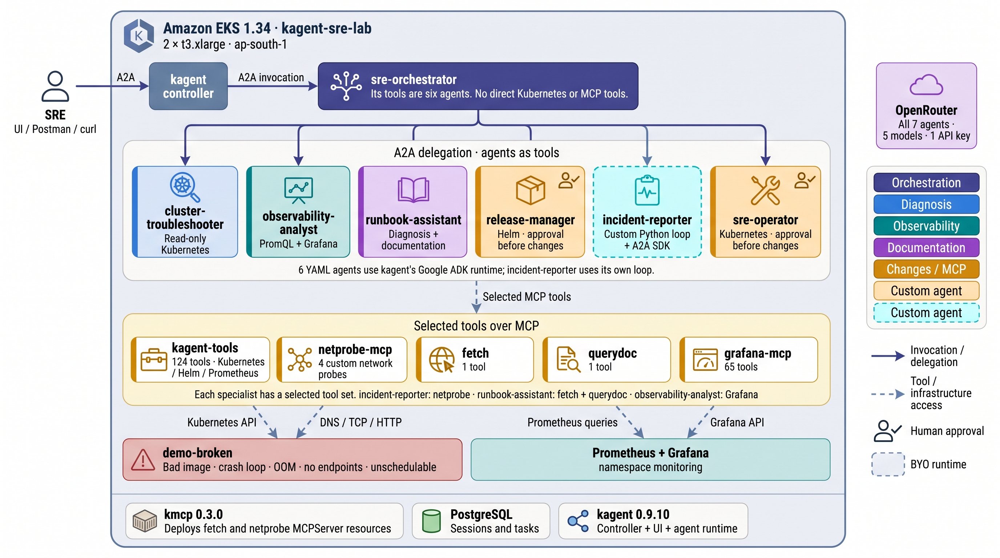
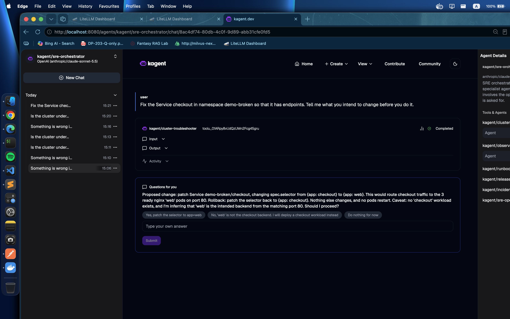
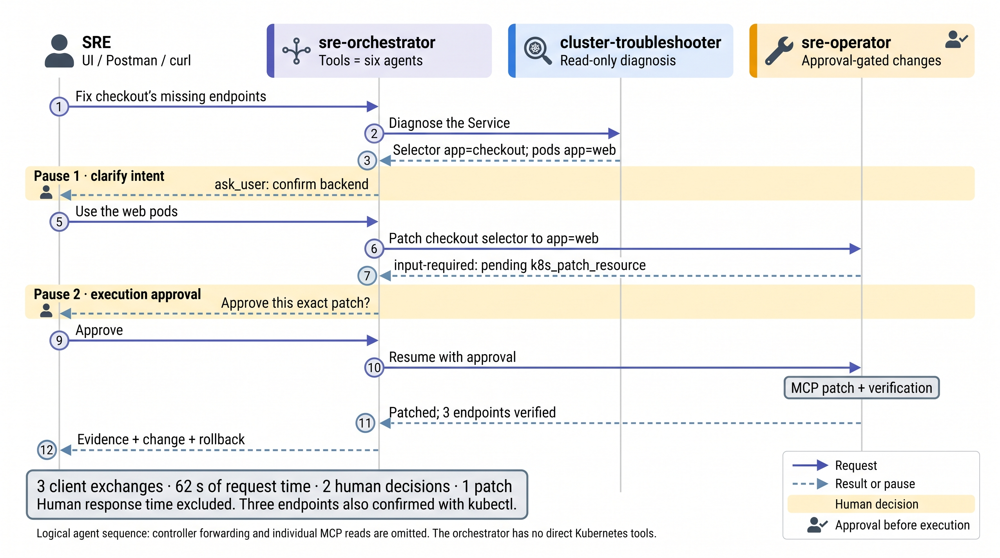
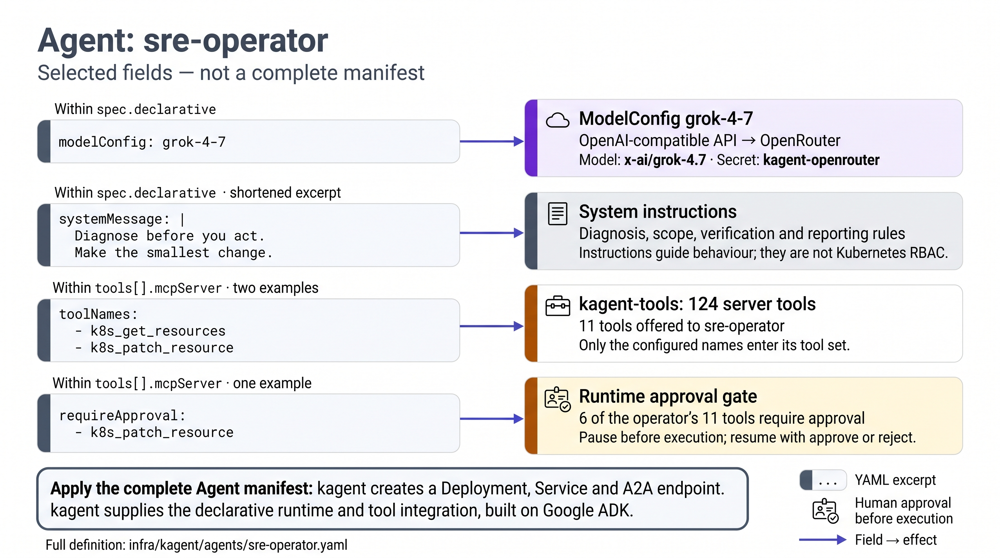
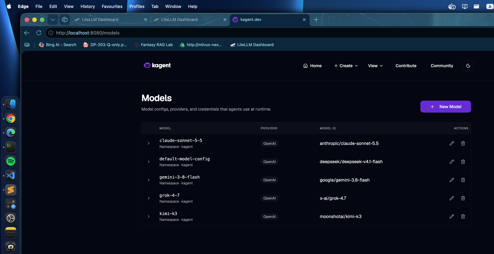
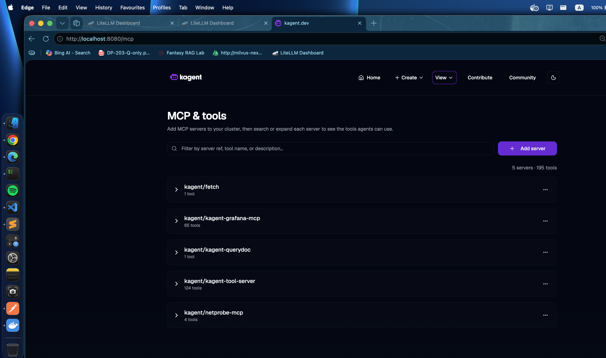
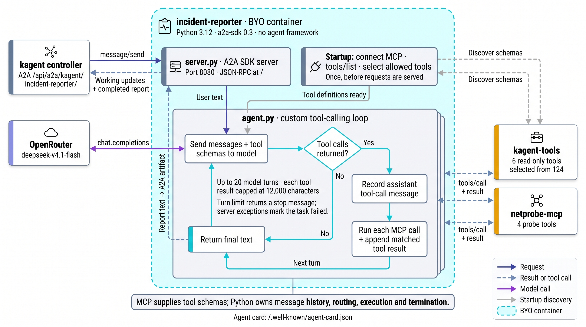

# Multi-agent SRE workflows on Amazon EKS with kagent and kmcp

I built and tested multi-agent orchestration for SRE workflows on Amazon EKS using kagent and kmcp. An orchestrator uses specialist agents as tools to diagnose Kubernetes faults and coordinate repairs. Before a change runs, the operator's approval gate pauses execution and surfaces the proposed tool call to the user—even when another agent called the operator.

Six of the seven agents are defined in YAML: a model reference, system instructions and allowed tool calls. kagent deploys them and supplies the built-in operational tools. Its Python runtime builds on Google's Agent Development Kit (ADK). kmcp deploys Model Context Protocol (MCP) tool servers, including a network-probe server I developed. The seventh agent is my own Python tool-calling loop, exposed through the Agent-to-Agent (A2A) protocol.

The test environment was one EKS 1.34 cluster in `ap-south-1`, with two `t3.xlarge` nodes and five deliberately broken workloads. The troubleshooter diagnosed all five individual faults. The orchestrator repaired a Service through two human decisions and verified three endpoints. Its longest diagnostic request never completed: testing exposed a controller timeout, overlapping abandoned requests and a memory failure.

The repository contains the manifests, custom code, API collection, raw responses and original build record. The framework provides the runtime and protocol integration; this project defines the specialist roles, adds custom capabilities and checks the resulting behavior against cluster evidence.

Repository: `<REPO_URL>` (replace before publication).

## Reading path

- [Delegation and approval in one repair](#delegation-and-approval-in-one-repair)
- [What the frameworks provide](#what-the-frameworks-provide)
- [Defining an agent in YAML](#defining-an-agent-in-yaml)
- [Specialists and custom implementations](#specialists-and-custom-implementations)
- [Deployment choices](#deployment-choices)
- [Method](#method), [results](#results) and [findings](#findings)
- [Limitations](#limitations) and [reproduction](#reproduce-it)

For request fields, tool inventories and transport details, see the [runtime and protocol reference](runtime-and-protocols.md). For copyable deployment commands, use the [setup guide](setup-guide.md). The [build record](build-record.md) retains the complete investigation and outputs.



*The system. An SRE reaches the orchestrator through the kagent controller over A2A; the orchestrator delegates to six specialists, which use selected tools on five MCP servers; the tools act on the demo namespace and the monitoring stack. kmcp, PostgreSQL and kagent are the platform underneath.*

## Delegation and approval in one repair

The orchestrator has no direct Kubernetes tools. Its tools are six specialist agents, registered with `type: Agent`. Each specialist keeps its own model, instructions and allowed tools. kagent makes the specialist callable through A2A and returns its answer to the orchestrator as a tool result.

Scenario 15 asked:

> Fix the Service checkout in namespace demo-broken so that it has endpoints. Tell me what you intend to change before you do it.

The request exercised the complete workflow:

1. **Diagnose.** The orchestrator called `cluster_troubleshooter`. It found that the Service selected `app: checkout`, while the running backend pods were labelled `app: web`.
2. **Resolve intent.** Matching `web` looked plausible, but the intended backend was an inference. The orchestrator used `ask_user` to offer three choices, with the proposed patch and rollback. The task paused in `input-required`.
3. **Delegate the change.** The user's answer resumed the same task. The orchestrator called `sre_operator` with the specific repair request.
4. **Approve execution.** The operator selected `k8s_patch_resource`, which is listed under its `requireApproval`. The task paused again. kagent surfaced the specialist's pending tool call and arguments through the parent conversation.
5. **Apply and verify.** After approval, the operator changed the selector to `app: web`. The Service had three endpoints, independently confirmed with `kubectl`. The final report included evidence, the change, rollback and specialists used.

The three client exchanges took 32 s, 16 s and 14 s: 62 s of request time in total, with two human decisions and one change. Those timings do not measure human deliberation time.

The two pauses serve different purposes. The first asks which change the user intends. The second is the runtime gate on executing the selected tool. The gate is configured once on the operator and remains active when the operator is called by another agent.



*A separate UI run of the same repair request. The troubleshooter has completed; the orchestrator is asking the user to confirm the backend, with the patch and rollback visible.*



*Scenario 15 as a logical sequence: twelve messages, two human pauses and one patch. The controller hop and the operator's individual MCP reads are omitted; the operator's pending patch runs only after the second decision.*

The direct operator tests checked execution approval separately. Approving a scale changed `web` from two to three replicas. Rejecting the opposite change left it at three. The replica counts were checked before and after; the rejected tool call did not execute.

## What the frameworks provide

### kagent: configuration, runtime and built-in tools

kagent brings agent configuration into Kubernetes custom resources. In this build, a `ModelConfig` selects the provider and model, an `Agent` specifies the instructions and tools, and a `RemoteMCPServer` identifies an existing tool endpoint. Applying an Agent creates its Deployment and Service.

The chart supplies the operational tools. Its main `kagent-tools` server exposed 124 tools in this run, including Kubernetes resource inspection, events, logs, scaling and patching; Helm operations; and Prometheus queries. The chart also provides a Grafana MCP server and documentation search. A troubleshooter can therefore use existing tools without implementing Kubernetes API wrappers.

The controller and the agent runtime have separate jobs. The controller reconciles Kubernetes resources and deploys agents. Inside each declarative Python agent, kagent builds on Google ADK to run the conversation and tool execution. kagent adds its MCP integration, A2A serving, session handling and approval behavior. The pinned v0.9.10 source imports ADK's `Runner` and uses `ToolContext.request_confirmation()` for approval. [Runtime source](https://github.com/kagent-dev/kagent/blob/v0.9.10/python/packages/kagent-adk/src/kagent/adk/_agent_executor.py), [approval source](https://github.com/kagent-dev/kagent/blob/v0.9.10/python/packages/kagent-adk/src/kagent/adk/_approval.py).

All six declarative agents ultimately ran on Python. The Go runtime was attempted, but the chart's pinned image digest was unavailable. The custom seventh agent uses its own loop and the A2A SDK; it does not use Google ADK.

### kmcp: running tool servers on Kubernetes

kmcp manages MCP servers rather than agent conversations. Its CLI scaffolds, builds and deploys projects. Its controller turns an `MCPServer` resource into a Deployment, Service, ConfigMap and ServiceAccount.

This build uses two deployment paths:

- **An existing stdio package:** `fetch` reads documentation pages. kmcp starts the package through `agentgateway`, which adapts its stdin/stdout interface to MCP over HTTP. No custom image was built.
- **A custom HTTP server:** `netprobe-mcp` serves four network checks through FastMCP. `kmcp init` supplied the scaffold, `kmcp build` built and pushed the image, and an `MCPServer` resource deployed it without a stdio adapter.

kmcp ships the deployment machinery; kagent's chart ships the built-in operational tool servers. [kmcp source](https://github.com/kagent-dev/kmcp/tree/v0.3.0).

### The two protocol boundaries

**Model Context Protocol (MCP)** lets an agent discover and call tools. **Agent-to-Agent (A2A)** lets a client or another agent discover and invoke an agent, receive progress and continue paused tasks.

For a repair, the path is: user → orchestrator over A2A → specialist over A2A → tool server over MCP → Kubernetes API. Model calls go to OpenRouter. Using the same invocation interface for declarative and custom agents lets the orchestrator call both without owning their internal loops.

These are established framework capabilities. The engineering work here is composing them into an SRE workflow, constraining the available operations, implementing the custom pieces and testing what holds under delegation.

## Defining an agent in YAML

A declarative agent has three core inputs, plus execution approval where needed:

| Input | Field | Purpose in this build |
|---|---|---|
| Model | `modelConfig` | Selects a provider, model and API-key Secret through a `ModelConfig` |
| Instructions | `systemMessage` | Defines the specialist's task and reporting rules |
| Allowed tools | `tools[].mcpServer.toolNames` | Selects which tools the model can call |
| Execution approval | `tools[].mcpServer.requireApproval` | Pauses selected tool calls for a human decision |

The following is a shortened example based on [sre-operator.yaml](../infra/kagent/agents/sre-operator.yaml), with the instructions condensed and the tool list abbreviated. The full file includes all eleven allowed tools and all six approval-gated operations.

```yaml
spec:
  type: Declarative
  declarative:
    modelConfig: grok-4-7
    systemMessage: |
      Diagnose before you act. State the root cause and proposed change.
      After a change, verify and report the before and after state.
    tools:
      - type: McpServer
        mcpServer:
          apiGroup: kagent.dev
          kind: RemoteMCPServer
          name: kagent-tool-server
          toolNames: [k8s_get_resources, k8s_patch_resource]
          requireApproval: [k8s_patch_resource]
```

`toolNames` limits the tool catalogue exposed to the model. `requireApproval` is enforced by the runtime before execution; it is not merely a prompt instruction. Neither field replaces Kubernetes RBAC, authentication or network policy. This lab uses the chart's default Kubernetes permissions.

The orchestrator selects agents instead of MCP tools:

```yaml
tools:
  - type: Agent
    agent: { name: cluster-troubleshooter }
  - type: Agent
    agent: { name: sre-operator }
```

The [full orchestrator](../infra/kagent/agents/sre-orchestrator.yaml) lists all six specialists. Its instructions live in a ConfigMap referenced by `systemMessageFrom`. `promptTemplate` includes the built-in safety snippet through `{{include "builtin/safety-guardrails"}}`; other agents use the Kubernetes context snippet. Prompts and tool lists remain reviewable in Git.



*The four fields of `sre-operator` that decide its behaviour. The excerpts are selected lines, not a complete manifest; the approval gate covers six of its eleven tools.*

## Specialists and custom implementations

| Agent | Model | Tool sources | Changes the cluster | Distinctive feature |
|---|---|---|---|---|
| `cluster-troubleshooter` | deepseek-v4.1-flash | 9 read-only `k8s_*` | no | built-in prompt snippets |
| `sre-operator` | grok-4.7 | 11 `k8s_*`, 6 under approval | with approval | `requireApproval` |
| `observability-analyst` | gemini-3.8-flash | `prometheus_*`, Grafana MCP, `k8s_*` | no | two routes to Prometheus |
| `release-manager` | kimi-k3 | `helm_*`, upgrades under approval | with approval | Go runtime tried; its image was missing |
| `runbook-assistant` | claude-sonnet-5.5 | `k8s_*`, `fetch` (kmcp), `query_documentation` (Service) | no | three kinds of tool source |
| `incident-reporter` | deepseek-v4.1-flash | tool server + netprobe, over MCP directly | no | bring your own container |
| `sre-orchestrator` | claude-sonnet-5.5 | the six agents above | tested repair via `sre-operator` | `type: Agent` tools, prompt in a ConfigMap |

Five `ModelConfig` resources share one OpenRouter Secret. They use `provider: OpenAI` with an OpenRouter `baseUrl`; the model identifier differs. This makes model selection independent of agent deployment, but this experiment did not compare models on the same task.



*The provider reads `OpenAI` for every entry because each model is reached through OpenRouter's OpenAI-compatible API.*

### Custom MCP tools: checking the network from inside the cluster

Kubernetes state can explain a bad selector, but an SRE also needs to test whether a name resolves and a Service actually answers. I added `dns_lookup`, `tcp_connect`, `http_check` and `tls_cert_expiry` as four typed Python functions. FastMCP derives their tool schemas from type hints and docstrings.

The server uses `httpx` for HTTP and `certifi` for a consistent TLS trust bundle. Its image was 98 MB. kmcp supplied the scaffold and build path; the probe functions are the custom implementation. The [component README](../byo/netprobe-mcp/README.md) documents inputs, outputs, local execution and extension.



*Two `RemoteMCPServer` resources offered 124 and 65 tools; two kmcp-managed `MCPServer` resources offered one and four; a labelled Service offered documentation search. Total: 195 tools. Each agent sees only its selected subset.*

### Custom agent: owning the tool-calling loop

The incident reporter is about 230 lines across [agent.py](../byo/incident-reporter-agent/src/agent.py) and [server.py](../byo/incident-reporter-agent/src/server.py). It connects to the built-in tool server and netprobe, discovers their schemas, filters them to six Kubernetes tools and four probes, and sends those definitions with the conversation to the model.

When the model requests a tool, the loop routes the call to the server that owns it, appends the result and asks the model again. It stops on a text answer or the configured turn limit. The implementation defaults to 20 turns and truncates each tool result to 12,000 characters.

The A2A SDK wrapper emits `working` updates per tool step, publishes the report as an artifact and ends in `completed` or `failed`. kagent requires port 8080, an agent card at `/.well-known/agent-card.json` and A2A 0.3 JSON-RPC at `/`. The card is also the readiness endpoint. The controller publishes its own card and injects `KAGENT_NAME`, `KAGENT_NAMESPACE` and `KAGENT_URL`.

The image was 57 MB and its pod became Ready in 19 s. The report scenario diagnosed all five faults in 161 s with 21 tool calls, including DNS, TCP and HTTP probes of `checkout`. The [protocol reference](runtime-and-protocols.md#the-custom-agent-boundary) covers the request loop and container contract in detail.



*The custom agent. server.py receives `message/send` from the controller and returns the report as an A2A artifact. Startup discovers tool schemas once over MCP. agent.py sends the conversation and tool schemas to the model, runs any requested tool calls over MCP, appends the results and asks again, until the model answers without tool calls.*

## Deployment choices

The [setup guide](setup-guide.md) follows dependency order: cluster and storage, model credentials, monitoring and its token, kagent, MCP servers, the custom agent image, declarative agents, then tests. The [build record](build-record.md) preserves the order in which the original work actually happened.

| Layer | Configuration |
|---|---|
| Cluster | EKS 1.34, two private `t3.xlarge` nodes, two availability zones, one NAT gateway |
| Storage | Default `gp3` StorageClass; EBS CSI driver authorized through EKS Pod Identity |
| Agent platform | kagent 0.9.10, bundled kmcp 0.3.0, PostgreSQL with 2 GiB volume |
| Monitoring | kube-prometheus-stack 83.6.0; Prometheus with 10 GiB volume and two-day retention |
| Models | Five configs through OpenRouter; one API-key Secret |
| Exposure | ClusterIP Services accessed through local port-forwards |
| Test namespace | Five documented faults in `demo-broken` |

The build stayed on the reviewed v0.9.10 resource model. The v1.0 alphas replace `Agent` with `Harness`/`AgentTemplate` and require a separate runtime; v0.10.3 was released after the original source review and was not evaluated. The exact versions and migration details are in the [reference](runtime-and-protocols.md#version-and-deployment-boundaries).

One instructive deployment issue was Grafana MCP tool discovery. Initializing through a local port-forward returned 200, while the controller's in-cluster request returned `Forbidden`. Testing the same request with the Service-name `Host` header reproduced 403. The `mcp/grafana:latest` image allowed only loopback hosts by default. Adding the controller's Service hostname through `--allowed-hosts`, then triggering reconciliation, made all 65 tools discoverable. The committed values include the fix. [Full investigation](build-record.md#9-the-grafana-mcp-server-that-ships-with-kagent).

## Method

**The faults are known in advance.** Five workloads in `demo-broken`, each broken one way: a bad image tag (`ImagePullBackOff`), a command that prints a line and exits 1 (`CrashLoopBackOff`), 200 MiB allocated under a 64 MiB limit (`OOMKilled`), a Service selector that matches no pod (no endpoints), a 16-CPU request on 4-CPU nodes (`Pending`). A diagnosis counts as correct only if it names the configured fault and supports it with evidence. A completed task can still contain an incorrect answer.

**The questions.** Fourteen in [scripts/scenarios.txt](../scripts/scenarios.txt): six to the troubleshooter (one per fault, plus a "which pods are unhealthy" question), three to the observability analyst, one to the release manager, one to the runbook assistant, one to the bring-your-own agent (a full incident report), and two to the orchestrator. A script sent the initial pass through the controller with A2A `message/send` and saved the raw responses and answer text. A third orchestrator question, which asks for a fix, was added after the first two.

**The approval flow** was exercised twice against `sre-operator` with its own script: a scale request approved, and a scale request rejected, with the deployment's replica count checked before and after.

**What was recorded.** For each scenario: the task state, wall-clock seconds for the request, the number and names of tool calls (from the function-call parts in the A2A task history), and the answer. Tool counts for the bring-your-own agent come from its own progress messages, since it does not emit kagent's metadata. Checks against the cluster used `kubectl`, `helm list` and a direct Prometheus query at the time of the run.

**Scope.** Specialist questions were run once. The orchestrator questions were retried through streaming and, for scenario 13, directly against its Service. No model was swapped on the same question, and timings were recorded in whole seconds. Per-scenario model cost was not captured.

## Results

Measured on 2026-10-07 on the cluster described above. Specialist timings are wall-clock seconds for a single request. Orchestrator outcomes include the documented retries. Tool calls come from A2A task history or the custom reporter's progress messages. Full answers and raw responses are in [results/answers/](../results/answers/).

**Twelve questions to five of the six specialists, including the bring-your-own agent:**

| # | Agent | Question | Time (s) | Tool calls | Verdict |
|---|---|---|---|---|---|
| 1 | cluster-troubleshooter | why is `api` not running | 11 | 4 | correct: `ImagePullBackOff`, quoted the `not found` event |
| 2 | cluster-troubleshooter | why does `worker` restart, quote the log | 8 | 5 | correct: quoted `config file /etc/worker/config.yaml not found` |
| 3 | cluster-troubleshooter | what happens to `cache` | 12 | 5 | correct: `OOMKilled`, 200M under 64Mi |
| 4 | cluster-troubleshooter | why `checkout` refuses connections | 52 | 8 | correct: selector matches no pod, empty Endpoints |
| 5 | cluster-troubleshooter | why is `batch` Pending | 5 | 4 | correct: `cpu: 16`, `Insufficient cpu` |
| 6 | cluster-troubleshooter | which pods are healthy, which not | 9 | 2 | partly wrong: the four unhealthy pods are right, but `batch` also appears in the healthy list |
| 7 | observability-analyst | most restarts in 30 min | 30 | 9 | correct on its metric: `worker` and `cache`, 6 each |
| 8 | observability-analyst | node CPU and memory vs capacity | 46 | 11 | correct: 2 nodes, 4 cores and 16.55 GB each, `rate(node_cpu_seconds_total)` per node |
| 9 | observability-analyst | alert rules, any firing | 33 | 6 | correct but incomplete: six firing alerts in `demo-broken` found; four others firing cluster-wide not listed |
| 10 | release-manager | Helm releases and versions | 7 | 1 | correct: three releases, matching `helm list` |
| 11 | runbook-assistant | diagnose `cache`, quote the docs | 35 | 9 | correct: diagnosis plus the Kubernetes "Resource Management" page, fetched and quoted with its URL |
| 12 | incident-reporter (BYO) | incident report for the namespace | 161 | 21 | correct: all five faults, with in-cluster probes of `checkout` |

Twelve of twelve completed; ten correct, one correct but incomplete, one partly wrong. All five faults were found by the troubleshooter one at a time, and all five again by the bring-your-own agent in one report.

**The approval flow, `sre-operator`:**

| Request | After `message/send` | After the decision | Deployment `web` replicas |
|---|---|---|---|
| scale `web` to 3 | `input-required`, pending `k8s_scale(name=web, namespace=demo-broken, replicas=3)` | approve: `completed`, "3/3 ready" | 2 → 3 |
| scale `web` to 2 | `input-required`, pending `k8s_scale(..., replicas=2)` | reject: `completed`, "The scale was not applied" | 3 → 3 |

**The orchestrator** (`sre-orchestrator`, whose only tools are the six agents above):

| # | Question | Outcome | Delegated to | Human turns | Time (s) |
|---|---|---|---|---|---|
| 13 | find every problem in `demo-broken` and the fix for each | **never completed**: cut at 180 s twice by the controller's client timeout, and the direct re-run was stopped by hand on cost | `incident_reporter`, `cluster_troubleshooter` | 0 | 180+ |
| 14 | is the cluster under CPU or memory pressure, is anything restarting because of it | **completed, correct**: no pressure (4.7% and 7.6% CPU, 15.9% and 17.4% memory), `cache` restarts from its own 64Mi limit, `worker` from exit 1; also flagged, unasked, a kagent pod with a missing image | `observability_analyst`, `cluster_troubleshooter` | 0 | 78 |
| 15 | fix the `checkout` Service so it has endpoints; say what you intend to change first | **completed, fixed**: asked which backend to use (three choices), then the operator's `k8s_patch_resource` paused for approval, then patched the selector to `app: web`; `kubectl` showed three endpoints | `cluster_troubleshooter`, `sre_operator` | 2 | 32 + 16 + 14 |

Model spend for the day, including all scenarios and retries, was about 6 USD on OpenRouter. Per-request spend was not captured.

## Findings

**Declarative configuration was sufficient for the individual diagnoses.** A nine-tool read-only agent diagnosed the five faults in 5–52 s with 4–8 calls per question. Its configuration is about 60 lines of YAML; no custom Kubernetes tool implementation was needed.

**Delegation preserved the operator's execution gate.** The orchestrator's tools were agent references, and the specialist's approval pause surfaced through the parent. The successful repair and direct rejection test establish this behavior for the tested calls.

**A completed task can still contain an incorrect answer.** The troubleshooter classified `batch` as both healthy and unhealthy. The analyst missed four cluster-wide firing alerts. Scenario 14 combined metrics and resource evidence to distinguish node pressure from a container's own memory limit; it does not establish a general accuracy improvement from orchestration.

**Streaming did not remove the controller timeout.** The controller's A2A client cut both plain responses and streams at 180 s. Go's `http.Client.Timeout` covers reading the response body too. The recorded task remained `working`, without a final answer. Calling the agent Service directly bypasses this controller boundary, but the direct scenario 13 attempt was stopped on cost and never demonstrated completion.

**Retries can overlap with abandoned work.** Work continued in the pod after some client requests timed out. Three overlapping orchestrations exceeded the default 1 GiB memory limit. The manifest now gives the orchestrator 2 GiB, and subsequent tests were serialized. Logs showed the incident-reporter card fetched 77 times in a few minutes, suggesting retries inside delegation; that mechanism was not conclusively isolated.

**Framework integration still needed operational investigation.** Besides the Grafana Host check, the pinned Go image was unavailable, and the Prometheus tool rejected comparison operators as potentially dangerous characters. The latter was observed through live calls to the separate `kagent-tools` image, not established from its source. Raw error evidence and workarounds remain in the [build record](build-record.md) and [protocol reference](runtime-and-protocols.md#tool-sources-and-discovery).

Most of the day's roughly 6 USD of model spend was attributed in the original notes to orchestration and abandoned runs. Per-scenario spend was not captured, so that attribution is not a measured breakdown.

## Limitations

- **One cluster and no repeated specialist trials.** Fourteen initial scenarios and an additional repair scenario were tested on one cluster. Orchestrator questions were retried during troubleshooting. "Ten of twelve correct" is what happened, not an accuracy figure for these agents or models.
- **Known faults and pointed questions.** The questions name the namespace and often the workload. A real incident starts with a symptom, not a resource name. The orchestrator scenarios are the closest this build comes to that.
- **Verification was partial for the metrics answers.** The restart counts and firing alerts were checked against Prometheus at the time; the per-node CPU and memory shares were not recomputed by hand.
- **Not a production setup.** The controller runs in its default `unsecure` auth mode (every caller is `admin@kagent.dev`), nothing is exposed outside the cluster, there is no NetworkPolicy, the tool server's Kubernetes permissions are the chart's defaults, and kmcp 0.3.0 adds no readiness or liveness probes to the pods it creates.
- **Pre-1.0 software.** kagent 0.9.10 and kmcp 0.3.0. kagent's 1.0 alphas replace the `Agent` resource model used here; 0.10.3 was released after the source review and was not evaluated.
- **The tool server is not part of the kagent source.** `kagent-tools` 0.2.1 is a separate image. Its argument names and its PromQL filter (which rejects comparison operators) were taken from its live `tools/list` and from calling it, not from code.
- **Per-scenario cost was not recorded.** The OpenRouter total for the day was about 6 USD; spend per scenario was not captured.
- **Not compared.** No other agent runtime, no other way of hosting MCP servers, no controlled latency or throughput benchmark.

## Reproduce it

Start with the [setup guide](setup-guide.md). The [build record](build-record.md) contains every original command and output; the [runtime and protocol reference](runtime-and-protocols.md) explains the resource fields, transports and API boundaries. All chart values and manifests are in `infra/`.

You need AWS access with eight spare on-demand vCPUs in the region, Docker, the command-line tools listed in the guide and an OpenRouter API key. AWS bills the EKS control plane, nodes, NAT gateway, storage and ECR images while they exist. The hourly total was not calculated; teardown is included. The original cluster was deleted after testing, and the two image repositories were retained.

Repository: `<REPO_URL>` (replace before publication). Markdown tables may need adaptation for the article publisher's editor. The diagrams are generated from `diagrams/prompts.md`; the screenshots are from the recorded build.
