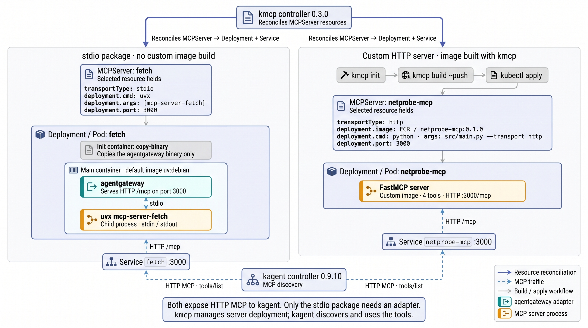
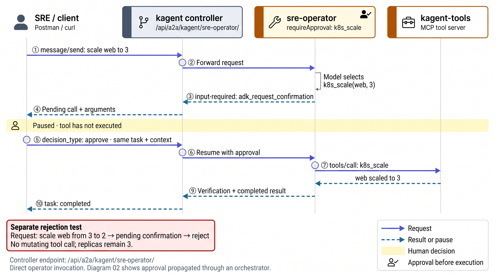

# Runtime and protocol reference

This reference explains the layers beneath the [multi-agent SRE workflow](article.md). It retains the resource fields, tool inventory, wire formats and deployment boundaries without requiring the article reader to follow every protocol detail. The implementation and recorded tests use kagent 0.9.10 and kmcp 0.3.0.

## Contents

- [Who runs what](#who-runs-what)
- [Agent configuration and approval](#agent-configuration-and-approval)
- [Tool sources and discovery](#tool-sources-and-discovery)
- [kmcp deployment paths](#kmcp-deployment-paths)
- [The model tool-calling loop](#the-model-tool-calling-loop)
- [A2A discovery, invocation and continuation](#a2a-discovery-invocation-and-continuation)
- [The custom agent boundary](#the-custom-agent-boundary)
- [HTTP timeouts and request lifetime](#http-timeouts-and-request-lifetime)
- [API collection and validation scope](#api-collection-and-validation-scope)
- [Version and deployment boundaries](#version-and-deployment-boundaries)

## Who runs what

| Component | Responsibility | Use in this build |
|---|---|---|
| kagent controller | Reconciles model, agent and tool-source resources; deploys agents and exposes APIs | Deployments, Services, discovery, UI/API access |
| kagent Python runtime | Builds on Google ADK for agent execution; integrates MCP, A2A, sessions and approval | All six declarative agents |
| Google Agent Development Kit (ADK) | Provides the underlying Python agent execution primitives | `Runner`, tool context and confirmation mechanisms used by kagent |
| kmcp controller | Deploys the server described by an `MCPServer` resource | `fetch` and `netprobe-mcp` |
| MCP tool servers | List tool schemas and execute tool requests | Kubernetes, Helm, metrics, documentation and network probes |
| Custom incident reporter | Owns its model conversation and tool-calling loop | Python loop with the A2A SDK; no Google ADK |
| OpenRouter | Routes model requests through an OpenAI-compatible API | Five model configurations sharing one Secret |
| PostgreSQL | Stores kagent sessions, tasks and agent state | Bundled instance with a 2 GiB volume |

The pinned kagent Python package declares `google-adk>=1.28.1,<2`. That is a source dependency range, not a measurement of the package version installed in the running image. Its executor imports ADK's `Runner`; its approval callback uses `ToolContext.request_confirmation()`. [Dependency declaration](https://github.com/kagent-dev/kagent/blob/v0.9.10/python/packages/kagent-adk/pyproject.toml), [executor](https://github.com/kagent-dev/kagent/blob/v0.9.10/python/packages/kagent-adk/src/kagent/adk/_agent_executor.py), [approval implementation](https://github.com/kagent-dev/kagent/blob/v0.9.10/python/packages/kagent-adk/src/kagent/adk/_approval.py).

kagent also offers a Go runtime. This build attempted it but ultimately used Python because the chart's Go image digest could not be pulled. Describing this project as ADK-based therefore applies to the declarative Python agents, not to every possible kagent runtime or the custom incident reporter.

## Agent configuration and approval

### The Kubernetes resources

| Resource | Fields that matter here | Result |
|---|---|---|
| `ModelConfig` | Provider, model, base URL, API-key Secret reference | A reusable model configuration |
| `RemoteMCPServer` | Protocol and URL of an existing MCP endpoint | Discovered tools recorded in resource status |
| `MCPServer` | Image/package command, transport and port | A server deployed by kmcp |
| Declarative `Agent` | Model reference, instructions, selected tools, optional deployment resources | Agent Deployment, Service and A2A access |
| BYO `Agent` | Container image and environment | Custom agent deployed through the same platform |

kagent supports providers including OpenAI, Anthropic, Azure OpenAI, Gemini, Vertex AI, Bedrock and Ollama. This build uses only the `OpenAI` provider with `baseUrl: https://openrouter.ai/api/v1`. The chart creates `default-model-config`; four files in [infra/kagent/models/](../infra/kagent/models/) create the other configurations. Each references `kagent-openrouter` and the `OPENROUTER_API_KEY` key.

Instructions can be inline in `systemMessage`, loaded from a ConfigMap through `systemMessageFrom`, or rendered with `promptTemplate`. The orchestrator combines the ConfigMap reference with a template that includes `builtin/safety-guardrails`. The troubleshooter includes `builtin/kubernetes-context`.

### Tool selection and execution approval

`toolNames` selects the MCP tools exposed to the model. The troubleshooter sees nine of the built-in server's 124 tools. The operator sees eleven, with these six under `requireApproval`:

```text
k8s_scale
k8s_rollout
k8s_patch_resource
k8s_apply_manifest
k8s_label_resource
k8s_annotate_resource
```

The configured agents do not expose `k8s_delete_resource`, `k8s_execute_command` or `shell`. This constrains available tool calls; the MCP server still runs with the chart's default Kubernetes permissions. Namespace restrictions written only in a prompt are instructions, not RBAC enforcement.

For a gated tool, the runtime intercepts execution and requests confirmation. The task returns `input-required` with the original call and arguments. After an approve/reject decision, the runtime resumes the pending call or returns a rejection result without executing it. In the pinned implementation, this is an ADK before-tool callback. Confirmation events remain in session state but are stripped from model requests by a separate callback.

### Agents used as tools

An orchestrator entry with `type: Agent` references a specialist. kagent resolves the agent card and exposes a callable tool taking a free-form request. The specialist's description helps the model select it. The runtime invokes the specialist over A2A and returns its result to the calling model.

The release manager also exposes approval-gated Helm operations (`helm_upgrade`, `helm_uninstall`, `helm_repo_add`). The orchestrator's prompt directs repairs to the operator, but its available release-manager tool is not a runtime prohibition on Helm changes. The tested Service repair used the operator.

When the specialist returns `input-required`, kagent's remote A2A tool requests confirmation in the parent. It retains the child task/context information so a user decision can continue that child. This is the mechanism exercised by scenario 15. [Pinned remote-agent implementation](https://github.com/kagent-dev/kagent/blob/v0.9.10/python/packages/kagent-adk/src/kagent/adk/_remote_a2a_tool.py).

## Tool sources and discovery

The run discovered five tool sources, totaling 195 tools:

| Source | Kind used by agents | In-cluster endpoint | Tools |
|---|---|---|---|
| `kagent-tool-server` | `RemoteMCPServer` | `http://kagent-tools.kagent:8084/mcp` | 124 |
| `kagent-grafana-mcp` | `RemoteMCPServer` | `http://kagent-grafana-mcp.kagent:8000/mcp` | 65 |
| `fetch` | `MCPServer` | `http://fetch.kagent:3000/mcp` | 1 |
| `netprobe-mcp` | `MCPServer` | `http://netprobe-mcp.kagent:3000/mcp` | 4 |
| `kagent-querydoc` | Labelled `Service` | `http://kagent-querydoc.kagent:8080/mcp` | 1 |

The built-in server's recorded inventory is:

| Tool family | Count |
|---|---|
| Kubernetes (`k8s_*`) | 22 |
| Helm (`helm_*`) | 6 |
| Prometheus (`prometheus_*`) | 5 |
| Istio (`istio_*`) | 13 |
| Cilium (`cilium_*`) | 58 |
| Argo Rollouts (`argo_*`) | 8 |
| Kubescape (`kubescape_*`) | 10 |
| `datetime_get_current_time`, `shell` | 2 |

The exact schemas come from the live [tools/list response](../results/raw/kagent-tools-tools-list.json). Examples of the argument names are `k8s_get_resources(resource_type, namespace, all_namespaces, resource_name, output="wide")`, `k8s_scale(name, namespace, replicas)` and `prometheus_query_tool(prometheus_url, query)`. `kagent-tools` 0.2.1 is a separate image; this repository did not inspect its implementation source.

The Prometheus tool rejected comparison operators (`>`, `<`, `==`) as "potentially dangerous characters" during live calls. A query such as `topk(5, sum by (namespace, pod) (kube_pod_container_status_restarts_total))` avoids a comparison filter. The Grafana MCP server's `query_prometheus` provides a second query path. [Recorded query response](../results/raw/tools-call-prometheus_query_tool.json).

A labelled Service can also be a tool source. kagent recognizes `kagent.dev/mcp-service: "true"` with a supported MCP port declaration (`appProtocol: mcp` or the `kagent.dev/mcp-service-port` annotation). The observed kmcp-created `fetch` Service used `appProtocol: kgateway.dev/mcp`. The querydoc source must be referenced as `kind: Service`; referencing it as `RemoteMCPServer` caused `runbook-assistant` to be rejected.

Tool discovery can initially fail if the server is not listening when the controller reconciles. The recorded workaround annotated the `RemoteMCPServer` to trigger reconciliation. After fixing Grafana's Host validation, its stale `Forbidden` condition also remained until reconciliation. A condition describes the last reconciliation, so inspect the endpoint and trigger a fresh check before concluding that a fix failed.

The controller additionally exposes its own MCP endpoint at `http://kagent-controller.kagent:8083/mcp`, with `list_agents` and `invoke_agent`. This endpoint presents agents to MCP clients; it is separate from the five operational tool sources above.

## kmcp deployment paths

The v0.3.0 CLI scaffolds Python projects from a FastMCP template with `kmcp init python`; Go, TypeScript and Java templates also exist. `kmcp build` runs a Docker build with a project-derived or explicit tag, and `--push` pushes the image. `kmcp deploy` generates an `MCPServer` resource. This repository keeps the deployment manifests as files and applies them with `kubectl`.

### Adapting a stdio package

The reference `fetch` package speaks MCP over stdin/stdout. To make it callable from other pods, kmcp creates an init container that copies `agentgateway` into the pod. The main container runs agentgateway, which starts `uvx mcp-server-fetch` as a child and exposes its MCP interface at port 3000 over streamable HTTP.

The observed init image was `ghcr.io/agentgateway/agentgateway:0.9.0-musl`; the main image was `ghcr.io/astral-sh/uv:debian`, kmcp's default for a `uvx` command. kmcp also supplies default images for `npx` commands. Public stdio packages can therefore be deployed without creating a custom image.

### Running a native HTTP server

`netprobe-mcp` serves streamable HTTP itself. Its `MCPServer` sets `transportType: http`, target/container port 3000 and the command `python src/main.py --transport http --host 0.0.0.0 --port 3000`. No agentgateway init container is needed. kagent calls `/mcp`; the reviewed controller fixes this path rather than using `httpTransport.path` for HTTP servers.

The scaffold generated `pyproject.toml`, a two-stage Dockerfile, `kmcp.yaml`, `src/main.py`, the dynamic loader, an echo example and tests. The echo tool was replaced with four probes. FastMCP 3.0.0 derives their JSON Schemas from typed functions. The generated CLI hint named `kmcp run local`, but v0.3.0 uses `kmcp run`; the historical scaffold command and local verification remain in the [build record](build-record.md#10-bring-your-own-mcp-server-scaffold-build-push-deploy).

kmcp 0.3.0 adds no readiness or liveness probes to these generated pods. A Ready deployment is not an end-to-end MCP health check. This build also checked tool discovery and made direct tool calls.



*The two kmcp deployment paths in this build. `fetch` runs on kmcp's default image with agentgateway serving its stdio as HTTP; `netprobe-mcp` serves HTTP itself from the image built with `kmcp build`. kagent discovers both through their Services.*

## The model tool-calling loop

The custom agent makes the loop explicit. It uses an OpenAI-compatible chat-completions request; that describes the API format, not the selected model vendor.

1. **Discover.** Connect to each MCP server, initialize its session and request `tools/list`.
2. **Select.** Filter the catalogue by the agent's allow-list. Copy each tool's name, description and JSON Schema into a function definition in the model request's `tools` array.
3. **Ask the model.** Send the conversation and tool definitions. A response can contain text or `tool_calls`.
4. **Execute requested calls.** A `tool_calls` response is a request for execution; the model has not executed the function. Route each call to its owning MCP server using `tools/call`.
5. **Return evidence.** Append the assistant's tool-call message and a `role: "tool"` response matched by `tool_call_id`, then send the updated conversation to the model.
6. **Finish or repeat.** Continue until the model answers without tool calls, or the configured turn limit is reached.

In the common tool-call response shape, `finish_reason` is `"tool_calls"` and text `content` can be `null`; a finished text response commonly has `finish_reason: "stop"`. The implementation checks for `msg.tool_calls` rather than branching solely on the finish reason.

Chat completions require the client to supply conversation history. The assistant's requested calls and corresponding tool results must remain correctly paired. The schemas are included on each request, so they contribute to input tokens even when no tool is used. With automatic tool selection, the model may answer directly; the reporter's instructions require it to gather evidence before stating cluster facts.

MCP handles discovery and execution, while the model's function-call format expresses its chosen operation. In this build, MCP uses streamable HTTP: JSON-RPC over HTTP POST, an `initialize` handshake and session handling. The [Postman collection](../postman/kagent.postman_collection.json) demonstrates tool requests without a model in the path.

### Alternative API shape: Responses

The original source review found no Responses API field in the v0.9.10 `ModelConfig`; this build uses chat completions throughout. The reviewed 1.0 alpha model adds Responses configuration, but it was not deployed here.

The Responses API is a different request shape: it can chain conversation state using `previous_response_id` and can manage supported built-in tools, including declared remote MCP servers. Custom function tools still require client execution and a returned function result. These capabilities were not tested in this project; the deployed custom loop remains the reference for observed behavior. [Conversation state](https://developers.openai.com/api/docs/guides/conversation-state), [remote MCP tools](https://developers.openai.com/api/docs/guides/tools-connectors-mcp), [function calling](https://developers.openai.com/api/docs/guides/function-calling).

## A2A discovery, invocation and continuation

A2A is the interface exposed by the deployed agents. The version used by the custom container is the 0.3 JSON-RPC wire format.

| Operation | Request | Role |
|---|---|---|
| Discovery | `GET /.well-known/agent-card.json` | Reads name, description, capabilities, skills and invocation URL |
| Non-streaming invocation | JSON-RPC `message/send` | Returns the agent's task/result |
| Streaming invocation | JSON-RPC `message/stream` | Receives progress through server-sent events |
| Task lookup | JSON-RPC `tasks/get` | Fetches the recorded task state |
| Continuation | Another message with the same `contextId` and `taskId` | Supplies the answer or decision for a paused task |

The card's `skills` describe free-form agent capabilities rather than typed function arguments. The orchestrator uses specialist descriptions and cards to invoke them. Common task states are `submitted`, `working`, `completed`, `failed` and `input-required`.

The controller route is `/api/a2a/<namespace>/<agent>/`. Each agent also has a Kubernetes Service on port 8080. The custom agent's JSON-RPC endpoint is `/`, and its card is `/.well-known/agent-card.json`.

For direct operator approval, the first request returns `input-required` with an `adk_request_confirmation` part containing `originalFunctionCall` and `toolConfirmation`. A follow-up data part of `{"decision_type":"approve"}` resumes the pending call; `{"decision_type":"reject"}` rejects it. The request retains the same task and context identifiers.

An `ask_user` answer adds `ask_user_answers`. Scenario 15 first continued that question, then separately approved the operator's tool call. [Approval script](../scripts/approval-demo.sh), [orchestrator continuation script](../scripts/orchestrator-continue.sh), [recorded exchanges](build-record.md#12-human-approval-over-a2a).



*Direct approval against `sre-operator`. The first message into kagent-tools is the scale call after the client's approve decision on the same task and context. The rejection test is a separate later request.*

## The custom agent boundary

[agent.py](../byo/incident-reporter-agent/src/agent.py) owns the model client, allowed tools, two MCP sessions, name-to-server routing and message history. [server.py](../byo/incident-reporter-agent/src/server.py) wraps it with an A2A `AgentExecutor`, emitting a `working` update for each tool step and a final artifact named `incident-report`.

| Setting | Default or contract |
|---|---|
| Model | `deepseek/deepseek-v4.1-flash` through OpenRouter |
| Model endpoint | `OPENAI_BASE_URL`, defaulting to `https://openrouter.ai/api/v1` |
| Credentials | `OPENROUTER_API_KEY` supplied from the existing Secret |
| Tool endpoints | `KAGENT_TOOLS_URL` and `NETPROBE_URL` |
| Loop bound | `MAX_TURNS`, default 20 |
| Tool result bound | First 12,000 characters per result |
| Readiness | Agent card served on port 8080 |
| Invocation | A2A 0.3 JSON-RPC at `/` |
| Progress and completion | `working` updates, report artifact, `completed` or `failed` |
| Local task storage | A2A SDK `InMemoryTaskStore` |
| Cancellation | Custom executor raises `NotImplementedError`; cancellation is not implemented |

kagent deploys the image, publishes a controller-facing card and forwards requests. It injects `KAGENT_NAME`, `KAGENT_NAMESPACE` and `KAGENT_URL`; the custom code takes its own model/endpoint settings from the configured environment. The loop and MCP sessions belong to the container, rather than a declarative `ModelConfig`.

The two-stage uv Dockerfile produced a 57 MB image. The recorded pod readiness time was 19 s. Readiness verifies that the card is served; it does not prove a full incident-report request will succeed.

## HTTP timeouts and request lifetime

The controller's A2A client had a three-minute HTTP timeout. The original inspection checked a2a-go v0.3.13; kagent 0.9.10 depends on v0.3.15. The observed controller calls were cut at 180 s:

```go
// Inspected in a2a-go v0.3.13, a2aclient/jsonrpc.go
t.httpClient = &http.Client{Timeout: 3 * time.Minute}
```

The timeout covers response-body reading, so it applies to streaming as well as non-streaming calls. `message/stream` exposes progress and approval pauses; it does not remove the controller limit. The repository's scripts use longer local curl limits, which cannot override the controller's internal timeout.

A direct port-forward to `svc/sre-orchestrator` bypasses this controller hop. It does not establish a bound on specialist delegation, execution cost or task completion. The direct scenario 13 attempt was stopped on cost. Some abandoned controller calls continued in the pod, while controller task records stayed `working`; neither a disconnect nor a stale state proves that work was cancelled.

Three overlapping requests were present when the orchestrator was OOMKilled at its default 1 GiB limit (`requests: cpu 100m, memory 384Mi; limits: cpu 2, memory 1Gi`). Its manifest now sets `requests: cpu 200m, memory 512Mi` and `limits: memory 2Gi`. Subsequent attempts were run sequentially. The memory failure was observed; no per-request memory profile was captured.

## API collection and validation scope

[postman/build_collection.py](../postman/build_collection.py) generates ten folders and 62 requests. The collection covers system information; models; tool sources; direct built-in and custom MCP calls; agents; A2A invocation/approval; sessions/tasks; the controller MCP endpoint; and feedback.

Routes and bodies were taken from kagent v0.9.10's `go/core/internal/httpserver/server.go` and handlers. System, tool-source, direct MCP, agent-list, session-list and controller-MCP requests were exercised with curl. Their responses are in [results/raw/api/](../results/raw/api/). The collection itself was not executed in Postman, and every CRUD request was not tested.

Agent invocation uses A2A or the controller MCP `invoke_agent` tool. Direct operational tool calls go to the owning MCP server; the controller does not provide a separate REST route for executing them. The collection also contains a v1 wire-format example; the observed custom-agent exchanges use A2A 0.3.

## Version and deployment boundaries

The [README version table](../README.md#versions) records the complete software and image inventory. The original source review used kagent v0.9.10, kmcp v0.3.0 and live `kagent-tools` 0.2.1 schemas. Source inspection commands are retained in [build-record.md](build-record.md#1-source-checkouts).

The first reviewed kagent checkout was v1.0.0-alpha4. Its model uses `Harness` and `AgentTemplate`, with running `AgentInstance` state in PostgreSQL. It requires Substrate, a separate runtime with a gVisor worker pool, certificate/JWT pools and S3 snapshots. Alpha5 renamed the CRD group to `api.kagent.dev`. Neither alpha was deployed for the recorded experiment. kagent v0.10.3 was released after the original review and was not evaluated. The documented commands intentionally reproduce the pinned 0.9.10 model.

kagent can use vector-store-backed long-term memory and OpenTelemetry traces. Neither was enabled here. The broader ecosystem also includes agentgateway authentication/policy for agent traffic, but the tested stdio adapter does not demonstrate those controls. This cluster used default `unsecure` controller authentication, no NetworkPolicy and default tool-server Kubernetes permissions.

The framework reduces the deployment work when Kubernetes is already the operating environment: resources, model references, tools and prompts can be reviewed as YAML. Applying YAML does not configure GitOps, access control or production authentication by itself. A cluster and PostgreSQL are also substantial dependencies for a small local prototype.

Background: kagent originated at Solo.io in 2025. [kagent project](https://kagent.dev/), [pinned source](https://github.com/kagent-dev/kagent/tree/v0.9.10), [kmcp source](https://github.com/kagent-dev/kmcp/tree/v0.3.0), [agentgateway](https://agentgateway.dev/).
