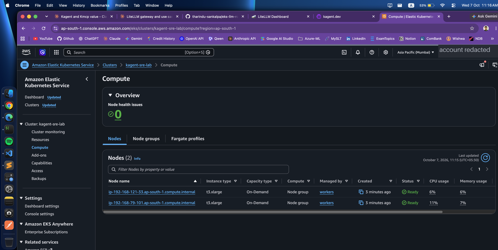
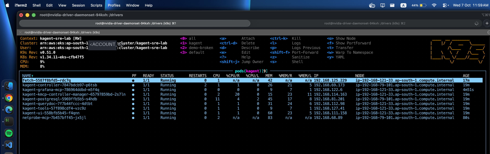
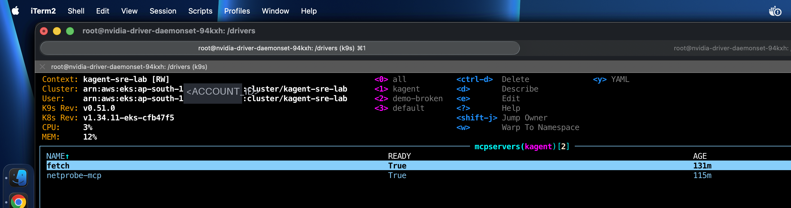
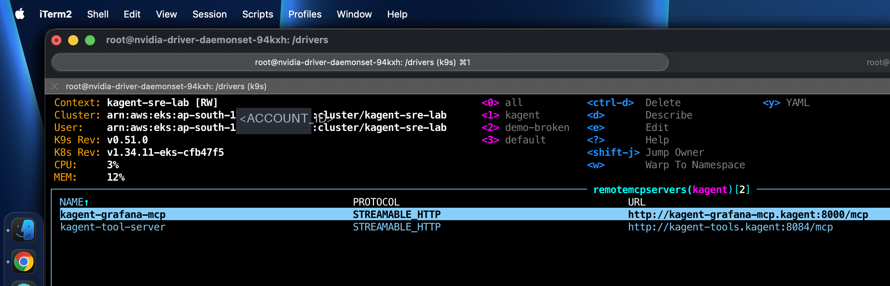
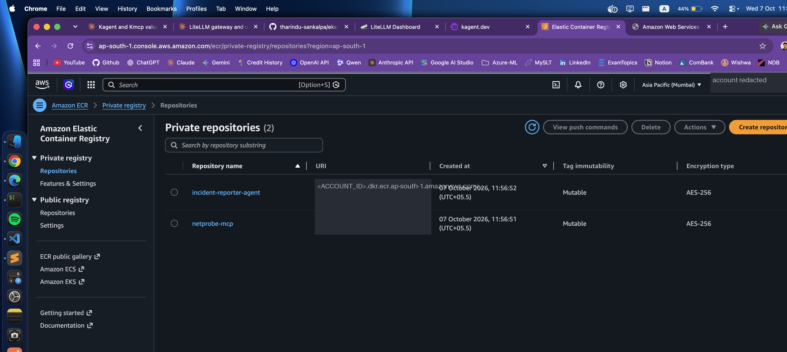
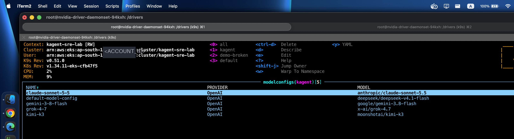
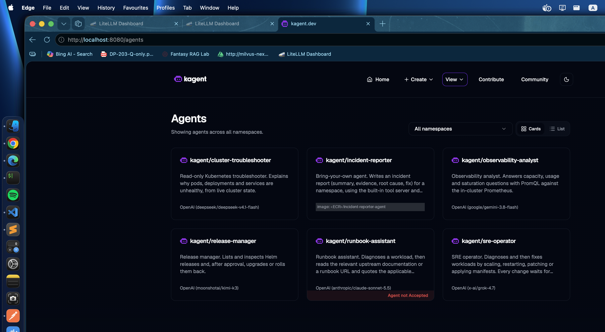
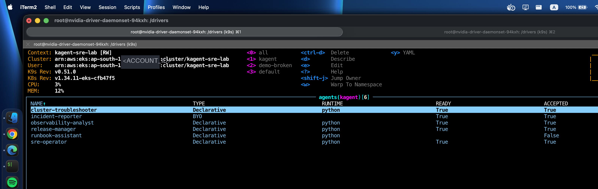

# Setup guide: SRE agents on Amazon EKS with kagent and kmcp

This guide records every command used to build the stack, in the order it was run on 2026-10-07. Each step says what it does, why, the command, and the output that shows it worked. Errors are recorded where they happened, with the message, the cause and the fix.

**Status of this record:** being written while the build runs. Steps marked `(not yet run)` have no output.

**Manual and automated.** The cluster is created with one `eksctl` command from a file. Everything else is `helm install` and `kubectl apply` of files in `infra/`. No agent, model or tool is created by hand in a UI; every one is a YAML file in this repository.

**Cost and teardown.** The EKS control plane, the two `t3.xlarge` nodes, the NAT gateway and the EBS volumes are billed while they exist. [Teardown](#teardown) is at the end.

<!-- TODO(diagram): docs/diagrams/01-system-overview.jpg -->

## Conventions

- Lines starting with `$` are commands. Lines without it are output.
- Output is trimmed to the lines that prove the step. Names, IPs, IDs and ages will differ for you.
- `<ACCOUNT_ID>` and similar are placeholders for values removed from the output.
- Keys are never shown. `sk-or-…` stands for a real key.

## 0. Variables

What this does: defines every value that is reused, once.

Why: the cluster gets its own kubeconfig file, so no command in this guide can reach another cluster by accident.

```bash
$ export AWS_REGION=ap-south-1
$ export CLUSTER=kagent-sre-lab
$ export KUBECONFIG=$PWD/.kube/config        # gitignored, used only for this cluster
$ cp .env.example .env                       # then fill in the values
$ set -a && . ./.env && set +a
```

`.env` holds the one external credential this build needs, `OPENROUTER_API_KEY`, and a Grafana admin password of your choosing.

## 1. Source checkouts

What this does: pins the versions that are installed.

Why: the chart values, CRD fields and tool names in this guide were read from the project sources at these versions, not from documentation.

| Project | Version used | Why this version |
|---|---|---|
| kagent | v0.9.10 (charts `kagent-crds` and `kagent` 0.9.10) | Latest non-prerelease tag when the source was reviewed. kagent 1.0 alphas replace the `Agent` resource with a different model and need a separate runtime; see [Why not the newest kagent](#why-not-the-newest-kagent). |
| kmcp | v0.3.0 | The version kagent 0.9.10 bundles (`go/go.mod`: `github.com/kagent-dev/kmcp v0.3.0`). |
| kagent-tools | 0.2.1 | The tool server subchart kagent 0.9.10 depends on. |

```bash
$ git clone https://github.com/kagent-dev/kagent.git repos/kagent && git -C repos/kagent checkout v0.9.10
$ git clone https://github.com/kagent-dev/kmcp.git repos/kmcp && git -C repos/kmcp checkout v0.3.0
```

`repos/` is gitignored.

### Why not the newest kagent

At `v1.0.0-alpha4` and later, kagent has no `Agent` CRD. An agent is a `Harness` plus an `AgentTemplate`, a running one is an `AgentInstance` in PostgreSQL, and the controller needs Substrate (a separate runtime with a gVisor worker pool, CA and JWT pools and S3 snapshots) before any agent runs. `v1.0.0-alpha5` renames the CRD group to `api.kagent.dev`. This build uses the `Agent` resource of v0.9.10, where one YAML file is one agent. kagent v0.10.3 was published as a stable release after the source review and was not evaluated.

## 2. Tooling and pre-flight checks

What this does: records tool versions and checks, read-only, that the region can host the cluster.

```bash
$ aws --version; eksctl version; kubectl version --client; helm version --short; jq --version
$ aws service-quotas get-service-quota --service-code ec2 --quota-code L-1216C47A \
    --region $AWS_REGION --query 'Quota.Value' --output text
32.0
```

`L-1216C47A` is the quota for running on-demand standard instances, in vCPUs. This build uses 8 (2 × `t3.xlarge`).

| Tool | Version |
|---|---|
| aws-cli | 2.37.4 |
| eksctl | 0.230.0-dev |
| kubectl | v1.35.0 |
| helm | v4.2.4 |
| jq | 1.8.2 |

## 3. EKS cluster

What this does: creates a VPC with two availability zones and one NAT gateway, the EKS 1.34 control plane, a managed node group of 2 × `t3.xlarge` in private subnets, and six add-ons, with one command.

Why these choices:

- **Private nodes, one NAT gateway.** Nodes have no public IPs. One NAT gateway instead of one per zone is enough for a lab.
- **`t3.xlarge` × 2.** 8 vCPU and 32 GiB in total for kagent (controller, UI, PostgreSQL, tool servers, five agent pods), kmcp, Prometheus and Grafana, and the demo workloads.
- **EBS CSI driver and Pod Identity agent.** kagent's PostgreSQL and Prometheus need volumes. `autoApplyPodIdentityAssociations: true` makes eksctl create the IAM role the EBS CSI controller needs and bind it through EKS Pod Identity, which is why the Pod Identity agent add-on is in the list.

The configuration is [infra/eks/cluster.yaml](../infra/eks/cluster.yaml).

```bash
$ eksctl create cluster -f infra/eks/cluster.yaml --kubeconfig $KUBECONFIG
```

`--kubeconfig` writes the new context into the repo-local file from step 0 instead of `~/.kube/config`.

The command ran for 14 minutes and then failed, after the control plane, the add-ons and the node group stack had been created:

```
2026-10-07 11:09:54 [ℹ]  successfully created addon: coredns
2026-10-07 11:11:57 [ℹ]  deploying stack "eksctl-kagent-sre-lab-nodegroup-workers"
2026-10-07 11:15:44 [!]  1 error(s) occurred and cluster hasn't been created properly, you may wish to check CloudFormation console
2026-10-07 11:15:44 [✖]  operation error CloudFormation: DescribeStacks, https response error StatusCode: 403, ...
                         api error ExpiredToken: The security token included in the request is expired
Error: failed to create cluster "kagent-sre-lab"
```

### What went wrong here

**The AWS session expired while eksctl was waiting for the node group stack.** The CLI was logged in with temporary credentials. The CloudFormation stacks kept running in AWS (CloudFormation does not need the caller's session once a stack is submitted), but eksctl could no longer poll them, so it reported failure and did not write the kubeconfig.

Cause: temporary credentials with a lifetime shorter than the cluster creation (about 15 to 20 minutes), obtained a while before the command was started.

Fix: refresh the credentials, then check what AWS finished on its own and write the kubeconfig by hand:

```bash
$ aws cloudformation list-stacks --region $AWS_REGION \
    --query "StackSummaries[?contains(StackName,'$CLUSTER') && StackStatus!='DELETE_COMPLETE'].[StackName,StackStatus]" --output text
```

With fresh credentials, 15 minutes later:

```bash
$ aws cloudformation list-stacks --region $AWS_REGION \
    --query "StackSummaries[?contains(StackName,'$CLUSTER') && StackStatus!='DELETE_COMPLETE'].[StackName,StackStatus]" --output text
eksctl-kagent-sre-lab-nodegroup-workers                          CREATE_COMPLETE
eksctl-kagent-sre-lab-addon-vpc-cni-podidentityrole-aws-node     CREATE_COMPLETE
eksctl-kagent-sre-lab-cluster                                    CREATE_COMPLETE

$ aws eks list-addons --region $AWS_REGION --cluster-name $CLUSTER --output text
ADDONS  coredns
ADDONS  eks-pod-identity-agent
ADDONS  kube-proxy
ADDONS  vpc-cni
```

The control plane and node group had finished, but eksctl installs add-ons in sequence and had not reached `metrics-server` and `aws-ebs-csi-driver`. Those two were added by hand, in the same way eksctl would have:

```bash
$ aws eks update-kubeconfig --region $AWS_REGION --name $CLUSTER --kubeconfig $KUBECONFIG --alias $CLUSTER
Added new context kagent-sre-lab to .kube/config

$ eksctl create addon --cluster $CLUSTER --region $AWS_REGION --name metrics-server
2026-10-07 11:35:25 [ℹ]  addon "metrics-server" active

$ eksctl create addon --cluster $CLUSTER --region $AWS_REGION --name aws-ebs-csi-driver \
    --auto-apply-pod-identity-associations
2026-10-07 11:35:28 [ℹ]  deploying stack "eksctl-kagent-sre-lab-addon-aws-ebs-csi-driver-podidentityrole-ebs-csi-controller-sa"
2026-10-07 11:37:31 [ℹ]  creating addon: aws-ebs-csi-driver
```

Verify:

```bash
$ kubectl get nodes
NAME                                 STATUS   ROLES    AGE   VERSION
ip-<IP>.ap-south-1.compute.internal  Ready    <none>   15m   v1.34.11-eks-3b4a6ca
ip-<IP>.ap-south-1.compute.internal  Ready    <none>   15m   v1.34.11-eks-3b4a6ca

$ aws eks list-addons --region $AWS_REGION --cluster-name $CLUSTER --output text
ADDONS  aws-ebs-csi-driver
ADDONS  coredns
ADDONS  eks-pod-identity-agent
ADDONS  kube-proxy
ADDONS  metrics-server
ADDONS  vpc-cni
```

Installed add-on versions: `aws-ebs-csi-driver` v1.66.0-eksbuild.1, `eks-pod-identity-agent` v1.3.10-eksbuild.3, `metrics-server` v0.9.0-eksbuild.11. The cluster is EKS 1.34, platform `eks.34`.


*The Compute tab of the cluster in the AWS console, three minutes after the node group finished: two `t3.xlarge` On-Demand nodes in `workers`, both `Ready`. The account label is covered.*


To use the cluster from a normal terminal as well, the same context was added to the default kubeconfig; `kubectl config use-context kagent-sre-lab` selects it:

```bash
$ aws eks update-kubeconfig --region $AWS_REGION --name $CLUSTER --alias $CLUSTER
```

Lesson: get fresh credentials right before `eksctl create cluster`, or use credentials that last at least an hour. When it does fail this way, nothing needs to be deleted: check which stacks finished, add what is missing, and write the kubeconfig by hand. The full log is in [results/raw/eksctl-create-cluster.log](../results/raw/eksctl-create-cluster.log).

## 4. Default StorageClass

What this does: creates a `gp3` StorageClass backed by the EBS CSI driver and marks it default.

Why: EKS creates a `gp2` class but does not mark it default. A PersistentVolumeClaim with no `storageClassName` (kagent's PostgreSQL, Prometheus) would stay `Pending`.

```bash
$ kubectl apply -f infra/eks/storageclass-gp3.yaml
$ kubectl get sc
NAME            PROVISIONER             RECLAIMPOLICY   VOLUMEBINDINGMODE      ALLOWVOLUMEEXPANSION
gp2             kubernetes.io/aws-ebs   Delete          WaitForFirstConsumer   false
gp3 (default)   ebs.csi.aws.com         Delete          WaitForFirstConsumer   true
```

## 5. kagent and kmcp

What this does: installs the kagent CRDs and kagent 0.9.10 from the published charts. The kagent chart installs kmcp 0.3.0 as a subchart, the built-in tool server (kagent-tools 0.2.1), the documentation search server, the UI, and a bundled PostgreSQL that keeps sessions, tasks and agent state.

Why each setting in [infra/kagent/values.yaml](../infra/kagent/values.yaml):

- **`providers.openAI` with `config.baseUrl: https://openrouter.ai/api/v1`.** The chart renders the `providers` block as the `ModelConfig` named `default-model-config`. OpenRouter speaks the OpenAI API, so the provider is `OpenAI` and only the base URL differs. The key is read from the Secret `kagent-openrouter` (step 6).
- **`database.postgres.bundled.enabled: true`, 2 GiB.** Without a database the controller does not start; with the bundled one, agent sessions survive agent and controller restarts.
- **`grafana-mcp.enabled: false`** until Grafana exists (step 8).
- **The ten bundled agents are disabled.** Every agent in this build is a file in `infra/kagent/agents/`.

```bash
$ kubectl create namespace kagent
$ helm upgrade --install kagent-crds oci://ghcr.io/kagent-dev/kagent/helm/kagent-crds \
    --version 0.9.10 --namespace kagent --wait
$ helm upgrade --install kagent oci://ghcr.io/kagent-dev/kagent/helm/kagent \
    --version 0.9.10 --namespace kagent -f infra/kagent/values.yaml --wait --timeout 10m
```

Verify:

```bash
$ kubectl -n kagent get pods,pvc
NAME                                                  READY   STATUS    RESTARTS      AGE
pod/kagent-controller-7847bdcb97-p6tsb                1/1     Running   2 (68s ago)   79s
pod/kagent-kmcp-controller-manager-65797859bd-2s7ln   1/1     Running   0             79s
pod/kagent-postgresql-5969ffb5b5-s4hdb                1/1     Running   0             79s
pod/kagent-querydoc-7f7b44fccc-4dtbt                  1/1     Running   0             79s
pod/kagent-tools-57f898cdf4-vzc9z                     1/1     Running   0             79s
pod/kagent-ui-558bfb5b45-f4qnn                        1/1     Running   0             79s

NAME                                      STATUS   CAPACITY   STORAGECLASS
persistentvolumeclaim/kagent-postgresql   Bound    2Gi        gp3

$ kubectl -n kagent get modelconfig
NAME                   PROVIDER   MODEL
default-model-config   OpenAI     deepseek/deepseek-v4.1-flash
```

The controller shows 2 restarts. Its previous log explains them:

```
"msg":"database migration failed","error":"core migrations: ... failed to connect to `user=kagent database=kagent`:
10.100.248.71:5432 (kagent-postgresql.kagent.svc.cluster.local): dial error: dial tcp ..."
```

It started before PostgreSQL was listening, exited, and was restarted by Kubernetes until the database was up. No action is needed; it is worth knowing so the restarts are not mistaken for a problem.


*The `kagent` namespace in k9s, captured after steps 7 to 10, so the Grafana MCP, `fetch` and `netprobe-mcp` pods are there too. Look at the controller's 2 restarts. Names, IPs and ages will differ for you.*


### The MCP servers kagent installs

| Server | In-cluster URL | What it offers |
|---|---|---|
| kagent tool server | `http://kagent-tools.kagent:8084/mcp` | 124 tools: `k8s_*` (22), `helm_*` (6), `istio_*` (13), `cilium_*` (58), `argo_*` (8), `kubescape_*` (10), `prometheus_*` (5), `datetime_get_current_time`, `shell` |
| querydoc | `http://kagent-querydoc.kagent:8080/mcp` | `query_documentation` |
| kagent controller | `http://kagent-controller.kagent:8083/mcp` | `list_agents`, `invoke_agent` |

The tool server's `tools/list` response, with every tool's input schema, is in [results/raw/kagent-tools-tools-list.json](../results/raw/kagent-tools-tools-list.json). The argument names used by the agents' prompts and by the Postman collection come from there, for example `k8s_get_resources(resource_type, namespace, all_namespaces, resource_name, output="wide")`, `k8s_scale(name, namespace, replicas)` and `prometheus_query_tool(prometheus_url, query)`.

**kmcp installs no MCP server.** Its chart contains the controller, RBAC and a metrics Service. kmcp is the machinery that runs MCP servers you describe (step 7 and step 10).

### Errors hit here

**The built-in tool server was not accepted after install**, as in the previous build: the controller tried to list its tools before the tool pod was listening and did not retry on its own.

```bash
$ kubectl -n kagent get remotemcpserver
NAME                 PROTOCOL          URL                                   ACCEPTED
kagent-tool-server   STREAMABLE_HTTP   http://kagent-tools.kagent:8084/mcp   False
```

Fix: any change to the resource triggers a reconcile.

```bash
$ kubectl -n kagent annotate remotemcpserver kagent-tool-server \
    docs/reconcile-nudge="$(date -u +%FT%TZ)" --overwrite
```

(verification in step 7)

## 6. The OpenRouter Secret

What this does: stores the one external credential of this build, an OpenRouter API key, in a Kubernetes Secret that every `ModelConfig` references.

Why: kagent reads the key from a Secret at agent start-up and injects it into the agent pod. The key is not in any YAML file in this repository.

```bash
$ kubectl -n kagent create secret generic kagent-openrouter \
    --from-literal=OPENROUTER_API_KEY="$OPENROUTER_API_KEY"
```

(not yet run: pending the key)

## 7. An MCP server run by kmcp, and the broken demo workloads

What this does: creates an `MCPServer` resource that runs the reference `fetch` server (a public Python package: it fetches a URL and returns the page as text), and creates a namespace of five deliberately broken workloads for the agents to diagnose.

Why `fetch`: it gives an agent a way to read a runbook or a documentation page while troubleshooting, and it shows what kmcp does with no API key and no image build. The package speaks MCP over stdin/stdout, which nothing in a cluster can call; kmcp makes it reachable over HTTP.

The manifests are [infra/kmcp/fetch-mcpserver.yaml](../infra/kmcp/fetch-mcpserver.yaml) and [infra/demo/broken-workloads.yaml](../infra/demo/broken-workloads.yaml).

```bash
$ kubectl apply -f infra/kmcp/fetch-mcpserver.yaml -f infra/demo/broken-workloads.yaml
mcpserver.kagent.dev/fetch created
namespace/demo-broken created
deployment.apps/api created
deployment.apps/worker created
deployment.apps/cache created
deployment.apps/web created
service/checkout created
deployment.apps/batch created
```

What the kmcp controller built from the one `MCPServer` resource: a Deployment, a Service (port 3000, `appProtocol: kgateway.dev/mcp`), a ConfigMap and a ServiceAccount, all named `fetch`. Its pod has an init container that copies the `agentgateway` binary (`ghcr.io/agentgateway/agentgateway:0.9.0-musl`), and a main container (`ghcr.io/astral-sh/uv:debian`, kmcp's default image for `cmd: uvx`) in which agentgateway starts `uvx mcp-server-fetch` and serves its stdio as streamable HTTP at `:3000/mcp`.

```bash
$ kubectl -n kagent get mcpserver fetch -o jsonpath='{range .status.conditions[*]}{.type}={.status} {end}{"\n"}'
Accepted=True ResolvedRefs=True Programmed=True Ready=True

$ kubectl -n kagent get remotemcpserver
NAME                 PROTOCOL          URL                                   ACCEPTED
kagent-tool-server   STREAMABLE_HTTP   http://kagent-tools.kagent:8084/mcp   True
```

The tool server is `ACCEPTED True` after the nudge in step 5, with 124 tools in `status.discoveredTools`. kagent also picked up the `fetch` server (as an `MCPServer` tool source, URL `http://fetch.kagent:3000/mcp`) and the `querydoc` Service (by its `kagent.dev/mcp-service: "true"` label); both appear under `GET /api/toolservers` (step 12).


*The `MCPServer` resources in k9s (`:mcpservers`), captured after step 10, so `netprobe-mcp` is already there next to `fetch`. `READY True` is the kmcp controller's verdict that the Deployment is up.*


The broken workloads, a minute after apply:

```bash
$ kubectl -n demo-broken get pods
NAME                      READY   STATUS         RESTARTS   AGE
api-74dd9997fd-cfx82      0/1     ErrImagePull   0          60s
batch-584bc7b947-t59cn    0/1     Pending        0          60s
cache-7d9bbbd4cc-kr5sx    1/1     Running        3          60s
web-894868994-c6g99       1/1     Running        0          60s
web-894868994-qm2bv       1/1     Running        0          60s
worker-59c46dcdc4-mtt5x   0/1     Error          3          60s
```

| Workload | Built-in fault | What the agents should find |
|---|---|---|
| `api` | image tag `nginx:1.99.99-does-not-exist` | `ErrImagePull` / `ImagePullBackOff` |
| `worker` | the container prints "config file ... not found" and exits 1 | `CrashLoopBackOff`, the log line |
| `cache` | allocates 200 MiB under a 64 MiB limit | `OOMKilled`, restart count climbing |
| `web` + Service `checkout` | the Service selector is `app: checkout`, the pods are `app: web` | the Service has no endpoints |
| `batch` | requests 16 CPU on 4-CPU nodes | `Pending`, `Insufficient cpu` |

## 8. Prometheus and Grafana

What this does: installs kube-prometheus-stack (Prometheus, Grafana, kube-state-metrics, node-exporter) into the `monitoring` namespace.

Why: the built-in tool server has five `prometheus_*` tools that take a `prometheus_url`, and kagent's chart ships a Grafana MCP server. Both need something to talk to. The observability agent (step 11) uses them to answer capacity and usage questions.

Values are in [infra/monitoring/values.yaml](../infra/monitoring/values.yaml): 2 days of retention on a 10 GiB volume, Alertmanager off, the EKS-managed control-plane scrape targets off. The Grafana admin password comes from `.env`.

```bash
$ helm repo add prometheus-community https://prometheus-community.github.io/helm-charts
$ helm upgrade --install prometheus prometheus-community/kube-prometheus-stack --version 83.6.0 \
    --namespace monitoring --create-namespace -f infra/monitoring/values.yaml \
    --set grafana.adminPassword="$GRAFANA_ADMIN_PASSWORD" --wait --timeout 10m
```

Chart 83.6.0 (app v0.90.1) was the version in the local Helm cache; 92.0.0 was current at the time and was not tried.

Verify:

```bash
$ kubectl -n monitoring get pods
NAME                                                     READY   STATUS
prometheus-grafana-f57c9bf77-whxgh                       3/3     Running
prometheus-kube-prometheus-operator-7f75b6c86c-grdxm     1/1     Running
prometheus-kube-state-metrics-f47d8dd47-rsbnp            1/1     Running
prometheus-prometheus-kube-prometheus-prometheus-0       2/2     Running
prometheus-prometheus-node-exporter-g6xn7                1/1     Running
prometheus-prometheus-node-exporter-wsm9q                1/1     Running
```

Prometheus is reachable in-cluster at `http://prometheus-kube-prometheus-prometheus.monitoring:9090`; Grafana at `http://prometheus-grafana.monitoring` (port 80).

### A Grafana token for the Grafana MCP server

The Grafana MCP server that kagent's chart ships needs a Grafana service-account token. Created through Grafana's API over a port-forward:

```bash
$ kubectl -n monitoring port-forward svc/prometheus-grafana 3001:80 &
$ curl -s -u admin:"$GRAFANA_ADMIN_PASSWORD" -H 'Content-Type: application/json' \
    -X POST http://127.0.0.1:3001/api/serviceaccounts -d '{"name":"kagent-grafana-mcp","role":"Viewer"}'
{"id":2,"name":"kagent-grafana-mcp","role":"Viewer"}
$ curl -s -u admin:"$GRAFANA_ADMIN_PASSWORD" -H 'Content-Type: application/json' \
    -X POST http://127.0.0.1:3001/api/serviceaccounts/2/tokens -d '{"name":"kagent-grafana-mcp"}'
{"id":1,"name":"kagent-grafana-mcp","key":"glsa_…"}
```

The token is stored in `.env` as `GRAFANA_MCP_TOKEN` and passed to the kagent chart in step 9. With it, `GET /api/datasources` returns the Prometheus datasource the chart created.

## 9. The Grafana MCP server that ships with kagent

What this does: turns on `grafana-mcp` in the kagent chart, so the `kagent-grafana-mcp` Deployment and its `RemoteMCPServer` exist, pointing at the Grafana from step 8.

```bash
$ helm upgrade --install kagent oci://ghcr.io/kagent-dev/kagent/helm/kagent --version 0.9.10 \
    --namespace kagent -f infra/kagent/values.yaml \
    --set grafana-mcp.grafana.serviceAccountToken="$GRAFANA_MCP_TOKEN" --wait --timeout 10m
```

### What went wrong here

**kagent could not connect to the Grafana MCP server: `Forbidden`.** After the first upgrade (with only the URL and the token set):

```bash
$ kubectl -n kagent get remotemcpserver kagent-grafana-mcp -o jsonpath='{.status.conditions[0].message}'
failed to fetch tools for toolServer kagent/kagent-grafana-mcp: failed to connect client for toolServer
kagent/kagent-grafana-mcp: calling "initialize": sending "initialize": Forbidden
```

The same `initialize` through a port-forward (`Host: 127.0.0.1`) returned 200; with `-H 'Host: kagent-grafana-mcp.kagent:8000'` it returned 403.

Cause: the image the chart uses, `mcp/grafana:latest`, validates the HTTP `Host` header against a loopback-only allow-list by default, as protection against DNS rebinding. Its `--help` says so:

```
-allowed-hosts string
    Comma-separated allowlist of Host header values for the HTTP/SSE transports.
    Defaults to loopback variants of --address. Use "*" to disable validation ...
```

The kagent controller calls the server by its Service name, which is not loopback. The chart pins `latest`, so this depends on when the image was pulled; the chart's own defaults did not account for it.

Fix: pass the in-cluster names as allowed hosts through the subchart's `args` value, now in [infra/kagent/values.yaml](../infra/kagent/values.yaml):

```yaml
grafana-mcp:
  args:
    - --allowed-hosts
    - kagent-grafana-mcp.kagent:8000,kagent-grafana-mcp.kagent
```

After the upgrade, a reconcile nudge, and 20 seconds:

```bash
$ kubectl -n kagent get remotemcpserver
NAME                 PROTOCOL          URL                                        ACCEPTED
kagent-grafana-mcp   STREAMABLE_HTTP   http://kagent-grafana-mcp.kagent:8000/mcp   True
kagent-tool-server   STREAMABLE_HTTP   http://kagent-tools.kagent:8084/mcp         True
```

kagent discovered 65 tools on the Grafana server (`list_datasources`, `query_prometheus`, `search_dashboards`, ...). Only `kagent-grafana-mcp.kagent:8000` is in the allow-list; the `.svc` and `.svc.cluster.local` forms still return 403, which is fine because the controller uses the short form.


*The two `RemoteMCPServer` resources in k9s (`:remotemcpservers`): the built-in tool server and the Grafana MCP server. Each is only a protocol and a URL; the tools live in the status.*


One detail: the status message stayed at `Forbidden` for a while after the fix was rolled out. The condition only changes when the controller reconciles the resource again, so a stale `False` after a fix is not proof that the fix failed. Nudge, then wait.

## 10. Bring your own MCP server: scaffold, build, push, deploy

What this does: writes a small MCP server with network probes, builds it into an image with the kmcp CLI, pushes it to Amazon ECR, and runs it in the cluster as an `MCPServer` with the HTTP transport.

Why: kagent's tool server covers the Kubernetes API, but an SRE also needs to know whether a Service answers from inside the cluster, whether a name resolves, whether a port accepts connections, and when a certificate expires. Those four checks are the server's four tools. They are useful and still small enough to read in one sitting.

### 10.1 Scaffold with `kmcp init`

The kmcp CLI v0.3.0 binary was downloaded from the project's GitHub release (`kmcp-darwin-arm64`).

```bash
$ kmcp init python netprobe-mcp --non-interactive --no-git --namespace kagent \
    --description "Network probes for SRE agents: HTTP check, DNS lookup, TCP connect, TLS certificate expiry"
✓ Successfully created Python MCP server project: netprobe-mcp
```

It generates a FastMCP 3.0.0 project: `pyproject.toml`, a two-stage `Dockerfile`, `kmcp.yaml`, `src/main.py` (argument parsing: `--transport stdio|http`, `--host`, `--port`, default 3000), `src/core/server.py` (imports every `src/tools/*.py` module at start-up, so a tool is one file with one decorated function), an example `src/tools/echo.py`, and tests. The CLI's closing hint, `kmcp run local --project-dir ...`, names a subcommand that does not exist in v0.3.0; `kmcp run` is the real one.

### 10.2 The tools

The echo example was deleted and four files added under `byo/netprobe-mcp/src/tools/`:

| Tool | Arguments | Returns |
|---|---|---|
| `http_check` | `url`, `timeout_seconds` | `ok`, `status_code`, `latency_ms`, `final_url`, `server`, or `error` |
| `dns_lookup` | `hostname` | `resolved`, `addresses`, `canonical_name`, or `error` |
| `tcp_connect` | `host`, `port`, `timeout_seconds` | `connected`, `connect_ms`, `peer`, or `error` |
| `tls_cert_expiry` | `host`, `port`, `timeout_seconds` | `valid_now`, `days_remaining`, `not_after`, `issuer`, `subject`, `san`, `tls_version`, or `error` |

Each is a plain function with type hints and a docstring; FastMCP derives the JSON schema the model sees from those. `httpx` and `certifi` were added to the dependencies.

### 10.3 Run and test locally

```bash
$ cd byo/netprobe-mcp
$ uv sync
$ uv run pytest -q
10 passed, 2 warnings in 0.94s

$ uv run python src/main.py --transport http --host 127.0.0.1 --port 3000 &
INFO:     Uvicorn running on http://127.0.0.1:3000 (Press CTRL+C to quit)
```

An MCP client (`mcp` Python package, streamable HTTP) listed the four tools and called each one; the output is in [results/raw/netprobe-local-mcp-test.txt](../results/raw/netprobe-local-mcp-test.txt):

```
dns_lookup -> {"resolved":true,"addresses":["104.20.23.154","172.66.147.243"],"canonical_name":"example.com"}
http_check -> {"ok":true,"status_code":200,"latency_ms":68.2,"final_url":"https://example.com/","server":"cloudflare",...}
tcp_connect -> {"connected":true,"connect_ms":9.5,"peer":["172.66.147.243",443]}
tls_cert_expiry -> {"valid_now":true,"days_remaining":79,"not_after":"2026-12-25T22:56:35+00:00",...}
```

**What went wrong here:** the first run of `tls_cert_expiry` on this machine returned `SSLCertVerificationError: unable to get local issuer certificate`. Cause: the uv-managed Python has no system CA bundle. Fix: build the SSL context from `certifi.where()`, which also makes the result independent of the container's CA store.

### 10.4 Build with `kmcp build` and push to ECR

```bash
$ aws ecr create-repository --region $AWS_REGION --repository-name netprobe-mcp --image-scanning-configuration scanOnPush=true
$ aws ecr get-login-password --region $AWS_REGION | docker login --username AWS --password-stdin <ACCOUNT_ID>.dkr.ecr.ap-south-1.amazonaws.com

$ kmcp build --platform linux/amd64 --tag <ACCOUNT_ID>.dkr.ecr.ap-south-1.amazonaws.com/netprobe-mcp:0.1.0 --push
✅ Docker image pushed successfully
```

`kmcp build` runs `docker build` in the project directory with the given tag and platform, then `docker push`. `--platform linux/amd64` matters on an Apple Silicon machine: the nodes are x86_64. The pushed image is 98 MB (`aws ecr describe-images`).


*The two repositories in the ECR console after both pushes (the agent image is built in step 13). The repository URIs carry the account id and are covered.*


### 10.5 Deploy as an `MCPServer`

The manifest is [infra/kmcp/netprobe-mcpserver.yaml](../infra/kmcp/netprobe-mcpserver.yaml): `transportType: http`, port 3000, the ECR image, and the command `python src/main.py --transport http --host 0.0.0.0 --port 3000`. It is the manifest `kmcp deploy --transport http` would generate, kept as a file. The account id is substituted at apply time:

```bash
$ sed "s/<ACCOUNT_ID>/$(aws sts get-caller-identity --query Account --output text)/" \
    infra/kmcp/netprobe-mcpserver.yaml | kubectl apply -f -
mcpserver.kagent.dev/netprobe-mcp created
$ kubectl -n kagent rollout status deploy/netprobe-mcp
deployment "netprobe-mcp" successfully rolled out
$ kubectl -n kagent get mcpserver
NAME           READY   AGE
fetch          True    16m
netprobe-mcp   True    1m
```

With the HTTP transport there is no `agentgateway` init container: the pod has the one container, running the command above, and the Service maps port 3000 to it. kagent calls `http://netprobe-mcp.kagent:3000/mcp` (the path is fixed to `/mcp` in the controller; `httpTransport.path` is not used for HTTP servers).

kagent discovered the four tools without any further resource:

```bash
$ curl -s http://127.0.0.1:8083/api/toolservers | jq -r '.data[]|"\(.ref) \(.groupKind) tools=\(.discoveredTools|length)"'
kagent/kagent-querydoc Service tools=1
kagent/kagent-tool-server RemoteMCPServer.kagent.dev tools=124
kagent/fetch MCPServer.kagent.dev tools=1
kagent/kagent-grafana-mcp RemoteMCPServer.kagent.dev tools=65
kagent/netprobe-mcp MCPServer.kagent.dev tools=4
```

Five tool sources, 195 tools, three ways of being registered: a `RemoteMCPServer` (URL), an `MCPServer` (run by kmcp), a labelled Service.


*The same five sources in the kagent UI (View → MCP & tools): `fetch` 1, Grafana 65, `querydoc` 1, the tool server 124, `netprobe-mcp` 4.*


## 11. The agents

What this does: creates seven agents from the files in `infra/kagent/agents/`, one `kubectl apply` each. Six are YAML only; the seventh (`incident-reporter`) is the container from step 13.

```bash
$ kubectl apply -f infra/kagent/models/            # four more ModelConfigs (the fifth came from the chart)
```



*The five `ModelConfig` resources in k9s (`:modelconfigs`). Every provider is `OpenAI` because every model is reached through OpenRouter's OpenAI-compatible API; the MODEL column is the OpenRouter model id.*


*The same five in the kagent UI (View → Models).*

```bash
$ kubectl apply -f infra/kagent/prompts/           # the orchestrator's prompt, as a ConfigMap
$ ACCT=$(aws sts get-caller-identity --query Account --output text)
$ for f in infra/kagent/agents/*.yaml; do sed "s/<ACCOUNT_ID>/$ACCT/" "$f" | kubectl apply -f -; done
$ kubectl -n kagent wait --for=condition=Ready agent --all --timeout=300s
$ kubectl -n kagent get agent -o wide
NAME                     TYPE          RUNTIME   READY   ACCEPTED
cluster-troubleshooter   Declarative   python    True    True
incident-reporter        BYO                     True    True
observability-analyst    Declarative   python    True    True
release-manager          Declarative   go        True    True
runbook-assistant        Declarative   python    True    True
sre-operator             Declarative   python    True    True
sre-orchestrator         Declarative   python    True    True
```

| Agent | Model (via OpenRouter) | Tool sources | Can change the cluster | What is special |
|---|---|---|---|---|
| `cluster-troubleshooter` | deepseek-v4.1-flash | 9 read-only `k8s_*` tools | no | `promptTemplate` includes the chart's built-in prompt snippets |
| `sre-operator` | grok-4.7 | 11 `k8s_*` tools | yes, 6 of them under `requireApproval` | every change pauses for a human |
| `observability-analyst` | gemini-3.8-flash | 5 `prometheus_*` + 3 `k8s_*` tools, 5 Grafana tools | no | two routes to the same Prometheus |
| `release-manager` | kimi-k3 | 6 `helm_*` + 2 `k8s_*` tools, upgrades under approval | yes, with approval | runs on the Go runtime |
| `runbook-assistant` | claude-sonnet-5.5 | 4 `k8s_*` tools, `fetch` (kmcp), `query_documentation` (Service) | no | three kinds of tool source in one agent |
| `incident-reporter` | deepseek-v4.1-flash (in the image) | 6 `k8s_*` + 4 netprobe tools, called directly over MCP | no | bring your own: Python loop, A2A SDK |
| `sre-orchestrator` | claude-sonnet-5.5 | the six agents above, as tools | only through `sre-operator` | prompt in a ConfigMap; `type: Agent` tools |

Three fields that carry the governance:

- **`toolNames`** is the allow-list. The tool server offers 124 tools; `cluster-troubleshooter` sees 9. `k8s_delete_resource`, `k8s_execute_command` and `shell` are on no agent.
- **`requireApproval`** lists the tools that pause for a human. On `sre-operator`: `k8s_scale`, `k8s_rollout`, `k8s_patch_resource`, `k8s_apply_manifest`, `k8s_label_resource`, `k8s_annotate_resource`.
- **`type: Agent` tools** turn an agent into a tool of another. The orchestrator's tool list is six agent references, no MCP server at all. A sub-agent's approval pause surfaces at the orchestrator.

### Errors hit here

**`runbook-assistant` was rejected on the first apply:**

```
Accepted=False: failed to compile agent kagent/runbook-assistant: RemoteMCPServer.kagent.dev "kagent-querydoc" not found
```

Cause: the documentation server is not a `RemoteMCPServer`. kagent registered it from its Service label (`kagent.dev/mcp-service: "true"`), so an agent references it as `kind: Service`. Fix: change the reference and re-apply; accepted on the next reconcile.


*The Agents page at that moment (before the orchestrator existed): six cards, each with its model, and `runbook-assistant` flagged "Agent not Accepted". The bring-your-own agent shows its image instead of a model.*


*The same state in k9s (`:agents`): `runbook-assistant` has no READY value and `ACCEPTED False`; the BYO agent has no RUNTIME.*


### The Go runtime: tried, not available

`release-manager` was first applied with `runtime: go`. The Agent reported `READY True` because its previous Python pod kept serving, while the new pod never started:

```bash
$ kubectl -n kagent get pods | grep release-manager
release-manager-54659cc586-dv4rd   0/1   ImagePullBackOff   0   23m
release-manager-5bf894948b-gx5n6   1/1   Running            0   91m

$ kubectl -n kagent describe pod release-manager-54659cc586-dv4rd | grep Failed | head -1
Failed to pull image "cr.kagent.dev/kagent-dev/kagent/golang-adk@sha256:4683a34e...":
  ... cr.kagent.dev/kagent-dev/kagent/golang-adk@sha256:4683a34e...: not found
```

Cause: the 0.9.10 chart pins the Go runtime image by a digest that the registry does not have. The Python runtime image, pinned the same way, pulls fine. The field was removed again and the agent runs on Python. An earlier version of this section reported the Go pod "Ready in 0 seconds"; that number was the pod's `Ready=False` transition at start, not a start-up time, and it was wrong.

It was the orchestrator that pointed this out, unasked, in scenario 14: "`kagent/release-manager-54659cc586-dv4rd` has the same bad-image-tag problem."

For the record, the Python runtime pods were Ready 17 seconds after start when the image was already on the node (the controller gives the Python runtime a 15-second `initialDelaySeconds` before the first readiness probe), and 51 to 59 seconds on a first pull.

## 12. Human approval over A2A

What this does: asks `sre-operator` for a change, watches the task pause, and sends the decision. The script is [scripts/approval-demo.sh](../scripts/approval-demo.sh); it uses nothing but `curl` against the controller's A2A endpoint.

Why: `requireApproval` is the field that makes an operator agent safe to run. This step shows what it does on the wire, which is also what the UI's Approve and Reject buttons send.

```bash
$ kubectl -n demo-broken get deploy web -o jsonpath='{.spec.replicas}'
2
$ ./scripts/approval-demo.sh approve
== 1. request the change
task=25a9a96e-ddfb-4e30-aa58-9cca92273906 context=eb9d0fa9-5e9e-43f5-b2e5-300d51faf925 state=input-required
pending call:
{"args":{"originalFunctionCall":{"args":{"name":"web","namespace":"demo-broken","replicas":3},
 "id":"call-fee893e6-...","name":"k8s_scale"},
 "toolConfirmation":{"confirmed":false,"hint":"Tool 'k8s_scale' requires approval before execution."}},
 "id":"adk-29d4eb9b-...","name":"adk_request_confirmation"}
== 2. send the decision: approve
state=completed
**web** in `demo-broken` is scaled to 3 and healthy.
**Before:** deployment `web` was 2/2 ready ... **Change:** `k8s_scale` set replicas to 3. Nothing else was changed.
**After:** deployment `web` is 3/3 ready ...
$ kubectl -n demo-broken get deploy web -o jsonpath='{.spec.replicas}'
3
```

What happened, in three messages:

1. **`message/send`** with the request. The agent read the deployment, decided on `k8s_scale(name=web, namespace=demo-broken, replicas=3)`, and because `k8s_scale` is in `requireApproval`, the runtime emitted an `adk_request_confirmation` call instead of running it. The task came back in state **`input-required`**, with the pending call, its arguments and a hint in the status message.
2. **`message/send`** again, same `contextId` and `taskId`, with a data part `{"decision_type": "approve"}`. The runtime matched it to the pending call and ran the tool.
3. The task ended **`completed`**, with the agent's before-and-after report as the artifact.

Raw responses: [results/answers/sre-operator/approval-1.json](../results/answers/sre-operator/approval-1.json) and [approval-2.json](../results/answers/sre-operator/approval-2.json). The Postman collection has the same two requests (folder 6, requests 5 and 6).

The reject variant, asking for the opposite change and refusing it:

```bash
$ ./scripts/approval-demo.sh reject "Scale the deployment web in namespace demo-broken down to 2 replicas." reject
== 1. request the change
state=input-required
pending call: ... {"args":{"name":"web","namespace":"demo-broken","replicas":2},"name":"k8s_scale"} ...
== 2. send the decision: reject
state=completed
The scale was not applied — the approval prompt was rejected.
**Intended change:** `k8s_scale` `web` in `demo-broken` from 3 to 2 replicas. ...
**After:** unchanged — still **3/3**.
$ kubectl -n demo-broken get deploy web -o jsonpath='{.spec.replicas}'
3
```

The tool never ran; the runtime handed the model "Tool call was rejected by user" and the model reported the intended change and the unchanged state. Raw responses: [reject-1.json](../results/answers/sre-operator/reject-1.json), [reject-2.json](../results/answers/sre-operator/reject-2.json).

## 13. Bring your own agent: a loop, an A2A server, a container

What this does: writes an agent without a framework, serves it over A2A with the A2A Python SDK, runs it locally, builds it into an image, pushes it to ECR, and hands it to kagent as an `Agent` of type `BYO`.

Why: the six YAML agents show what kagent gives you. This one shows the boundary: what you must provide when the agent is yours, and how little kagent asks of it.

The code is in [byo/incident-reporter-agent/src/](../byo/incident-reporter-agent/src/):

- **`agent.py`** (about 140 lines): connects to two MCP servers over streamable HTTP (the built-in tool server, with 6 read-only tools allowed, and the netprobe server from step 10), turns their `tools/list` schemas into OpenAI function tools unchanged, and runs the loop: chat completion with `tools`, run every `tool_calls` entry against the server that owns it, append the results, repeat until `finish_reason` is `stop`. Model and endpoints come from environment variables; the default model is `deepseek/deepseek-v4.1-flash` through OpenRouter.
- **`server.py`** (about 90 lines): an `AgentExecutor` for the A2A SDK (`a2a-sdk` 0.3.26, the 0.3 wire version kagent 0.9.10 speaks to BYO agents). It publishes a `working` status per tool step, the answer as an artifact named `incident-report`, and `completed` or `failed`. `A2AStarletteApplication` serves the card at `/.well-known/agent-card.json` and JSON-RPC at `/`.
- **`Dockerfile`**: the same two-stage uv layout as the kmcp template. 57 MB pushed.

What kagent requires of a BYO container, from the controller source: listen on port 8080; answer `GET /.well-known/agent-card.json` (that is the readiness probe); accept A2A 0.3 JSON-RPC at `/`. The controller builds the public card itself from the Agent resource and forwards `message/send` to `http://incident-reporter.kagent:8080/`. It injects `KAGENT_NAME`, `KAGENT_NAMESPACE` and `KAGENT_URL` into the pod.

### 13.1 Run it locally against the port-forwarded tool server

```bash
$ cd byo/netprobe-mcp && uv run python src/main.py --transport http --port 3000 &
$ cd byo/incident-reporter-agent && uv sync
$ OPENROUTER_API_KEY=... KAGENT_TOOLS_URL=http://127.0.0.1:8084/mcp NETPROBE_URL=http://127.0.0.1:3000/mcp \
    PORT=8090 PUBLIC_URL=http://localhost:8090/ uv run python src/server.py &
INFO:     Uvicorn running on http://0.0.0.0:8090

$ curl -s http://127.0.0.1:8090/.well-known/agent-card.json | jq -c '{name,url,protocolVersion,skills:[.skills[].id]}'
{"name":"incident_reporter","url":"http://localhost:8090/","protocolVersion":"0.3.0","skills":["incident-report"]}
```

The card and the server were verified locally this way; the agent's first full report was produced in the cluster (step 15).

### 13.2 Build, push, deploy

```bash
$ aws ecr create-repository --region $AWS_REGION --repository-name incident-reporter-agent --image-scanning-configuration scanOnPush=true
$ docker buildx build --platform linux/amd64 \
    -t <ACCOUNT_ID>.dkr.ecr.ap-south-1.amazonaws.com/incident-reporter-agent:0.1.0 --push byo/incident-reporter-agent
$ sed "s/<ACCOUNT_ID>/$ACCT/" infra/kagent/agents/incident-reporter.yaml | kubectl apply -f -
agent.kagent.dev/incident-reporter created
$ kubectl -n kagent get agent incident-reporter
NAME                TYPE   RUNTIME   READY   ACCEPTED
incident-reporter   BYO              True    True
```

The resource is [infra/kagent/agents/incident-reporter.yaml](../infra/kagent/agents/incident-reporter.yaml): `type: BYO`, the image, and `env` with the OpenRouter key from the same Secret the other agents use, the model name, and the two MCP URLs. The pod was Ready 19 seconds after start.

## 14. The Postman collection

What this does: records every request a reader can make against this stack, with documentation inside each request. The collection is generated by [postman/build_collection.py](../postman/build_collection.py) into [postman/kagent.postman_collection.json](../postman/kagent.postman_collection.json): 10 folders, 61 requests.

| Folder | What it covers | Port-forward |
|---|---|---|
| 1 · System | `/health`, `/version`, `/api/me`, `/api/namespaces` | controller 8083 |
| 2 · Model configs | list, get, create, update, delete; supported providers | controller |
| 3 · Tool servers and tools | the five tool sources and their discovered tools; register one through the API | controller |
| 4 · Call the built-in tools directly | MCP handshake and `tools/call` against the tool server, no model | tools 8084 |
| 4b · Call the bring-your-own MCP server | same, against netprobe | netprobe 3002 |
| 5 · Agents | list, get, create through the API, update, delete | controller |
| 6 · Invoke an agent (A2A) | card, `message/send`, follow-up in a session, `tasks/get`, approval and rejection, v1 wire format | controller |
| 7 · Sessions and tasks | create a session, chat in it, list events and tasks | controller |
| 8 · The controller's own MCP endpoint | `list_agents`, `invoke_agent`: agents as tools for any MCP client | controller |
| 9 · Feedback | thumbs up and down on an answer | controller |

Routes and bodies come from the kagent v0.9.10 source (`go/core/internal/httpserver/server.go` and the handlers). Folders 1, 3, 4, 4b, 5 (list), 7 (list) and 8 were run against this cluster with `curl` and their responses are in [results/raw/api/](../results/raw/api/); the collection itself was not run in Postman.

Two things the API does not have, which the collection documents instead of pretending: there is no route that invokes an agent other than A2A (and the controller's MCP `invoke_agent`), and there is no route that calls a tool directly; tools are called on the tool server itself (folders 4 and 4b).

## 15. The scenarios

What this does: sends the fourteen questions in [scripts/scenarios.txt](../scripts/scenarios.txt) to the agents, one A2A `message/send` each, with [scripts/run-scenarios.sh](../scripts/run-scenarios.sh). Each answer is then compared with the fault table of step 7 and with `kubectl`.

```bash
$ ./scripts/run-scenarios.sh
cluster-troubleshooter/s01  completed  11s
cluster-troubleshooter/s02  completed  8s
cluster-troubleshooter/s03  completed  12s
cluster-troubleshooter/s04  completed  52s
cluster-troubleshooter/s05  completed  5s
cluster-troubleshooter/s06  completed  9s
observability-analyst/s07  completed  30s
observability-analyst/s08  completed  46s
observability-analyst/s09  completed  33s
release-manager/s10  completed  7s
runbook-assistant/s11  completed  35s
incident-reporter/s12  completed  161s
sre-orchestrator/s13  failed to send HTTP request: Post "http://sre-orchestrator.kagent:8080": context deadline exceeded (Client.Timeout exceeded while awaiting headers)  180s
```

Seconds are wall-clock for the whole request, one run each. Tool-call counts below are from the function-call parts in each task's A2A history ([scripts/summarise-scenarios.py](../scripts/summarise-scenarios.py), output in [results/summary/scenarios.md](../results/summary/scenarios.md)). Full answers: [results/answers/](../results/answers/).

| # | Agent | Question (short) | s | Tool calls | Verdict |
|---|---|---|---|---|---|
| s01 | cluster-troubleshooter | why is `api` not running | 11 | 4 | **Correct.** `ImagePullBackOff`, quoted the `not found` event for `nginx:1.99.99-does-not-exist`. |
| s02 | cluster-troubleshooter | why does `worker` restart, quote the log | 8 | 5 | **Correct.** Quoted `config file /etc/worker/config.yaml not found`, exit code 1, 43 restarts. |
| s03 | cluster-troubleshooter | what happens to `cache` | 12 | 5 | **Correct.** `OOMKilled`, exit 137, 200M under a 64Mi limit; offered both fixes. |
| s04 | cluster-troubleshooter | why `checkout` refuses connections | 52 | 8 | **Correct.** Selector `app=checkout` matches no pod; empty Endpoints; ran the connectivity check (`exit status 7`). |
| s05 | cluster-troubleshooter | why is `batch` Pending | 5 | 4 | **Correct.** `cpu: 16` request, `0/2 nodes are available: 2 Insufficient cpu`. |
| s06 | cluster-troubleshooter | which pods are healthy / unhealthy | 9 | 2 | **Partly wrong.** The four unhealthy pods and their reasons are right (7 pods, 4 unhealthy), but `batch` (Pending) is listed in the healthy table as well as the unhealthy one. |
| s07 | observability-analyst | most restarts in 30 min | 30 | 9 | **Correct on the metric it chose.** `worker` and `cache`, 6 each (37 to 43), from `kube_pod_container_status_restarts_total` with `offset 30m`; the counters read 44 shortly after. |
| s08 | observability-analyst | node CPU and memory as share of capacity | 46 | 11 | **Correct.** 2 nodes, 4 cores and 16.55 GB each, `rate(node_cpu_seconds_total{mode!="idle"}[5m])` per node; the shares were not independently recomputed. |
| s09 | observability-analyst | alert rules in Grafana, any firing | 33 | 6 | **Correct but incomplete.** Found the rule groups and six firing alerts in `demo-broken` via `list_datasources` + `query_prometheus`; a direct `ALERTS{alertstate="firing"}` query at the time also showed `Watchdog`, `PrometheusNotConnectedToAlertmanagers`, `KubeCPUOvercommit` and `KubeDeploymentRolloutStuck`, which it did not list. |
| s10 | release-manager | Helm releases and versions | 7 | 1 | **Correct.** The three releases with chart versions, matching `helm list -A`. |
| s11 | runbook-assistant | diagnose `cache` and quote the docs | 35 | 9 | **Correct.** Diagnosis as s03; fetched the Kubernetes "Resource Management" page with `fetch` (3 calls) and `query_documentation` (1), quoted the OOMKilled section with its URL. |
| s12 | incident-reporter (BYO) | incident report for the namespace | 161 | 21 | **Correct, all five.** Every fault with its evidence, root cause and fix; used `dns_lookup`, `tcp_connect` and `http_check` against `checkout` from inside the cluster. |
| s13 | sre-orchestrator | find every problem | 180 | n/a | **Timed out.** See below. |

### What went wrong here

**The orchestrator cannot be called with `message/send`.** It delegates to several specialists in turn, and the whole run takes longer than three minutes. The kagent controller forwards a non-streaming `message/send` to the agent pod with the A2A client library's default HTTP timeout:

```go
// a2a-go, a2aclient/jsonrpc.go (checked at v0.3.13; kagent 0.9.10 uses v0.3.15)
t.httpClient = &http.Client{Timeout: 3 * time.Minute}
```

so after 180 s the controller gave up waiting for headers and returned the error above, while the orchestrator kept working in its pod. Fix: call long-running agents with `message/stream`, which returns server-sent events as the agent works and has no wait for a single response. [scripts/ask-agent-stream.sh](../scripts/ask-agent-stream.sh) does that and is used for the orchestrator in step 16. The UI always uses `message/stream`, which is why the same request works in the UI.

## 16. The orchestrator, over `message/stream`

What this does: runs the orchestrator scenarios again with [scripts/ask-agent-stream.sh](../scripts/ask-agent-stream.sh), which uses `message/stream` and collects the server-sent events until the task ends.

### What went wrong here, twice

**First attempt: the orchestrator pod was OOMKilled.** The two streamed requests ended early, one with `SSE stream error: unexpected EOF` after 50 s and the next with `connection refused`:

```bash
$ kubectl -n kagent get pod -l app.kubernetes.io/name=sre-orchestrator -o jsonpath='{.items[0].status.containerStatuses[0].lastState}'
{"terminated":{"exitCode":137,"reason":"OOMKilled","startedAt":"2026-10-07T09:28:51Z","finishedAt":"2026-10-07T09:44:27Z"}}
```

Cause: the controller's default resources for an agent pod are a 1 GiB memory limit (`requests: 100m / 384Mi, limits: cpu 2 / memory 1Gi`). The orchestrator holds one sub-agent conversation per delegated call, and at that moment it was serving three requests at once: the two from step 15 that the controller had stopped waiting for but the pod was still working on, plus the new streamed one. Its log before the kill shows it fetching the `incident-reporter` card for another delegation. The specialist agents, which hold one conversation each, never came near the limit.

Fix: set the pod's resources on the Agent (`spec.declarative.deployment.resources`, memory limit 2 GiB), re-apply, and run the orchestrator scenarios one at a time:

```yaml
    deployment:
      resources:
        requests: { cpu: 200m, memory: 512Mi }
        limits: { memory: 2Gi }
```

Two lessons. An agent that calls other agents needs more memory than one that calls tools, and the default limit is sized for the latter. And a request the controller has given up on is not cancelled: the agent pod keeps working on it, so retrying immediately stacks requests.

**Second attempt: the stream was cut at 180 s too.** With the bigger pod and one request at a time, scenario 14 completed in 78 s, but scenario 13, which delegates to the bring-your-own agent (161 s on its own) and then to the troubleshooter, was cut at exactly 180 s with the task still `working`:

```
sre-orchestrator/s13  working  180s  tools: kagent__NS__cluster_troubleshooter×1 kagent__NS__incident_reporter×1
sre-orchestrator/s14  completed  78s  tools: kagent__NS__cluster_troubleshooter×1 kagent__NS__observability_analyst×1
```

Cause: the same 3-minute `http.Client` timeout. In Go, `http.Client.Timeout` covers reading the response body, so it cuts a server-sent-event stream at 3 minutes just as it cuts a plain response. Polling the task afterwards (`GET /api/tasks/{id}`, A2A `tasks/get`) returned `working` for good: once the controller dropped the connection, the orchestrator stopped and the task was never completed.

Fix for runs longer than three minutes: call the agent's own Service, which has no such timeout. Every kagent agent is a Service on port 8080 speaking A2A, so `kubectl -n kagent port-forward svc/sre-orchestrator 8090:8080` and the same `message/stream` body against `http://127.0.0.1:8090/` works. Scenario 13 was re-run that way (results below). The controller's timeout is not configurable in 0.9.10; it is the A2A client library's default.

### Results

**Scenario 14** (`Is the cluster under CPU or memory pressure right now, and is anything in demo-broken restarting because of it?`), 78 s, through the controller over `message/stream`, delegated to `observability_analyst` and `cluster_troubleshooter`:

> The cluster is not under CPU or memory pressure. Two pods in demo-broken are restarting, but only one of them is restarting because of memory, and that is a limit set too low for the workload. ... Node CPU: about 4.7% and 7.6%. Node memory: about 15.9% and 17.4%. ... `cache`: OOMKilled, a 64Mi limit on a 200MiB allocation, not node pressure. `worker`: exit 1, `config file /etc/worker/config.yaml not found`, nothing to do with resources. ... Specialists used: observability_analyst for the metrics and cluster_troubleshooter for the live pod and node state. They agreed on every point.

Verdict: **correct**, and it added something true that was not asked: "`kagent/release-manager-54659cc586-dv4rd` has the same bad-image-tag problem", which is the Go-runtime pod from step 11.

**Scenario 15** (`Fix the Service checkout in namespace demo-broken so that it has endpoints. Tell me what you intend to change before you do it.`), three exchanges, 32 s + 16 s + 14 s:

1. The orchestrator delegated the diagnosis to `cluster_troubleshooter`, then paused with an `ask_user` question: three choices, the first "Yes, patch the selector to app=web", with the proposed patch, its rollback and a caveat that `web` being the backend is an inference. State `input-required`.
2. The answer was sent as a data part (`decision_type: approve`, `ask_user_answers`). The orchestrator called `sre_operator`, and the operator's own approval gate surfaced at the orchestrator as a second `input-required`, naming the exact `k8s_patch_resource` request.
3. One `approve` later: `completed`. The Service selector is `{app: web}` and the Endpoints list the three `web` pod IPs on port 80, which `kubectl` confirms.

> **Change made (you approved it):** I had `sre_operator` patch only `spec.selector`, from `{app: checkout}` to `{app: web}`. ... **Rollback:** Patch the selector back to `{"app":"checkout"}`. ... **Specialists used:** `cluster_troubleshooter` for the diagnosis and `sre_operator` for the patch.

The sequence of task states over the three calls: `submitted > working ×5 > input-required > working ×4 > input-required > working ×3 > completed`. Scripts: [scripts/ask-agent-stream.sh](../scripts/ask-agent-stream.sh) and [scripts/orchestrator-continue.sh](../scripts/orchestrator-continue.sh); events in [results/answers/sre-orchestrator/](../results/answers/sre-orchestrator/).


*The same request in the kagent UI, run separately by the operator: the `cluster-troubleshooter` call is `Completed`, and the orchestrator is paused on its question with the proposed patch, the rollback, the caveat and three buttons. This is the `input-required` state as the UI shows it; the chat list on the left is the day's earlier runs.*


**Scenario 13** (`Something is wrong in namespace demo-broken. Find every problem and give me the fix for each.`) **never completed through any path.** It was started three times: once with `message/send` through the controller (cut at 180 s), once with `message/stream` through the controller (cut at 180 s), and once directly against the orchestrator's Service, which was stopped by hand after the OpenRouter spend for the day passed 6 USD. The two abandoned controller runs had kept executing in the pod, and the orchestrator's log showed the `incident-reporter` card being fetched 77 times in a few minutes, which points at retries inside the delegated call. The question as phrased makes the orchestrator delegate to the slowest specialist (the full incident report, 161 s on its own) and then to the troubleshooter, so it is the one scenario that does not fit in three minutes. It is left as a documented failure rather than re-run.

What this cost: the whole day's model usage, fourteen scenarios plus the approval flows plus the three orchestrator attempts and their abandoned runs, was about 6 USD on OpenRouter, most of it from the orchestrator's `claude-sonnet-5.5` and the runs nobody was waiting for. Per-scenario cost was not captured.

## Teardown

Run on 2026-10-07 after the scenarios, to stop the AWS charges during a pause in the work; the ECR repositories were kept (their two images total about 155 MB, which costs cents per month) so the cluster can be recreated without rebuilding them. The order matters: the EBS volumes are deleted first, while the EBS CSI driver is still running, then the cluster.

```bash
# 0. Stop local port-forwards
$ pkill -f "kubectl.*port-forward" || true

# 1. Remove the workloads that hold volumes, then the claims
$ helm uninstall prometheus -n monitoring
$ helm uninstall kagent -n kagent
$ kubectl delete pvc --all -n monitoring
$ kubectl delete pvc --all -n kagent

# 2. Wait until no PersistentVolume is left (the CSI driver deletes the EBS volumes)
$ kubectl get pv
No resources found
```

Output of steps 1 and 2 as run: `release "prometheus" uninstalled`, `release "kagent" uninstalled`, the Prometheus claim deleted, kagent's claim already removed by its chart, and `persistent volumes left: 0` after a few seconds; `describe-volumes` with the cluster tag returned nothing.

```bash

# 3. Delete the cluster: node group, add-ons and their IAM roles, control plane, NAT gateway, VPC
$ eksctl delete cluster --name $CLUSTER --region $AWS_REGION --wait

# 4. Optional: the two image repositories (kept in this run; the images are deleted with them)
$ aws ecr delete-repository --region $AWS_REGION --repository-name netprobe-mcp --force
$ aws ecr delete-repository --region $AWS_REGION --repository-name incident-reporter-agent --force
```

As run:

```
$ eksctl delete cluster --name $CLUSTER --region $AWS_REGION --wait
2026-10-07 15:46:04 [ℹ]  will delete stack "eksctl-kagent-sre-lab-cluster"
2026-10-07 15:47:33 [✔]  all cluster resources were deleted
```

About 14 minutes from the first `helm uninstall` to the last line. The checks afterwards returned no volumes, no stacks, no clusters, no NAT gateways and no running instances; `describe-repositories` returned the two kept ECR repositories. Full log: [results/raw/eksctl-delete-cluster.log](../results/raw/eksctl-delete-cluster.log).

Afterwards, check that nothing billable is left:

```bash
$ aws ec2 describe-volumes --region $AWS_REGION \
    --filters Name=tag:kubernetes.io/cluster/$CLUSTER,Values=owned --query 'Volumes[].VolumeId'      # expect []
$ aws cloudformation list-stacks --region $AWS_REGION \
    --query "StackSummaries[?contains(StackName,'$CLUSTER') && StackStatus!='DELETE_COMPLETE'].[StackName,StackStatus]" --output text   # expect nothing
$ aws eks list-clusters --region $AWS_REGION                                                      # expect an empty list
$ aws ecr describe-repositories --region $AWS_REGION --query 'repositories[].repositoryName'      # expect []
```

Also remove the context from your default kubeconfig if you added it: `kubectl config delete-context kagent-sre-lab`.
