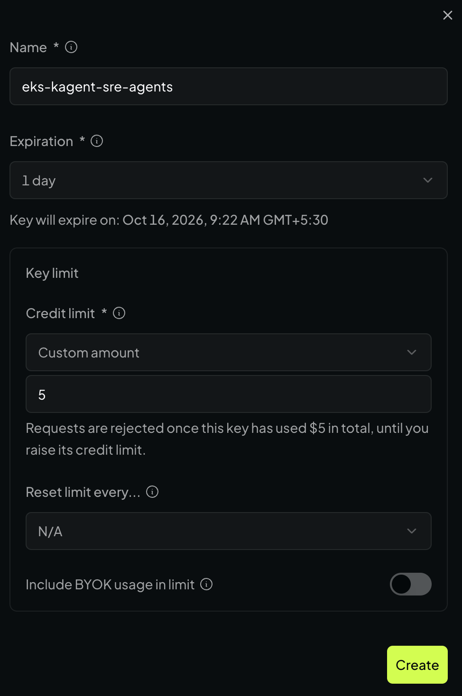

# Setup guide: multi-agent SRE workflows on Amazon EKS

This guide deploys seven agents: an orchestrator that uses six specialists as tools, including one custom incident reporter. kagent runs the declarative agents and supplies operational tools; kmcp deploys additional Model Context Protocol (MCP) servers. The tests cover diagnosis, delegated repair and human approval before changes.

The steps are ordered so each one has what it needs from the one before. They were rebuilt from the final configuration and the 2026-10-07 build. On 2026-10-13, the operator reported following the guide and successfully completing the section 12 web UI walkthrough; the [follow-up record](build-record.md#follow-up-web-ui-validation-2026-10-13) describes the supplied screenshot evidence. For more detail, see the [build record](build-record.md) (original commands, outputs and investigations), the [article](article.md) (how the workflow works) and the [runtime reference](runtime-and-protocols.md) (how the pieces talk to each other).

The cluster is created from an `eksctl` file. Helm installs the platform and monitoring; `kubectl apply` creates model, agent and tool resources. No agent is created manually in the UI. The custom server and agent images are built locally and pushed to ECR.

AWS bills the control plane, nodes, NAT gateway, storage and image repositories while they exist. Model requests incur OpenRouter charges. The recorded model total was about 6 USD; no hourly AWS total or per-scenario model cost was measured. [Teardown](#teardown) removes the cluster and optionally the images.


*The system. An SRE reaches the orchestrator through the kagent controller over A2A; the orchestrator delegates to six specialists, which use selected tools on five MCP servers; the tools act on the demo namespace and the monitoring stack. kmcp, PostgreSQL and kagent are the platform underneath.*

## Contents

- [Prerequisites and command conventions](#prerequisites-and-command-conventions)
- [0. Variables and credentials](#0-variables-and-credentials)
- [1. Create the EKS cluster](#1-create-the-eks-cluster)
- [2. Set the default StorageClass](#2-set-the-default-storageclass)
- [3. Create the model Secret](#3-create-the-model-secret)
- [4. Install Prometheus and Grafana](#4-install-prometheus-and-grafana)
- [5. Create the Grafana service-account token](#5-create-the-grafana-service-account-token)
- [6. Install kagent and bundled kmcp](#6-install-kagent-and-bundled-kmcp)
- [7. Deploy fetch and the broken workloads](#7-deploy-fetch-and-the-broken-workloads)
- [8. Build and deploy the custom MCP server](#8-build-and-deploy-the-custom-mcp-server)
- [9. Build the custom agent image](#9-build-the-custom-agent-image)
- [10. Apply model, prompt and agent resources](#10-apply-model-prompt-and-agent-resources)
- [11. Open local access and check tool discovery](#11-open-local-access-and-check-tool-discovery)
- [12. Test diagnosis, approval and orchestration](#12-test-diagnosis-approval-and-orchestration)
- [Troubleshooting](#troubleshooting)
- [Teardown](#teardown)

## Prerequisites and command conventions

You should be comfortable with Kubernetes resources, Helm and AWS credentials. MCP is the tool interface; A2A is the agent invocation interface. You do not need to implement either protocol to deploy the YAML agents.

| Requirement | Used for |
|---|---|
| AWS account and authenticated CLI | EKS, CloudFormation, EC2, IAM/Pod Identity and ECR operations |
| Eight spare standard on-demand vCPUs in `ap-south-1` | Two `t3.xlarge` workers |
| `aws`, `eksctl`, `kubectl`, `helm` | Provisioning and deployment |
| Docker with Buildx | Building Linux amd64 images |
| `kmcp` v0.3.0 | Building the custom MCP image |
| `uv` and Python 3.12 | Local MCP tests and optional agent development |
| `curl`, `jq`, Git; Python 3 for collection generation | API tests and repository tooling |
| OpenRouter API key and funded account | Model calls for the configured model IDs |
| A Grafana admin password of your choosing | Creating a Viewer service-account token |

Install these tools before continuing. kmcp v0.3.0 binaries are available from its [release](https://github.com/kagent-dev/kmcp/releases/tag/v0.3.0); the original machine used `kmcp-darwin-arm64`. The [version table](../README.md#versions) records the tested toolchain, including a development build of eksctl. This guide does not claim all newer tool versions are equivalent.

Command blocks contain commands only; outputs and success criteria are separate. Run commands from the repository root unless a subshell explicitly changes directory. Subshells such as `(cd ... && ...)` return to the root automatically. New terminals must load the variables from step 0. Names, IDs, IPs and ages in the build record will differ for you.

The manifests use `ap-south-1` and cluster name `kagent-sre-lab`. To use another region or name, update the cluster manifest and ECR image references as well as the shell variables. Source checkouts are optional for reproducing the source review; they are not needed to deploy the charts.

## 0. Variables and credentials

Start in the cloned repository. Copy the environment example once, then edit `.env` and replace both placeholders. Quote values containing spaces or shell metacharacters. Do not source the untouched example.

```bash
export REPO_ROOT="$PWD"
test -f "$REPO_ROOT/infra/eks/cluster.yaml"
test -f .env || cp .env.example .env
```

The first `test -f` checks that the cluster manifest exists. The second creates `.env` from `.env.example` only if `.env` is missing (`||` means “if the check fails”).

After editing `.env`, initialize the deployment shell:

```bash
export AWS_REGION=ap-south-1
export CLUSTER=kagent-sre-lab
mkdir -p "$REPO_ROOT/.kube"
export KUBECONFIG="$REPO_ROOT/.kube/config"
set -a
. "$REPO_ROOT/.env"
set +a
: "${OPENROUTER_API_KEY:?Set OPENROUTER_API_KEY in .env}"
: "${GRAFANA_ADMIN_PASSWORD:?Set GRAFANA_ADMIN_PASSWORD in .env}"
export AWS_ACCOUNT_ID=$(aws sts get-caller-identity --query Account --output text)
export ECR_REGISTRY="$AWS_ACCOUNT_ID.dkr.ecr.$AWS_REGION.amazonaws.com"
```

`set -a` automatically exports variables loaded by `. "$REPO_ROOT/.env"` into the current shell; `set +a` turns automatic exporting off. The two `: "${…:?…}"` checks report an error if either required value is missing or empty.

`.env` and `.kube/` are gitignored. The dedicated kubeconfig keeps these commands pointed at the lab cluster. Use the same absolute `KUBECONFIG` in every terminal used below; k9s can also use it when launched from that shell. Step 1 shows how to add the cluster to your default kubeconfig for access from other terminals.

Check authentication, versions and quota before provisioning:

```bash
aws sts get-caller-identity
aws --version
eksctl version
kubectl version --client
helm version --short
jq --version
docker buildx version
kmcp version
uv --version
aws service-quotas get-service-quota --service-code ec2 --quota-code L-1216C47A \
  --region "$AWS_REGION" --query 'Quota.Value' --output text
```

`L-1216C47A` is the standard on-demand EC2 vCPU quota. This build needs eight available vCPUs, not just a quota of eight if other instances already use it. The recorded quota was 32. Use fresh AWS credentials before cluster creation; an expired session interrupted the original eksctl command even though the submitted stacks continued in AWS.

## 1. Create the EKS cluster

[infra/eks/cluster.yaml](../infra/eks/cluster.yaml) provisions EKS 1.34, two private `t3.xlarge` workers in two availability zones and one NAT gateway. The nodes provide eight vCPUs and 32 GiB total, with a 50 GiB gp3 root volume per node. One NAT gateway is the lab's cost choice; it does not provide a gateway per zone.

The add-ons include the EBS CSI driver and EKS Pod Identity agent. `autoApplyPodIdentityAssociations: true` creates and associates the IAM role needed by the storage driver. The other add-ons are VPC CNI, CoreDNS, kube-proxy and metrics-server.

```bash
eksctl create cluster -f infra/eks/cluster.yaml --kubeconfig "$KUBECONFIG"
```

If the cluster already exists, skip creation and load its connection details into the repo's kubeconfig:

```bash
aws eks update-kubeconfig --region "$AWS_REGION" --name "$CLUSTER" --kubeconfig "$KUBECONFIG"
```

For either path, check the nodes and add-ons:

```bash
kubectl get nodes
aws eks list-addons --region "$AWS_REGION" --cluster-name "$CLUSTER" --output text
```

Continue when both nodes are Ready and all six add-ons are installed. The original cluster took approximately 15–20 minutes to finish. If the command returns `ExpiredToken`, use the [recorded recovery](build-record.md#3-eks-cluster): refresh credentials, inspect completed stacks, write the kubeconfig and add only missing add-ons. Do not assume the reported CLI failure means nothing was created.

Once the cluster exists, optionally add it to your default kubectl contexts for access outside this repo:

```bash
aws eks update-kubeconfig --region "$AWS_REGION" --name "$CLUSTER" --kubeconfig "$HOME/.kube/config"
KUBECONFIG="$HOME/.kube/config" k9s
```

This saves the context in `~/.kube/config` and makes it that file's current context. The explicit path overrides the guide's exported `KUBECONFIG`; without it, `update-kubeconfig` would update the repo's config. The second command uses the default file for k9s only. In terminals without `KUBECONFIG` set, `kubectl` and k9s use the default file automatically. See the [AWS CLI reference](https://docs.aws.amazon.com/cli/latest/reference/eks/update-kubeconfig.html).

## 2. Set the default StorageClass

PostgreSQL and Prometheus request storage without specifying a class. The cluster needs a default class that can provision their volumes.

```bash
kubectl apply -f infra/eks/storageclass-gp3.yaml
kubectl get sc
```

Success criterion: `gp3 (default)` uses `ebs.csi.aws.com`, with `Delete` reclaim policy and `WaitForFirstConsumer` binding. The original `gp2` class was present but was not default.

## 3. Create the model Secret

For this project, a dedicated OpenRouter API key named `eks-kagent-sre-agents` was created in the OpenRouter portal with a **24-hour expiry** and a **$5 total credit limit**, with no automatic limit reset. OpenRouter enforces these limits; the Kubernetes Secret stores the key. Set its value as `OPENROUTER_API_KEY` in your gitignored `.env` and reload it using step 0 before continuing.



*OpenRouter key settings for this project: expiry after one day and a $5 total limit.*

Every declarative model configuration references the same Secret. The custom agent receives its key from that Secret too. Create it before applying the agents.

```bash
kubectl create namespace kagent --dry-run=client -o yaml | kubectl apply -f -
kubectl -n kagent create secret generic kagent-openrouter \
  --from-literal=OPENROUTER_API_KEY="$OPENROUTER_API_KEY" \
  --dry-run=client -o yaml | kubectl apply -f -
kubectl -n kagent get secret kagent-openrouter
```

The final command confirms existence without printing the key. The model provider is `OpenAI` because OpenRouter exposes an OpenAI-compatible API; it does not mean every configured model is an OpenAI model.

## 4. Install Prometheus and Grafana

The [monitoring values](../infra/monitoring/values.yaml) set two-day Prometheus retention on a 10 GiB volume, disable Alertmanager and disable scrape targets for inaccessible EKS-managed control-plane components. Grafana persistence is off; its dashboards come from the chart.

```bash
helm repo add prometheus-community https://prometheus-community.github.io/helm-charts
helm repo update prometheus-community
helm upgrade --install prometheus prometheus-community/kube-prometheus-stack \
  --version 83.6.0 --namespace monitoring --create-namespace \
  -f infra/monitoring/values.yaml \
  --set-string grafana.adminPassword="$GRAFANA_ADMIN_PASSWORD" --wait --timeout 10m
kubectl -n monitoring get pods,pvc
```

Continue when the monitoring pods are Running/Ready and the Prometheus PVC is Bound. Chart 83.6.0 was used in the original build; chart 92.0.0 was available at that time but was not evaluated.

In-cluster endpoints are `http://prometheus-kube-prometheus-prometheus.monitoring:9090` and `http://prometheus-grafana.monitoring` on port 80.

## 5. Create the Grafana service-account token

The Grafana MCP server needs a Viewer service-account token. In a second terminal with the same `KUBECONFIG`, start this port-forward and leave it running:

```bash
kubectl -n monitoring port-forward svc/prometheus-grafana 3001:80
```

Once forwarding is ready, return to the deployment terminal. These commands capture the returned account ID rather than assuming it is `2`, as it was in the original run.

```bash
GRAFANA_SERVICE_ACCOUNT_ID=$(curl -fsS -u "admin:$GRAFANA_ADMIN_PASSWORD" \
  -H 'Content-Type: application/json' -X POST http://127.0.0.1:3001/api/serviceaccounts \
  -d '{"name":"kagent-grafana-mcp","role":"Viewer"}' | jq -er '.id')
export GRAFANA_MCP_TOKEN=$(curl -fsS -u "admin:$GRAFANA_ADMIN_PASSWORD" \
  -H 'Content-Type: application/json' \
  -X POST "http://127.0.0.1:3001/api/serviceaccounts/$GRAFANA_SERVICE_ACCOUNT_ID/tokens" \
  -d '{"name":"kagent-grafana-mcp"}' | jq -er '.key')
: "${GRAFANA_MCP_TOKEN:?Grafana token creation failed}"
```

Keep the token in the deployment shell. If you need to resume in another shell, store it as a quoted `GRAFANA_MCP_TOKEN` entry in your gitignored `.env` and reload that file. A service account with this name must not already exist for the create request; reuse its returned ID and issue a new token if resuming an existing deployment.

## 6. Install kagent and bundled kmcp

The committed [kagent values](../infra/kagent/values.yaml) enable Grafana MCP, so Grafana and its token now exist before installing kagent. They also enable bundled PostgreSQL with a 2 GiB volume, configure OpenRouter and disable the ten bundled agents.

```bash
helm upgrade --install kagent-crds oci://ghcr.io/kagent-dev/kagent/helm/kagent-crds \
  --version 0.9.10 --namespace kagent --wait
helm upgrade --install kagent oci://ghcr.io/kagent-dev/kagent/helm/kagent \
  --version 0.9.10 --namespace kagent -f infra/kagent/values.yaml \
  --set-string grafana-mcp.grafana.serviceAccountToken="$GRAFANA_MCP_TOKEN" \
  --wait --timeout 10m
kubectl -n kagent get pods,pvc
kubectl -n kagent get modelconfig
kubectl -n kagent get remotemcpserver
```

The chart includes kmcp 0.3.0, kagent-tools 0.2.1, querydoc, Grafana MCP, the UI and controller. `default-model-config` should select `deepseek/deepseek-v4.1-flash`; PostgreSQL's PVC should be Bound. The Python agent runtime builds on Google ADK; the [reference](runtime-and-protocols.md#who-runs-what) identifies the pinned source.

The Grafana MCP values include `--allowed-hosts` for `kagent-grafana-mcp.kagent:8000` and `kagent-grafana-mcp.kagent`. Without this, the observed image rejected the controller's Service-name Host header. The image tag is `latest`, so its future behavior is not pinned by this guide.

If a server is Running but its `RemoteMCPServer` remains unaccepted after a startup discovery failure, trigger a new reconciliation:

```bash
kubectl -n kagent annotate remotemcpserver kagent-tool-server \
  docs/reconcile-nudge="$(date -u +%FT%TZ)" --overwrite
kubectl -n kagent annotate remotemcpserver kagent-grafana-mcp \
  docs/reconcile-nudge="$(date -u +%FT%TZ)" --overwrite
kubectl -n kagent get remotemcpserver
```

Wait for both to report Accepted. The original controller restarted twice because it started before PostgreSQL was listening; inspect logs and readiness rather than treating any startup restart as a persistent failure.

## 7. Deploy fetch and the broken workloads

`fetch` supplies URL/documentation retrieval. kmcp adapts its stdio package to HTTP through agentgateway. The demo namespace contains intentionally unhealthy workloads, so waiting for every demo pod to become Ready would be incorrect.

```bash
kubectl apply -f infra/kmcp/fetch-mcpserver.yaml -f infra/demo/broken-workloads.yaml
kubectl -n kagent rollout status deploy/fetch --timeout=300s
kubectl -n kagent get mcpserver fetch
kubectl -n demo-broken get pods
```

| Workload | Configured fault | Expected evidence |
|---|---|---|
| `api` | Nonexistent `nginx:1.99.99-does-not-exist` tag | ErrImagePull / ImagePullBackOff and the image error |
| `worker` | Prints a missing-config message and exits 1 | CrashLoopBackOff, exit status and log line |
| `cache` | Allocates 200 MiB under a 64 MiB limit | OOMKilled and increasing restart count |
| `checkout` Service / `web` pods | Selector `app: checkout`, pod labels `app: web` | Empty Service endpoints |
| `batch` | Requests 16 CPUs on 4-CPU nodes | Pending and Insufficient cpu |

These faults are the known answers for the diagnosis tests. Kubernetes status may vary between an immediate error and the later backoff state.

## 8. Build and deploy the custom MCP server

This step runs our custom `netprobe-mcp` server inside EKS so agents can check the network from inside the cluster. It exposes four MCP tools: `dns_lookup` resolves a hostname, `tcp_connect` checks a port, `http_check` checks an HTTP response, and `tls_cert_expiry` checks a TLS certificate. The Python implementations are already in [byo/netprobe-mcp/](../byo/netprobe-mcp/).

### What is kmcp, and where does `kmcp init` fit?

[kmcp](https://github.com/kagent-dev/kmcp/tree/v0.3.0) has two parts: a **CLI on your computer** for creating and packaging MCP projects, and a **controller in Kubernetes** that turns `MCPServer` resources into running Deployments and Services. Step 6 installed the controller; these commands use the local v0.3.0 CLI.

| Command | What it does | Use in this guide |
|---|---|---|
| `kmcp init python netprobe-mcp` | Creates a starter Python/FastMCP project: source files, an example tool, tests, `pyproject.toml`, `kmcp.yaml` and a Dockerfile | Already done; use the committed project |
| `kmcp build --tag …` | Builds a container image from the project's Dockerfile | Run below after testing |
| `kmcp build --tag … --push` | Builds the image, then uploads it to the registry named in the tag | Upload to Amazon ECR below |
| `kmcp deploy` | Creates/applies an `MCPServer` resource for the controller to deploy | Here we apply the committed YAML with `kubectl` instead |

`init` only creates the starter project. We replaced its example tool with the four probes; the full original command and generated-file details are in the [build record](build-record.md#101-scaffold-with-kmcp-init). When following this guide, continue with the existing directory below.

### How do fetch and agentgateway relate to this server?

[infra/kmcp/fetch-mcpserver.yaml](../infra/kmcp/fetch-mcpserver.yaml), applied in step 7, is the Kubernetes deployment description for a separate server named `fetch`. It runs the public [`mcp-server-fetch` package](https://github.com/modelcontextprotocol/servers/tree/main/src/fetch), whose tool retrieves a URL's page content so an agent can read documentation or runbooks. The filename describes the manifest; the package supplies the tool.

Fetch communicates over **stdio**: its parent process sends MCP messages through standard input and receives replies through standard output. That is a local process connection. Other pods need a network endpoint, so kmcp adds **agentgateway**, a proxy that starts the fetch process and bridges HTTP MCP requests to its stdio connection. The fetch manifest uses `uvx mcp-server-fetch`; kmcp supplies a default image containing uv, so you do not build a custom image for fetch.

Our netprobe server uses FastMCP to serve MCP over **HTTP itself**, so its manifest uses `transportType: http` and needs no agentgateway adapter. The two request paths are:

```text
fetch:        kagent → HTTP → agentgateway → stdio → mcp-server-fetch
netprobe-mcp: kagent → HTTP → FastMCP → our Python probe functions
```

Both are managed by kmcp. Fetch retrieves page content; netprobe returns network diagnostic evidence. This step builds only netprobe's image.

### Test the existing project locally

```bash
(cd "$REPO_ROOT/byo/netprobe-mcp" && uv sync && uv run pytest -q)
```

`uv sync` installs the project's dependencies; `uv run pytest -q` runs its tests. The subshell returns you to the repository root afterward. The original run passed ten tests with two warnings in 0.94 s. The [component README](../byo/netprobe-mcp/README.md#run-locally) explains how to start the server locally; [recorded MCP client calls](../results/raw/netprobe-local-mcp-test.txt) show the four tools being listed and exercised.

### Build the image and push it to ECR

Amazon ECR stores the image that the EKS nodes will download. For a new lab, create the `netprobe-mcp` repository. Skip this command if that ECR repository already exists:

```bash
aws ecr create-repository --region "$AWS_REGION" --repository-name netprobe-mcp \
  --image-scanning-configuration scanOnPush=true
```

Authenticate Docker to ECR, then build and upload the image from the project directory:

```bash
aws ecr get-login-password --region "$AWS_REGION" | \
  docker login --username AWS --password-stdin "$ECR_REGISTRY"
(cd "$REPO_ROOT/byo/netprobe-mcp" && \
  kmcp build --platform linux/amd64 --tag "$ECR_REGISTRY/netprobe-mcp:0.1.0" --push)
```

`--platform linux/amd64` builds for the EKS workers' x86_64 CPUs, including when your laptop uses Apple Silicon. `--tag` specifies the ECR registry, repository and image version (`0.1.0`). `--push` uploads the finished image after building; it does not deploy it to Kubernetes. The original pushed image was 98 MB.

### Deploy the uploaded image to EKS

[infra/kmcp/netprobe-mcpserver.yaml](../infra/kmcp/netprobe-mcpserver.yaml) describes which image to run and how to expose it. Replace its `<ACCOUNT_ID>` placeholder in the input sent to `kubectl`, then apply it:

```bash
sed "s/<ACCOUNT_ID>/$AWS_ACCOUNT_ID/" infra/kmcp/netprobe-mcpserver.yaml | kubectl apply -f -
kubectl -n kagent rollout status deploy/netprobe-mcp --timeout=300s
kubectl -n kagent get mcpserver netprobe-mcp
```

The kmcp controller creates the Deployment and Service. The container runs `python src/main.py --transport http --host 0.0.0.0 --port 3000`, allowing other pods to call `http://netprobe-mcp.kagent:3000/mcp`. kagent discovers the tools through that endpoint; step 10 assigns them to agents.

Continue when the rollout succeeds and the `MCPServer` reports Ready. A Ready Deployment alone does not prove that MCP calls work; use the tool-discovery checks in [step 11](#11-open-local-access-and-check-tool-discovery) to confirm that all four probes are exposed.


*Steps 7 and 8 create two tool servers: fetch uses agentgateway to bridge HTTP to stdio; netprobe serves HTTP directly from our ECR image. kmcp deploys both, and kagent calls their tools.*

## 9. Build the custom agent image

Build the incident reporter before applying its Agent resource. The [Python implementation](../byo/incident-reporter-agent/src/) owns the tool-calling loop and uses the A2A SDK for its server; it does not depend on Google ADK.

```bash
aws ecr create-repository --region "$AWS_REGION" --repository-name incident-reporter-agent \
  --image-scanning-configuration scanOnPush=true
docker buildx build --platform linux/amd64 \
  -t "$ECR_REGISTRY/incident-reporter-agent:0.1.0" --push byo/incident-reporter-agent
```

Reuse an existing repository if resuming. The original image was 57 MB. Its deployment environment references the model Secret and the two MCP endpoints. The [local development commands](build-record.md#13-bring-your-own-agent-a-loop-an-a2a-server-a-container) and [container contract](runtime-and-protocols.md#the-custom-agent-boundary) are separate from the cluster deployment path.

## 10. Apply model, prompt and agent resources

The chart already created one model configuration. Apply the four additional configs, the orchestrator's prompt ConfigMap, then all seven agents. Substitute the AWS account ID in the BYO image reference.

```bash
kubectl apply -f infra/kagent/models/
kubectl apply -f infra/kagent/prompts/
for manifest in infra/kagent/agents/*.yaml; do
  sed "s/<ACCOUNT_ID>/$AWS_ACCOUNT_ID/" "$manifest" | kubectl apply -f -
done
kubectl -n kagent wait --for=condition=Ready agent --all --timeout=300s
kubectl -n kagent get agent -o wide
kubectl -n kagent get pods
```

Success criteria: all seven agents are Accepted and Ready, and their current pod rollouts are healthy. Six declarative agents use Python; `incident-reporter` is BYO. An Agent condition alone can be misleading during a failed rollout: the original Go-runtime attempt reported Ready while an old Python pod was still serving.

| Agent | Responsibility | Execution control |
|---|---|---|
| `cluster-troubleshooter` | Kubernetes diagnosis | Nine read-only tools |
| `observability-analyst` | Prometheus and Grafana analysis | Read-only tool selection |
| `runbook-assistant` | Diagnosis with documentation | Read-only tools and fetch |
| `release-manager` | Helm inspection and release operations | Upgrades, uninstalls and repository additions require approval |
| `incident-reporter` | Full namespace report and network evidence | Six Kubernetes tools and four probes; no mutating tools |
| `sre-operator` | Scaling, rollout and resource changes | All six exposed mutating tools require approval |
| `sre-orchestrator` | Select specialists and combine results | Six agent references; tested repair delegates to the approval-gated operator |

The orchestrator's prompt is in a ConfigMap. The manifest sets a 2 GiB memory limit after the recorded concurrent requests exceeded the original 1 GiB limit. The reference covers [tool selection and approval](runtime-and-protocols.md#agent-configuration-and-approval), including the difference between prompt restrictions and enforced execution controls.

## 11. Open local access and check tool discovery

Keep each needed port-forward running in its own terminal, with the same lab kubeconfig. Wait for its forwarding message before using the local endpoint.

| Purpose | Command | Local endpoint |
|---|---|---|
| Controller / A2A / REST | `kubectl -n kagent port-forward svc/kagent-controller 8083:8083` | `http://127.0.0.1:8083` |
| UI | `kubectl -n kagent port-forward svc/kagent-ui 8080:8080` | `http://127.0.0.1:8080` |
| Direct built-in MCP calls | `kubectl -n kagent port-forward svc/kagent-tools 8084:8084` | `http://127.0.0.1:8084/mcp` |
| Direct netprobe MCP calls | `kubectl -n kagent port-forward svc/netprobe-mcp 3002:3000` | `http://127.0.0.1:3002/mcp` |
| Grafana | Port-forward from step 5 | `http://127.0.0.1:3001` |

With the controller port-forward ready, check discovery:

```bash
curl -fsS http://127.0.0.1:8083/api/toolservers | \
  jq -r '.data[]|"\(.ref) \(.groupKind) tools=\(.discoveredTools|length)"'
```

The recorded result was five sources with 195 tools: built-in Kubernetes/Helm/etc. 124, Grafana 65, querydoc one, fetch one, netprobe four. The querydoc source is a labelled `Service`, not a `RemoteMCPServer`. The [source inventory](runtime-and-protocols.md#tool-sources-and-discovery) lists their in-cluster URLs and discovery rules.

For manual API inspection, import [the existing Postman collection](../postman/kagent.postman_collection.json). Its collection variables already match these ports. Only regenerate it if you change the collection builder:

```bash
python3 postman/build_collection.py
```

The collection has ten folders and 62 requests, covering APIs, direct MCP calls and A2A invocation/approval. The original build exercised selected calls with curl; it did not execute the collection in Postman or validate every CRUD request. [Validation scope](runtime-and-protocols.md#api-collection-and-validation-scope).

## 12. Test diagnosis, approval and orchestration

Use the **web UI** to ask questions, watch tool calls and make approval decisions. Use **Postman** to inspect requests and responses. Both invoke the deployed agents through the controller; scripts are optional for recording repeatable runs.

**UI walkthrough confirmed on 2026-10-13:** the operator reported that these examples worked. Supplied screenshots show diagnostic answers, metrics, delegated calls and interactive approval/question controls. See the [follow-up validation record](build-record.md#follow-up-web-ui-validation-2026-10-13).

### Start in the web UI

If these port-forwards from step 11 are not already running, start each in a separate terminal with the lab kubeconfig:

```bash
kubectl -n kagent port-forward svc/kagent-ui 8080:8080
```

```bash
kubectl -n kagent port-forward svc/kagent-controller 8083:8083
```

Open **http://127.0.0.1:8080** for chat. Postman uses the controller API on port 8083.

1. Open the Agents view and select `cluster-troubleshooter` in namespace `kagent`.
2. Click **New Chat** and ask: **Why is the deployment api in namespace demo-broken not running?**
3. Expand **Arguments** and **Results** on the tool-call cards to inspect the checks and evidence. Completed calls show a green check. For delegated agent cards, expand **Input**, **Output** and **Activity**.
4. Read the final diagnosis. In the follow-up run it identified `ImagePullBackOff`, cited `nginx:1.99.99-does-not-exist` and explained that the invalid image tag prevents the pod from starting.

Then select another agent and start a new chat. Try these questions one at a time:

| Agent | Question | What to look for |
|---|---|---|
| `cluster-troubleshooter` | Why does the pod of deployment worker in namespace demo-broken keep restarting? Quote the log line. | The missing-config log line and exit status |
| `observability-analyst` | How much CPU and memory is each node using right now, as a share of its capacity? | Current metrics rather than guessed usage |
| `runbook-assistant` | The pod of deployment cache in demo-broken is OOMKilled. Diagnose it and tell me what the Kubernetes documentation says about memory limits and OOMKilled. | Workload evidence plus documentation |
| `sre-orchestrator` | Is the cluster under CPU or memory pressure right now, and is anything in demo-broken restarting because of it? | Delegated specialist calls; container limits distinguished from node pressure |

Copy more questions from [scripts/scenarios.txt](../scripts/scenarios.txt) into chat. Compare answers with step 7's known faults and the original [results](article.md#results); live metrics and timings will differ.

### Make approval and rejection decisions in the UI

Select `sre-operator` and ask: **Scale the deployment web in namespace demo-broken to 3 replicas.** This requests a real change to the lab.

The UI displays an orange **Approval required** card for `k8s_scale` and an **Awaiting approval…** status. Expand **Arguments**, review the deployment name, namespace and replica count, then click **Approve**. After it completes, ask: **Scale the deployment web in namespace demo-broken down to 2 replicas.** Review this second proposal and click **Reject**.

Run this check before and after each decision:

```bash
kubectl -n demo-broken get deploy web -o jsonpath='{.spec.replicas}{"\n"}'
```

From the original two-replica baseline, approval should produce `2 → 3`, and rejection should leave `3 → 3`.

For delegated repair, select `sre-orchestrator` and ask: **Fix the Service checkout in namespace demo-broken so that it has endpoints. Tell me what you intend to change before you do it.**

The flow has two separate decisions:

1. In **Questions for you**, select the option to patch the Service selector to `app=web`, then click **Submit**. The option explains that `sre-operator` will request its own approval next. The wording can vary between runs.
2. Review the operator's proposed `k8s_patch_resource` arguments in the separate **Approval required** card, then click **Approve** to execute the patch.

Submitting the first answer chooses the repair approach; the second decision authorizes the tool call. Verify the result:

```bash
kubectl -n demo-broken get svc checkout -o jsonpath='{.spec.selector}{"\n"}'
kubectl -n demo-broken get endpoints checkout
```

Expect selector `app: web` and endpoints for ready `web` pods. Restore the broken baseline, including `web`'s two replicas, before repeating the tests:

```bash
kubectl apply -f infra/demo/broken-workloads.yaml
```

### Try the same questions in Postman

Keep the controller forward on 8083 running and import [the Postman collection](../postman/kagent.postman_collection.json). Agent questions need only this forward; the MCP forwards in step 11 are for direct tool calls.

Set the collection variables (remove any conflicting environment overrides):

| Variable | Value |
|---|---|
| `base_url` | `http://127.0.0.1:8083` |
| `ns` | `kagent` |
| `agent` | `cluster-troubleshooter`, or another agent from the table above |

In **6 · Invoke an agent (A2A)**:

1. Open **2 · message/send · ask the troubleshooter**. Edit `params.message.parts[0].text` and click **Send**. The controller forwards `{{base_url}}/api/a2a/{{ns}}/{{agent}}/` to your selected agent.
2. Read `result.status.state` and `result.artifacts`; check for a JSON-RPC `error` too. The post-response script saves the task ID and context ID into `task_id` and `session_id`.
3. Use **3 · message/send · follow-up in the same session** to continue. Use request 2 for a new conversation, including when switching agents.
4. For live progress, edit and send **7 · message/stream · the orchestrator (long-running agents)**. This URL targets `sre-orchestrator` explicitly; the `agent` variable does not change it. Read its status and artifact events as they arrive.

For approval, send **5 · sre-operator · a change that needs approval**. At `input-required`, review the pending call, then send **6 · sre-operator · approve the pending change** using the saved IDs. To reject, change its data part to `"decision_type": "reject"` and text to `"Rejected"`. Verify replicas afterward.

Streaming request 7 does not save IDs automatically: copy the paused event's `result.taskId` into `task_id` and `result.contextId` into `session_id`. For delegated repair, use the UI or the [A2A continuation format](runtime-and-protocols.md#a2a-discovery-invocation-and-continuation). Folder **7 · Sessions and tasks** provides conversation history and task inspection.

Selected equivalent requests were tested with curl; the collection itself was not run in Postman during the original build. See [validation scope](runtime-and-protocols.md#api-collection-and-validation-scope).

### Optional: save repeatable runs with the scripts

For a saved run through the controller:

```bash
./scripts/ask-agent.sh cluster-troubleshooter demo-s01 \
  "Why is the deployment api in namespace demo-broken not running?"
```

Use fresh IDs to preserve existing files under `results/answers/<agent>/`. Other helpers record [streaming events](../scripts/ask-agent-stream.sh), [automatically approve/reject](../scripts/approval-demo.sh), or [continue orchestrator tasks](../scripts/orchestrator-continue.sh). Detailed exchanges remain in the [approval](build-record.md#12-human-approval-over-a2a) and [orchestration](build-record.md#16-the-orchestrator-over-messagestream) records.

[run-scenarios.sh](../scripts/run-scenarios.sh) runs fourteen questions, including the unsuccessful scenario 13, and writes the original `s01`–`s14` filenames. Inspect it first to avoid overwriting recorded answers.

### If a request exceeds three minutes

In kagent 0.9.10, the controller cuts both ordinary and streaming requests at 180 s, including UI and Postman requests. Run orchestrator questions one at a time; after a timeout, inspect logs and task state before retrying because work may continue in the pod.

The [timeout reference](runtime-and-protocols.md#http-timeouts-and-request-lifetime) covers direct agent access. Scenario 13 never completed through any tested path; start with the smaller questions above.

## Troubleshooting

| Symptom | First check / action | Original investigation |
|---|---|---|
| eksctl returns `ExpiredToken` | Refresh credentials; inspect existing stacks before recreating anything | [Cluster recovery](build-record.md#3-eks-cluster) |
| PVC remains Pending | Default StorageClass, CSI driver and Pod Identity association | [Storage setup](build-record.md#4-default-storageclass) |
| Running tool pod but unaccepted source | Endpoint readiness, then trigger reconciliation | [Startup discovery](build-record.md#5-kagent-and-kmcp) |
| Grafana MCP returns Forbidden | Service-name Host header and allowed-hosts arguments | [Host validation](build-record.md#9-the-grafana-mcp-server-that-ships-with-kagent) |
| querydoc reference rejected | Use `kind: Service` | [Agent acceptance](build-record.md#11-the-agents) |
| Agent says Ready but new pod cannot pull | Inspect the current Deployment rollout and image digest | [Go runtime attempt](build-record.md#the-go-runtime-tried-not-available) |
| Local TLS probe cannot verify issuer | Probe code uses a certifi trust bundle | [Local probe test](build-record.md#103-run-and-test-locally) |
| Prometheus tool rejects comparisons | Use supported queries such as `topk`, or Grafana's query path | [Tool behavior](runtime-and-protocols.md#tool-sources-and-discovery) |
| Orchestrator stream ends / pod restarts | Controller timeout, concurrent requests and memory state | [Orchestrator failures](build-record.md#16-the-orchestrator-over-messagestream) |

## Teardown

Stop the task's port-forwards with Ctrl-C in their terminals. Remove storage users and claims while the EBS CSI driver still exists, wait for volumes to disappear, then delete the cluster. The original teardown took about 14 minutes; its [full record](build-record.md#teardown) includes command outputs and follow-up checks.

```bash
helm uninstall prometheus -n monitoring
helm uninstall kagent -n kagent
kubectl delete pvc --all -n monitoring
kubectl delete pvc --all -n kagent
kubectl get pv
```

Wait until no lab PersistentVolumes remain. Check for orphaned volumes before deleting the cluster:

```bash
aws ec2 describe-volumes --region "$AWS_REGION" \
  --filters "Name=tag:kubernetes.io/cluster/$CLUSTER,Values=owned" --query 'Volumes[].VolumeId'
eksctl delete cluster --name "$CLUSTER" --region "$AWS_REGION" --wait
```

The cluster deletion removes its control plane, node group, add-ons and associated stacks, VPC and NAT gateway. Verify resources associated with this lab rather than assuming the AWS account contains no other clusters or repositories:

```bash
aws eks list-clusters --region "$AWS_REGION"
aws cloudformation list-stacks --region "$AWS_REGION" \
  --query "StackSummaries[?contains(StackName,'$CLUSTER') && StackStatus!='DELETE_COMPLETE'].[StackName,StackStatus]" \
  --output text
aws ec2 describe-volumes --region "$AWS_REGION" \
  --filters "Name=tag:kubernetes.io/cluster/$CLUSTER,Values=owned" --query 'Volumes[].VolumeId'
aws ecr describe-repositories --region "$AWS_REGION" \
  --query 'repositories[].repositoryName'
```

Expected: the lab cluster is absent, no non-deleted stacks for its name remain and the tagged volume list is empty. The original run also checked for remaining NAT gateways and instances. ECR repositories are independent of cluster deletion. The two retained images totaled about 155 MB in the original run; retaining them incurs ECR storage charges and allows rebuilding the cluster without rebuilding images.

If you want to delete the lab's images too:

```bash
aws ecr delete-repository --region "$AWS_REGION" --repository-name netprobe-mcp --force
aws ecr delete-repository --region "$AWS_REGION" --repository-name incident-reporter-agent --force
```

If you separately added the lab context to your default kubeconfig, remove that context explicitly from that file. The guide's normal commands used the repo-local kubeconfig.

```bash
kubectl --kubeconfig "$HOME/.kube/config" config delete-context kagent-sre-lab
```
